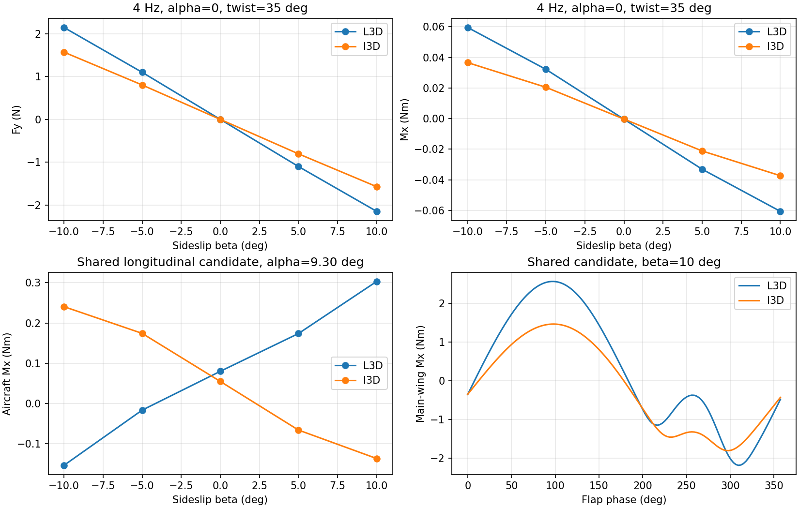

# 面向抗风 RL 的 L-3D / I-3D：实现与验证

**结论：L-3D 已具备基本三维侧风、滚转和偏航响应机制；I-3D 的差异足以影响策略，值得保留为结构对照。两者都未获得实机气动验证，也未证明闭环抗风能力。** 在共同前飞候选点，I-3D 改变了侧滑滚转响应方向；不能用单个局部参数修补使 L-3D 冒充 I-3D。当前可以开展明确标注假设的后续 RL 研究，但不足以宣称可迁移到实机。本轮没有训练策略。

## 交付位置与范围

- Worktree：`/home/zn/IsaacLab/.worktrees/control-oriented-3d-wing-aero`
- 分支：`feat/control-oriented-3d-wing-aero`；起点 HEAD：`69d316e4434672344e8f04d54f0d4859d05edecf`。实现、测试及本报告随开发分支提交；当前提交以 `git rev-parse HEAD` 为准。原 worktree、论文、历史结果未清理；本地论文和 AGENTS.md 已继承。完整仿真日志、构建产物和继承的未跟踪论文不在本次提交范围内。
- 核心：`physics/control_aero_3d.py`、`physics/control_aero_kinematics.py`，路径前缀为 `source/flapping_bot/flapping_bot/`。
- 接入：`direct/flapping_bot/straight_flight_env.py`；规定扭转：`physics/ullt_twist.py`；测试：`tests/test_control_aero_3d.py`。
- 入口：`scripts/flapping_px4/{compare,trim,smoke,benchmark,report}_control_aero_3d.py`。
- 完整数据：[logs/control_aero_3d](../../../logs/control_aero_3d)。`ll_final` 保存零/8°迎角矩阵；`system_trim_compare` 保存最终共同配平候选矩阵；`space20`、`time256` 及 `system_trim_space20`、`system_trim_time256` 保存定向加密。每目录含工况、部件周期均值、逐相位六分量、导数和求解诊断。

只复用 [10 月 29 日可辨识性报告](../2026-10-29-realflight-aero-evidence/report_zh.md) 和证据矩阵；没有重新读取航次数据、封存 test 或用历史 test 结果选型。

## 方程、参数与物理接口

统一使用 FLU、SI 单位。分析力矩关于 measured **机身 COM** `(-0.13103,-0.00625,0.015) m`；连杆施力矩关于各翼 COM；纵向候选求解则使用每相位变化的**系统 COM**。三个参考点不混用。

几何来自完整 root-local CSV 和 URDF，保留两侧 ±56 mm 翼根间隙及安装旋转，无虚构中央翼面。每翼初始 10 站，保存四分之一弦、四分之三弦、端点、展长、投影弦长和正交基。沿弯曲四分之一弦线定义截面法平面；这仍是局部升力线近似，并非任意柔性膜面网格。

### 共享运动学及局部载荷

实际接口使用 PhysX 的 link pose、COM 线速度和角速度：

`u(P) = v_link_COM - wind(P) + omega_link × (P-COM_link) + R_link v_twist(P)`。

内部 `flow=-u`。实际连杆速度已包含机体三轴角速度及扑动，不再添加一份 `qdot × r`。离线适配器用同一接口生成规定运动；允许逐站三维风输入，当前环境为现有空间均匀世界风/OU 场。增加可选垂直恒风与 OU 分量，默认均零；原水平风合同保持。OU 默认不剪裁，验证中也显式关闭剪裁。

L-3D 对来流去展向投影，`alpha=atan2(flow·n,-flow·c)`，升力方向 `span×flow_perp/|flow_perp|`，阻力沿 flow。载荷为 `rho/2 V_perp² c ds (CL eLift+CD eDrag)`。极线使用现有五次 smoothstep：附着 `CL=2πsin(alpha)`，分离 `CL=A sin(2alpha)`、`CD=CD0+2A sin²(alpha)`。本次为 **early 未标定先验**（15°–30°，A=1），并未按整机反推 RMSE 选取；配置可换 late。共同 `CD0=.028`。

展向摩擦独立为 `rho/2 Cf c ds |v_span| v_span span`，`Cf=.005` 是小的工程先验。它只耗散展向运动，且在零侧滑的一阶导数为零；不重复法平面基准阻力，不承担拟合侧滑导数的角色。没有六轴经验力矩。

扭转为 `theta0(s)+A_tip[(1-kappa)s+kappa s²]cos(phase-psi)`，默认 theta0=0，支持根/梢静态扭转；比较 A_tip=0/35°，kappa=-.5、psi=0。完整几何、控制点速度、加速度及截面角速度由解析导数更新。35°只是候选，不是测得的膜翼变形；新环境配置默认仍为零扭转。

### I-3D 的诱导闭合

两翼共同求解 20×20 环量系统。Biot–Savart 有限束缚段加两条半无限直尾涡组成马蹄涡；保留跨翼、翼根空隙及非平面束缚段作用。直尾迹沿共同平均局部来流方向，未计算卷起、尾迹记忆或翼尾干扰。

在四分之一弦升力线上取非局部诱导 `K Gamma`；自己的束缚段以主值零处理，其二维作用由 2π 升力斜率表示。三分之四弦用于运动学迎角，保留截面转动速度。令 `w` 为分离权重、`g` 为低速正向流平滑门函数、`a_i=πc_i(1-w_i)g_i`，则：

`[I + diag(a) K_normal] Gamma = -a (flow·n)`。

这是以未诱导局部迎角确定混合权重的**线性准稳态附着流闭合**，不是非线性失速环量求根。载荷用 `rho Gamma ds [(flow+K Gamma)×span]` 加共同分离升力及剖面阻力；不再叠加 Oswald/CL² 诱导阻力。束缚段统一正展向，正升力对应负环量。

正向流低于 .25 m/s 时附着权重连续减小，逆流/完全分离时局部附着环量为零；分离载荷仍保留。静止载荷为零。无可定义尾迹方向但存在附着环量、涡段奇异、非有限值、条件数超限或求解残差超限均显式报错，**不会回退 L-3D**。阈值是数值适用性处理，不能宣称验证了悬停/逆流气动。

初版曾混用三分之四弦束缚诱导与二维自身斜率，条件数达 10⁴–10⁵；已改为上述一致升力线闭合。`main` 为废弃初版数据，**不用于结论**。最终矩阵及加密最大条件数约 17，归一残差小于 5e-15；没有裁剪环量或调参掩盖问题。

附加质量复用薄板质量矩阵及自由偶矩，仅输入扑动与规定扭转的**相对运动**速度/解析加速度，含二者交叉项。没有上一帧机体加速度，没有重复 PhysX 机械惯性；尚非完整自由体流固惯性耦合。模型来源参见 [Izraelevitz 等原文](https://dspace.mit.edu/entities/publication/8bced600-e999-418a-ae67-11f9d081fc39) 及仓库 ULLT 公式；本实现没有采用其非定常状态模型。

### 尾翼、机身、PhysX

五翼面尾翼、实际舵角、机械限位、执行器、四路动作及频率 governor 沿用现有 CPU-native measured PureRL 合同。物理 480 Hz、动作 60 Hz；每物理步计算气动。PPO、奖励、观测和课程未改。新配置为 `FlappingBotStraightFlightL3DMeasuredPureRLEnvCfg` / `FlappingBotStraightFlightI3DMeasuredPureRLEnvCfg`，或设置 `cfg.control_aero_3d=ControlAero3DConfig(backend="L3D"/"I3D", ...)`。DeLaurier 默认保持 `None`。

机身三站 x=-.03/-.13/-.23 m，y=z=0；每站轴向 CdA=.0012、侧/垂向=.006 m²。它们依据约 .30×.06×.06 m 机身包络设定为**可配置工程先验**，不是精确 CAD 投影或测力标定。逐站 `F_k=-rho/2 CdA_k |u_k|u_k`，力矩由真实力臂形成。新路径拒绝旧机身 CdA 和虚拟姿态力矩同时启用。

左右翼分别施力至真实 wing link，力矩包含力臂和附加质量自由偶矩；机身/尾翼施加到 base_link。整机汇总只作诊断，不重复施力。后端无尾迹历史状态，单环境 reset 不影响其余环境。

## 控制机制结果

规定前飞 8 m/s，3/4 Hz，约 30° 扑幅；β=0、±.1°、±5°、±10°，p/r=±.25 rad/s，方向舵/差动尾舵±10°。每周期 128 相位，float64、单线程；准稳态后端无需等待尾迹收敛。β 定义为飞机减风速度的 `atan2(v_y,v_x)`。以下为**整机模型输出**，导数按 rad 计，非实飞辨识结果。

| 扭转 | Hz | 后端 | dFy/dβ | dMx/dβ | dMx/dp | dMz/dr |
|---|---:|---|---:|---:|---:|---:|
| 0° | 3 | L | -11.550 | -.212 | -.765 | +.113 |
| 0° | 3 | I | -8.118 | -.140 | -.713 | +.012 |
| 0° | 4 | L | -10.668 | -.201 | -.839 | +.075 |
| 0° | 4 | I | -7.910 | -.149 | -.807 | -.0002 |
| 35° | 3 | L | -13.915 | -.516 | -1.739 | -.322 |
| 35° | 3 | I | -9.228 | -.226 | -1.041 | -.184 |
| 35° | 4 | L | -12.665 | -.385 | -1.280 | -.097 |
| 35° | 4 | I | -9.242 | -.247 | -1.042 | -.179 |

这些零纵向迎角工况平均升力接近零，**不是前飞配平**。L 的侧滑/滚转响应自然来自非平面扑翼和局部来流，理想平面二维翼段一阶侧滑零响应测试通过。零扭转下 L 的正偏航率导数在加密后仍存在；I 在4 Hz接近零，不能将这个微小符号当作可靠阻尼改善。规定扑动可输入能量，正导数不自动等于数值发散，但未标定静态分离模型也不能证明实机反阻尼。

### 共同前飞候选：差异改变动作方向

只求解工作点，不拟合气动参数。最终纵向平衡使用瞬时三连杆系统 COM，求周期平均水平/垂直力平衡与俯仰矩平衡；不求横侧向配平或周期轨道。35°扭转下：

| 后端自身候选 | 迎角 | 扑频 | 对称实际尾舵 |
|---|---:|---:|---:|
| L | 5.837° | 2.492 Hz | +.732° |
| I | 9.302° | 3.000 Hz | -5.259° |

三个残差均小于 1.1e-8（N/N/Nm）。L 候选频率低于目标典型3–4 Hz，不能称两者都已解释典型实飞配平。**比较统一采用 I 的同一候选**，L 此时是同工况对照，并非自身配平。

| 后端，35°扭转 | dFy/dβ | dMx/dβ | dMx/dp | dMz/dr |
|---|---:|---:|---:|---:|
| L | -12.188 | **+1.002** | -1.413 | -.216 |
| I | -9.110 | **-1.486** | -1.028 | -.181 |

20站/翼时 dMx/dβ 分别 +1.016 / -1.684，反号保持；I 幅值改变约13%，所以10站不能当作最终空间收敛。256相位后六分量均值最大变化约4.4e-6，反号不是粗相位采样所致。诱导改变局部载荷和左右分布，在有平均升力时改变侧滑滚转作用；零迎角实验单独不能揭示这一风险。

同一共同候选、β=+10°、舵保持配平偏置，周期均值如下。F 为 N，M 为 N·m，均关于机身 COM：

| 部件/后端 | Fx | Fy | Fz | Mx | My | Mz |
|---|---:|---:|---:|---:|---:|---:|
| 主翼 L | 3.720 | -1.539 | 10.620 | +.265 | -.915 | +.014 |
| 主翼 I | 1.517 | -1.018 | 6.970 | -.175 | -.550 | +.061 |
| 共同尾翼 | .135 | -.489 | 1.310 | +.039 | +.475 | +.168 |
| 共同机身 | -.133 | -.021 | .018 | -.0002 | +.002 | +.0008 |

零迎角4 Hz时，主翼 β=10° 滚转扰动增量为 L/I：零扭转 -.064/-.056 N·m，35°扭转 -.091/-.068 N·m。共享差动10°权限约 .206 N·m，故主翼扰动约为其27%–44%。方向舵10°约 .091 N·m，而尾翼自身 β=10° 偏航扰动约 .171 N·m；不能假定10°方向舵足以消除扰动。

共同配平候选中，主翼侧滑滚转增量进一步达到约 **+.193 / -.222 N·m**，已接近或超过同工况约 .206 N·m 的差动10°权限，且方向相反。仅依据 L 学得的侧滑滚转补偿方向，不能假设在 I 中仍有效。两后端尾舵本身使用同一模型，其不同相对权限来自主翼扰动变化，未添加控制增益。

相位上，β=10°主翼 Mx 的标准差为 L/I：1.502/1.142 N·m，远大于静态差动权限；两模型均有明显半拍内峰谷，I 改变峰值及正负半拍面积。应由多体惯性和执行器带宽解释，不能要求尾翼逐拍抵消。



## 数值验证与真实多体 smoke

**32 项定向测试通过**：新增11项物理用例（含参数化）、现有扭转测试、环境 reset 合同。覆盖零速/逆流有限性、理想平面一阶侧滑零响应、正升力负环量、诱导减升与阻力方向、椭圆翼有限展长升力斜率（距解析值<3%）、旋转/换点协变、真实翼镜像、分翼汇总、解析扭转速度/加速度、独立环境状态。阻力耗散与极线过渡连续检查通过。

零迎角10→20站时所有已比对工况部件均值最大变化 Fy=.0283 N、Mx=.00626 N·m、Mz=.0450 N·m。主要侧力和滚转趋势稳定，但小偏航量和高迎角局部分布尚不完全收敛。新系统没有出现旧 ULLT-A 式非线性求解失败；这不证明其分离模型更真实。

真实测试为 **CPU-native measured multibody + native holonomic PhysX**，seed=29、4环境、1/480 s、decimation=8；每组3个动作步预热不计时。偶数环境中立保持，奇数环境叠加代表性方向舵/差动动作。不是GPU近似路线，也不是重放规定刚体运动。

- 共同工作点匹配计时（早期9.055°机身COM气动平衡候选）L/I各480物理步，均无终止；DeLaurier有2次终止。这个点仅用于相同输入成本对照，已由系统COM候选替代其配平解释。
- 最终**各自系统COM候选**各480步，L/I均0终止。中立环境从首个计时样本到末样本前移约7.97/7.60 m，高度变化 **-.984/-.160 m**；末速度约 `(8.35,-.095,-1.49)` / `(7.55,-.255,-.434)` m/s。仍有俯仰率及横侧漂移，未获得稳定周期前飞轨道。
- 三维非零风（世界y=1、z=.2 m/s）叠加未剪裁 OU，各240步：两者均0终止；真实连杆换点/汇总残差≤1.91e-6 N或N·m。单环境reset对其他环境状态改变量为0，实际舵角随动作变化。
- 最初直接沿用旧默认-18°尾舵的 L smoke 触发终止；早期仅机身COM气动平衡的 L 候选也下沉并终止。保留原始记录。修正系统COM平衡后不再终止，但依然下沉，故剩余问题不能归为换点错误已全部解决。

初始工作点失配、截面升推力及周期俯仰/刚柔运动耦合共同影响自由体行为。严格控制变量下，L在I候选点有约12.8 N平均机体系升力、I约8.75 N，足以解释两者爬升/下沉趋势不同；不能拿同一初值存活时间排序气动真实性。受限附加质量没有机体加速度反馈，规定扭转无结构响应，均可能影响真正周期轨道。没有虚拟推力、补偿力矩或奖励修改隐藏失败。

## 计算成本与取舍

CPU float32、单线程、4环境、480次主翼求值：

| 后端 | 主翼求值 ms/批 | 含运动学 ms/批 | 匹配 PhysX env·物理步/s |
|---|---:|---:|---:|
| DeLaurier 80条带/翼 | 1.632* | 1.633 | 345 |
| L-3D 10站/翼 | .576 | 3.150 | 245 |
| I-3D 10站/翼 | 1.721 | 4.640 | 233 |

\* DeLaurier现有参考适配器含其输入构造/坐标换点，不能解读为与新后端纯`evaluate`完全同边界的内核。总列包含共同几何运动学；PhysX列来自独立真实计时，包含观测/奖励/执行器/诊断与Python开销，DeLaurier还含2次reset，均非纯求解器吞吐。

I/L纯求值约3倍，含运动学约1.47倍；本次小批端到端时间约增加5.3%。这是单次共享主机测量，不是大批训练加速比或置信区间。当前主要可优化处包括解析扭转几何构造与张量分配；尚无证据需要低秩尾迹、代理网络或完整ULLT。

## 是否进入 RL

1. **基本机制：具备。** L自然产生真实几何下的侧滑/滚转/偏航响应，实际舵面和三维风路径均已接通；不能再把主翼横侧向响应视为确定零。
2. **I值得保留：是。** 它在共同候选点改变滚转补偿方向，且带来可测阻尼/权限变化；应保留作为结构对照。当前成本允许小规模后续研究，但未证明I比L更接近实机，也不因此自动将其设为在线默认。
3. **进入RL的边界：接口已可运行，可信抗风结论尚不具备。** 若用户决定继续，可研究跨L/I、扭转/极线联合假设的仿真鲁棒性；不得宣称实机抗风或复用旧策略已验证。正式推进前应选定目标工作点/启动过程，承认开放环漂移及默认零扭转的偏航反阻尼假设，而不是调奖励掩盖。
4. **缺少实机证据：** 真实三维气流、同步翼形/机械相位、部件测力、实际舵角及独立角速率激励、硬件绑定的惯量。现有日志不能独立识别主翼CYβ/Clβ/Cnβ或尾舵效。
5. 若今后任务证据否定静态局部闭合，应替换相应机制：诱导差异重要就保留有限翼耦合；相位迟滞/LEV重要则引入可验证的动态分离；变形载荷耦合重要则需要实测柔性或低维结构状态。不能连续添加自由侧滑/阻尼力矩去凑目标导数。当前结果不足以证明必须增加完整非定常尾迹。

## 复现

在该 worktree，激活既有环境；输出已存在时换新目录/文件名，避免覆盖本轮产物：

```bash
source /home/zn/anaconda3/etc/profile.d/conda.sh
conda activate env_isaaclab
export TERM=xterm
export PYTHONPATH="$PWD/source/flapping_bot${PYTHONPATH:+:$PYTHONPATH}"
./isaaclab.sh -p -m pytest -q tests/test_control_aero_3d.py \
  tests/test_ullt_prescribed_twist.py tests/test_straight_flight_env_reset_contract.py
BUILD_JOBS=4 bash scripts/flapping_px4/build_holonomic_constraint_extension.sh
./isaaclab.sh -p scripts/flapping_px4/compare_control_aero_3d.py --output logs/control_aero_3d/ll_final
./isaaclab.sh -p scripts/flapping_px4/trim_control_aero_3d.py --output logs/control_aero_3d/trim_system.json
./isaaclab.sh -p scripts/flapping_px4/compare_control_aero_3d.py \
  --output logs/control_aero_3d/system_trim_compare --trim logs/control_aero_3d/trim_system.json
# 定向加密：相同参数加 --sections 20 或 --steps 256，并换输出目录。
./isaaclab.sh -p scripts/flapping_px4/smoke_control_aero_3d.py --backend I3D --headless \
  --output logs/control_aero_3d/system_trim_I3D.json --trim logs/control_aero_3d/trim_system.json
# L自身候选加 --backend L3D --trim-model L3D；共同输入对照维持 --trim-model I3D。
# 非零风额外加 --wind 1 --wind-z .2 --ou --steps 30。
./isaaclab.sh -p scripts/flapping_px4/benchmark_control_aero_3d.py --output logs/control_aero_3d/kernel_timings.json
MPLCONFIGDIR=/tmp/control3d-mpl ./isaaclab.sh -p scripts/flapping_px4/report_control_aero_3d.py
```

PhysX需要正常主机Kit运行权限；本轮受限沙箱首次启动失败后，在同一env_isaaclab主机运行时完成，未安装/更换Isaac Sim。所有结果均为上述实际执行产物，未启动PPO。
