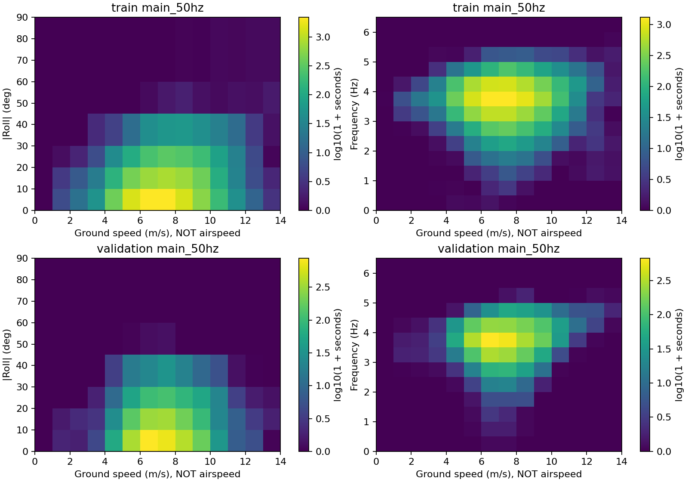

# 实飞日志对三维气动模型的约束能力与架构选择

2026-10-29；本阶段完成分析，不实施新气动模型或RL训练。

**首选 A：以三维局部翼段运动学和有界截面气动为骨架，显式保留尾翼、机身、执行器与多体惯性；将扭转、诱导及必要的低阶记忆作为有物理先验的不确定模块。** 日志用于限制整机运动、配平组合、频率动态和短时观察性响应，不用于把整机响应分摊成确定的主翼侧滑导数或独立舵效。这是当前证据下的工程选择，**不是实飞已经证明 A 比 B 更真实**；A/B 的低阶诱导与记忆结构仍应保留不确定性。

关键理由有三点：抗风任务需要当前 DeLaurier 接口缺少的主翼三维局部来流和 p/r 作用；现有日志没有足够独立气流、翼形或执行器观测去识别完整尾迹或相位控制效能；现有 ULLT 的高迎角、非线性求解和成本问题没有被更低实飞误差所补偿。最大未验证假设是：**低维扭转和诱导/记忆闭合能在任务所需的侧风、高迎角和变频过程中保留控制相关的六分量响应。** 若这个假设失败，必须升级到 B 的相应机制，不能靠扩大随机化掩盖结构误差。

本文标记含义：**已验证**＝本轮记录/计算或已有明确数值证据成立，只在所述层级；**有限支持**＝有观察性、局部或条件性证据；**合理推测**＝基于机制作出的待验证设计判断；**证据不足**＝现有材料不能支持该物理结论。已验证的统计不等于已验证的物理参数。E1–E9及N1–N3的绝对路径、版本和用途见[证据索引](sources.md)。

## 1. 实际范围与合同

新增分析由[analyze.py](analyze.py)在 IsaacLab 的独立目录中执行。其他仓库只读，不切换分支。使用 `env_isaaclab` 和 `./isaaclab.sh -p`，CPU，无随机拟合种子。代码和产物全部留在此目录；没有改原数据、划分、时间戳、传感器合同、气动模型或正式RL配置，没有提交或推送。

本轮严格从 E5 注册表解析 `velocity_rate_multistep_v1`，实际读取 `/home/zn/flap-system-identification/dataset/velocity_rate_multistep_v1` 的两份 `samples_train/validation.parquet`；仅读取当前/历史状态字段，不读取 `target_*`。另按注册flight身份读取161份原始ULog中的 `wind`、`airspeed`、`airspeed_validated`、`estimator_status_flags`、`estimator_selector_status`，没有重新计算控制匹配、控制回归或相位审计。完整路径见[read_scope.json](results/read_scope.json)。

| 分区/采样组 | 航次数 | 本轮相邻有效状态支持秒 | 实际日期 |
|---|---:|---:|---|
| train/main_50hz | 94 | 13,256.908 | 9月6、11–16、18、22–25、27–29日 |
| validation/main_50hz | 27 | 4,374.980 | 9月7、17、26日 |
| train/sparse_10hz | 28 | 4,022.737 | 10月10、12日 |
| validation/sparse_10hz | 12 | 1,836.591 | 10月11日 |

共947,397条状态记录，940,700条 `valid_core`；有效相邻支持23,491.217秒（6.525小时）。权重只累计两端均valid、同segment、间隔不超过40/160ms的原生时间区间，末样本不外推。它与E1有效**控制**时间23,489.302秒的微小差别来自不同支持定义，不能混用分母。保留原REVIEW，未另删飞行。

划分元数据还列出33段test及9月8、19日、10月13日；本轮没有打开其Parquet、ULog、标签或计算哈希。曾阅读含历史test汇总的共享 `kinematic_consistency.json`，未采用其中test统计作架构判断；不宣称本轮完全未见任何历史test摘要。

E4为 `trajectory_v3_september_expanded` 的41 train / 17 validation航次历史研究，本轮只读报告、协议和注册清单，不重新加载其样本。E8为**4月**canonical v0.4的20 train / 5 validation航次比较，本轮只读报告和注册表。4月ratio8/Hall零点/质量惯量合同不搬到9–10月。9–10月日志配置传动比约7.90909，E3的Hall/编码器核对支持该比值；没有统一物理机械零点。156航次同一飞控UUID，4航次另一UUID，1未知；UUID不证明机翼、电池、磁铁或载荷未变。

## 2. 直接继承的结论及其参数化后果

| 来源 | 可以直接继承的证据 | 对模型结构的实际含义 |
|---|---|---|
| E1 控制可辨识性 | 500ms/1s无重叠综合配对323/339；强化未来/历史差异后单电机12/3，三个舵通道均0；严格历史匹配仅5/5 | 不能给每个舵面和每个气动轴各放一组可任意自由拟合的独立增益，再称其物理标定完成。保留机械映射与执行器先验；日志约束混合输入下的整机响应 |
| E2 闭环信息量 | 300ms差动条件剩余仍为原RMS的81.8%，验证82.7%；矩阵24/24满秩；与过去运动仍相关；参考切换由到点状态触发 | 数据不是“没有输入信息”；剩余不是独立激励，满秩不是物理辨识。可用状态/参考条件下的行为检查，但不准将剩余命令当因果标签或工具变量 |
| E3 相位与执行器 | train/validation有wing_phase为117/39，有独立Hall为66/23；部分日期相位参考不稳定；电机驱动相位预测500ms RMSE 38.12°→18.55°，2s 105.55°→53.77° | 必须有自主频率/相位状态；可约束事实指令下的预测。不能把拟合约0.195s解释为真实机械时间常数，也不能跨未知零点拟合公共相位舵效 |
| E4 控制动力学 | 100ms common→q局部回归为正、GRU探针为负；集成改进预测，仍未控制晋升；参考辅助固定验证失败 | C的轨迹拟合能力不构成控制效能或日志外抗风能力。模型间一致也不能排除共同偏差 |
| E7 三维侧风比较 | 当前DeLaurier主翼缺侧向来流与p/r一阶响应；ULLT新增主翼滚转作用可达该模拟差动10°权限约29%–43%，甚至改变整机侧滑滚转导数符号 | 主翼横侧向机制不能因数据弱而设为确定零；数值差异仅说明结构可能影响策略，不给出真实系数、动作方向或风限 |

这些研究已经覆盖控制相关性、变化统计、匹配和相位，不再完整重做。E1未找到独立匹配并非数学上证明某参数永远不可辨识；本结论是**现有证据尚未识别**，不是所有未来闭环辨识方法都无效。

## 3. 新增证据：状态、气流与联合支持

### 3.1 可观察的三维运动范围

下表为每航次按原生时长计算分位数，再跨航次取对应分位数的中位数。**不是全体样本分位数、物理硬界或联合准入盒**。每行train/validation互不参与拟合；全部逐航次、日期和采样组结果见[状态表](results/state_per_flight.csv)、[日期表](results/by_date.csv)。

| main_50hz量 | train P10–P90 | validation P10–P90 | 观测层级 |
|---|---|---|---|
| 地速模 m/s | 5.77–9.19 | 5.82–9.07 | 记录的EKF导航速度；不是独立GNSS真值 |
| 传感器来源TAS m/s | 7.44–9.74 | 7.24–9.59 | source=1/2/3且正值；不是三维来流测量 |
| roll ° | −13.88–16.89 | −15.21–17.13 | EKF姿态 |
| pitch ° | 8.82–20.78 | 9.44–21.66 | 不是迎角；需扣除真实飞行路径/风 |
| p rad/s | −0.579–0.596 | −0.684–0.718 | 记录角速度，有滤波/时钟限制 |
| r rad/s | −0.331–0.418 | −0.313–0.392 | 同上 |
| 扑频 Hz | 3.09–4.30 | 3.18–4.23 | 有效频率通道；已滤波 |

**已验证：**主组具有前飞、双向滚转/偏航和变频的运动覆盖。按固定描述阈值，近直线代理（|roll|<10°、|r|<0.15rad/s、地速>4m/s）占train/validation约33.29%/36.06%；转弯代理（|roll|≥15°且|r|≥0.15rad/s）约18.40%/20.94%。这些是瞬时运动分类，不是经过航点几何认证的直线任务段，也不证明协调转弯或风扰动。

| 稀少区域，main_50hz | train秒 / 占比 | validation秒 / 占比 |
|---|---:|---:|
| 滚转绝对值>30° | 272.824 / 2.06% | 104.922 / 2.40% |
| 滚转绝对值>45° | 6.498 / 0.049% | 0.644 / 0.015% |
| 地速<4m/s | 114.890 / 0.87% | 9.631 / 0.22% |
| 扑频<2Hz | 79.479 / 0.60% | 16.536 / 0.38% |
| 扑频>5Hz | 32.400 / 0.24% | 1.998 / 0.046% |

[联合时长表](results/joint_occupancy.csv)同时分地速、滚转幅值、扑频、日期、固件与UUID，避免将边际范围相乘。图是该支持的二维投影，不能替代完整三维表，更不能证明含真实β的六维支持域。大滚转、低速、低频/高频组合和日志外阵风区域没有足够覆盖，不能把缺格补成力系数真值。



**有限支持：**常见前飞域的运动尺度在train/validation相近，但不是同分布证明。9月主组各日期的航次TAS中位数之中位数为7.58–9.18m/s、频率3.51–4.00Hz；10月低采样组为8.65–8.96m/s、3.47–3.68Hz，roll中位数均负。日期、采样组、任务和硬件配置混杂，不能归因为空气动力漂移。10Hz下3–4Hz翼拍每周期仅约2.5–3.3点，不能靠插值获得50Hz相位/瞬时控制证据。主组短时结果不代表10月已独立验证同一带宽模型。

新增的[空速—角速率—频率联合表](results/air_motion_joint.csv)进一步以传感器TAS、|p|、|r|、f四维分箱，并另存加入候选|β|的五维表。主组train/validation四维共同有效支持为12,967.700/4,373.899秒；加入候选β后为12,963.871/4,372.826秒。两段train航次没有四维共同有效支持，明确保留在[覆盖表](results/air_motion_joint_coverage.csv)，不补值。四维共同支持不代表物理上独立观测。

最密集的主组联合格是TAS 8–10m/s、|p|<0.5rad/s、|r|<0.25rad/s、f 3–4Hz，train/validation分别2,749.905/892.156秒；这给出一个可追溯的常见工作组合，不能据此推断同空速下任意大角速度或真实侧滑的控制响应。低采样组相同格为888.774/567.290秒，仍单独报告，不视为相同瞬时带宽证据。

### 3.2 风估计不能提供独立侧滑标定

**已验证（日志层）：**161航次均有wind:0、airspeed和airspeed_validated记录；新鲜度按发布时间向后查找，风≤500ms、空速≤200ms。

| 分区/组 | 传感器来源且TAS>0支持 / 有效秒 | 新鲜水平风支持秒 | 所选EKF的cs_fuse_beta开启秒 |
|---|---:|---:|---:|
| train/main | 13,113.172 / 13,256.908 | 13,256.531 | 13,256.531 |
| validation/main | 4,373.899 / 4,374.980 | 4,374.980 | 4,374.760 |
| train/sparse | 4,019.241 / 4,022.737 | 2,008.900 | 4,022.737 |
| validation/sparse | 1,827.110 / 1,836.591 | 916.449 | 1,836.591 |

source=0（地速减风）或4（合成）的新鲜支持在这批有效区间均为0；其余差额为缺失/非正TAS等，不能填作真实零空速。空速来源枚举可追溯，但探头安装、扑翼流场干扰、标定、端到端延迟仍未标定。sparse风支持约一半是500ms新鲜度与约1Hz记录节奏的结果，不等于一半时间没有物理风。

本地可获得的7个**对应日志固件**源码版本（覆盖60航次）均明确 `observation=0.f`，执行synthetic sideslip fusion；其空速来源枚举一致。其余10个版本的这些文件本地git对象不可读取，1航次固件未知，保留该限制，未联网补齐。各航次flag来自选定primary_instance；flag为开启条件，**不表示每次融合通过创新门槛**，也没有认证所有实飞binary。详见[固件语义检查](results/firmware_semantics.csv)。

候选定义是 `v_air,N = v_ground,N − [wind_N, wind_E, 0]`，再由记录姿态转入FRD，`β_hat=atan2(v_y,sqrt(v_x²+v_z²))`，速度<3m/s不计β。它假设垂直风为0，wind:0未逐固件认证与选定估计器的发布链完全一致，也未修正风与状态的滤波延迟。因此只标记**候选β**。

候选β的主组航次P10/P90中位数：train −7.88°/+6.67°，validation −8.68°/+6.81°。这不证明真实侧滑小，也不能证明日志覆盖真实±10°侧风。零侧滑伪观测会参与风的估计，使用该β去拟合CYβ/Clβ/Cnβ有循环约束风险。

新增敏感性只作量纲诊断：人为令水平风N/E各偏移±1m/s四个角点，**不是估计出的风误差或置信区间**。候选β区间宽度的航次中位数之中位数为17.30°/17.76°；train/validation主组约80.8%/73.5%的有效时长在这些假设扰动下β符号可跨0。PX4报告的水平风标准差合成量典型约0.28m/s是估计器内部协方差，未校准为真实误差，不能据它排除模型偏差或未测垂直风。

**结论：空速标量有观测支持；真实三维来流、迎角/侧滑、独立阵风幅值和谱仍证据不足。** 日志可描述“估计风下的飞行”，不能用于认证强侧风恢复或固定主翼横侧向系数。

## 4. 可用于未来模型的行为约束

### 4.1 配平与正常运动组合

额外保留原生、非重叠约1秒的候选近直线窗口：整个窗口满足近直线代理阈值，且端点速度向量变化<0.5m/s。主组train 23窗/13航次、validation 12窗/10航次；低采样组另有23/25窗。主组35窗描述性P10–P90：地速5.26–8.13m/s、pitch 10.92–17.15°、频率2.93–3.88Hz。四路归一化命令和每窗身份、实际时长保存在[cruise_windows.csv](results/cruise_windows.csv)。

这只是有限的稳定运动候选，不证明水平无加速配平、零风、真实升阻比或唯一舵角；窗口筛选使用端点运动，只供描述，**不进入因果控制匹配或训练选样**。不能以严格窗口少断言没有巡航数据，也不将跨采样组拼成同精度统计。对未来模型的合理用法是：同一候选联合条件附近应存在相容的前飞行为；配平所约束的是气动、质量、执行器和风的组合，不是每个参数分别成立。

### 4.2 短时原生状态增量

新增计算不使用六分量力标签，也不求加速度。按原连续segment选择不重叠起点，取达到名义时域后的第一条原生状态，输出实际dt；不跨缺口、不插值。由于原生步长略小于20ms，**名义100/200/500ms实际常约118–120/217–220/503–519ms**，不能把下面结果当精确100ms响应。各量由当前/历史可用的异步记录计算，保留原合同；不是重新同步的物理真值。

下表为各航次P90的跨航次中位数，完整P10/P50/P90/P99、时长和样本数见[response_summary.csv](results/response_summary.csv)，逐航次见[N3](results/response_per_flight.csv)。

| 名义时域 | train Δv向量模 m/s / 姿态测地角° / Δω模 rad/s | validation 同三量 |
|---|---|---|
| 100ms | 1.171 / 5.261 / 1.557 | 1.183 / 5.080 / 1.782 |
| 200ms | 1.070 / 7.794 / 1.412 | 1.021 / 7.427 / 1.569 |
| 500ms | 1.988 / 16.018 / 1.455 | 1.874 / 15.522 / 1.572 |

**已验证的是观察增量的统计复现；有限支持的是未来模型的行为约束。** 200ms速度/角速率增量并不必然大于100ms，不能强行拟合单调阻尼或据此给出噪声下界；翼拍周期、状态估计和异步观测均可能影响。模拟时应通过相同观测/采样过程再比较，不能拿瞬时真状态与该表直接作物理误差评价。分位数不是硬安全限值，不能裁剪模拟响应去“通过验证”。

对控制相关约束仍继承E2的原定义：93个训练航次中300ms原差动与未来Δp相关中位数+0.083，条件剩余为+0.134，但与过去Δp仍为−0.096/−0.066；没有确认独立因果方向。重复趋势可以作同状态、同模式、同采样组的观察性检查，不能据此把舵效或主翼阻尼固定。

## 5. 参数与机制证据矩阵

[完整CSV矩阵](evidence_matrix.csv)逐项包含机制/参数、所需观测、实际信号与支持、证据编号、状态、辨识结论、混淆和RL处理。下面给出决策摘要；“必须”表示抗风模型应能表示相应机制，不表示它的幅值已被日志证明。

| 机制/参数 | 日志能约束什么 | 不能分离什么/主要混淆 | 判定 | RL选择 |
|---|---|---|---|---|
| 平均升力/推力/阻力 | 常见前飞配平、净运动与频率关联 | m、气流、翼/尾/机身分量 | 有限支持 | 必须；联合而非逐参数标定 |
| 主翼CYβ、Clβ、Cnβ | 候选β条件下的整机描述 | 真实β、各部件力矩和质心 | 证据不足 | 必须表达；结构与幅值不确定 |
| Clp、Cnr及交叉阻尼 | p/r范围与短时整机变化 | 闭环控制、J、周期惯性和风 | 有限支持 | 必须有局部旋转来流；不固定实机导数 |
| 左/右舵、方向舵效能 | 混合指令条件下的响应 | 真实舵角、安装符号、延迟及尾流 | 证据不足 | 机械映射+执行器先验，保留效能不确定性 |
| motor→f动态 | 事实命令条件下的频率/相位预测 | 滤波、负载、电压与机械时间常数 | 有限支持 | 显式频率状态；未来不能喂真频率 |
| 相位强迫/周期控制增益 | 可信航次内周期信息 | 跨航次零点、周期强迫与反馈增益 | 有限支持 | 保留相位运动学，暂不自由拟合高阶舵效 |
| 扭转/柔性参数 | 无直接翼形约束 | 极线、诱导、相位与惯性补偿 | 证据不足 | 低维先验/结构备选；不能硬置确定零 |
| 大迎角极线/分离 | 整机行为可淘汰极端不相容组合 | 局部迎角和具体失速机制 | 合理推测 | 有界闭合必须；动态分离阶数待证 |
| 诱导/尾迹记忆 | 不能确定唯一状态阶数 | 伺服、扭转、滤波和相位滞后 | 证据不足 | 低阶结构备选；暂缓完整高阶尾迹 |
| 附加质量/翼惯性 | 历史数值耦合规则可验证 | 9–10月实际质量惯量未绑定 | 有限支持 | 多体守恒与参考点必须；参数保留不确定性 |
| 尾翼/机身/翼尾干扰 | 整机组合响应 | 各部件贡献与局部动压 | 证据不足 | 尾翼机身基本作用必须；干扰先低阶 |
| 风与传感器模型 | 记录空速/估计风分布 | 真实阵风、风误差和延迟 | 证据不足 | 物理扰动与观测误差分开 |
| 运动行为包络 | 原生支持及增量统计 | 物理极限和独立控制效果 | 已验证（统计层） | 用于行为核查，不当硬真值 |

不可辨识性不仅是“样本少”：在平动方程中同时缩放m和非重力F可保留运动；总力矩 `τwing+τtail+τbody` 内各加减同一项仍给出相同总量；若闭环 `u≈π(x)`，改变控制增益同时改变状态项，可沿已观测轨迹保持近似预测而改变反事实。未知相位偏移还会旋转谐波系数。数值满秩、低RMSE及控制变化均不消除这些机制混淆。真实多体惯性、IMU/COM杆臂及加速度标签误差又使“由整机运动倒推主翼参数”更不唯一。

## 6. A/B/C架构比较与选择

按用户优先级依次判断，不用任意加权总分制造唯一性。

| 优先级 | A 三维局部翼段 | B 降阶非定常三维升力线 | C 相位相关整机控制模型 |
|---|---|---|---|
| 1 必需抗风机制 | 可直接接三维来流、ω×r、扑/扭运动、左右非对称及大迎角截面；非局部诱导/尾迹需另闭合 | 三维诱导和尾迹较自然；高迎角/分离/柔性仍非自动解决 | 可表示六轴响应，但物理约束、风输入与日志外控制效能不自动存在 |
| 2 现有日志约束力 | 可限制低维参数组合及整机行为；局部极线/部件导数仍弱 | 整机约束相同，多出的环量/尾迹状态缺直接观测 | 常见闭环轨迹约束较强，独立控制与真实β极弱；未知机械零点阻碍共享相位舵效 |
| 3 先验与不确定性 | 几何、力臂、局部流向、对称性、阻力耗散有明确来源；极线扭转须保留范围/结构 | 有理论先验但依赖附着流和运动学；非线性极线/根分支增加不确定性 | 平均/周期分解可解释，但多个响应项易互相补偿；网络分歧不是校准的物理区间 |
| 4 日志外侧风/机动 | 物理局部运动学较有希望；强跨展向流、高迎角及翼尾干扰仍可能失败 | 在适用范围内诱导泛化更有依据；当前非线性可靠性未成立 | 无真侧风和独立舵效时，外推主要由函数类决定；风险最大 |
| 5 大规模RL成本 | 预期随面元数近线性、易批处理；尚未实现，不能报吞吐 | 当前ULLT涉及耦合解和状态推进；降阶或预计算可能改善，尚未证明达到预算 | 通常可低成本；不能用速度抵消控制真实性缺口 |

**选择A的必要限定（合理推测）：**选择的是几何驱动的三维局部模型家族，不是把旧DeLaurier输出增加两个经验系数就视为完整三维模型，也不是确定采用独立条带、完全无诱导的模型。局部升阻力需要截面平面/展向流处理、几何和左右翼运动学一致的方向定义；尾翼和机身独立记账。不能以相同日志RMSE在多个未辨识极线/扭转组合中挑一个并宣称物理唯一。

**保留B的什么：**低阶诱导强度、左右翼/展向耦合以及有限记忆可以作为A的结构备选，参数来自理论/独立测量先验；未来只有在独立强迫或整机响应验证表明局部模型漏掉关键时延、相位或阻尼时，才增加必要状态。当前日志不能唯一决定“无记忆/一个记忆/四状态”，不能宣布尾迹可以永远忽略。完整自由尾迹、展向黏性输运、详细LEV/多阶相位舵效可暂缓实现；这是优先级判断，不是已证明物理微小。

**C的合适位置：**作为支持域内的观察性行为参考、残差诊断和模型误差检查；若以后有可信执行器/气流与机械参考，低维整机周期模型仍可能有价值。当前不宜作为唯一抗风RL训练plant：策略会主动改变闭环输入分布，正是现有代理预测尚未验证的方向。把策略限定在四路指令各自min/max内也不能解决联合支持与因果问题。

### 为什么不直接沿用原始DeLaurier或完整ULLT？

原始DeLaurier当前生产路径的主翼没有侧向来流和机体p/r局部速度一阶作用，尾翼主导侧风恢复；机身在对比配置中CdA=0。坐标变换后有六分量载荷不等于包含六自由度气流机制。它可以保留为历史基线和部分截面先验，但抗风策略不能建立在未经验证的主翼横侧向确定零上。这是当前实现边界，不否定DeLaurier理论所有扩展。

ULLT提供的非零侧风作用和数值对称性值得保留为机制参照，但不是实机标定。E7在8m/s、3/4Hz规定扑动中局部迎角达到约46°/54°；线性附着流范围存疑。ULLT-A的时间加密通过部分检查，但20段/翼空间加密两个频率均有求解失败；静态有界极线不等于可信动态分离。现有后端还没有完成自由体附加质量耦合和正式RL接入。

E7中每批15个规定机翼工况的CPU float64步成本，ULLT-4约为DeLaurier的24–30倍、ULLT-A约53–57倍；这是**既有离线实现测量，不是未来B的下限，也不是RL环境吞吐比**。E8的4月比较中ULLT-4三个纵向轴RMSE全部较差，但标签是整机反推、模型只算主翼，不能据此宣布ULLT物理上较差；它至少未给出足以抵消新增代价与假设的实证收益。因此当前不直接推进完整ULLT。

## 7. 下一阶段首先实现和验证什么

下一阶段的首要机制应是**同一参考点下，真实三维局部相对来流如何通过左右翼/尾翼几何形成六分量载荷，以及机体p/r如何改变局部来流**。先构成完整几何与运动学路径，再选择未辨识闭合的复杂度；本轮不执行以下实现。

| 物理模块 | 参数类别与可用先验 | 日志能做的约束 | 关键验证/恢复证据 |
|---|---|---|---|
| 刚体+翼多体、统一参考 | 各link质量/惯量/COM、翼铰链；实际测量/装配记录 | 约束运动组合，不能补齐m/J尺度 | 绑定9–10月硬件；FRD/NED↔FLU、换点、左右镜像、动量/能量闭合；保留CPU-native与GPU近似区别 |
| 三维局部翼段与高迎角截面 | 几何、局部速度/扭转、CL/CD/CM与压力中心 | 前飞配平和原生状态包络 | 零风/β/±p/±r/翼拍镜像、力矩积分、步长/面元收敛；物理幅值另需测力/可信独立运动证据 |
| 尾翼和机身 | 面积、法向、力臂、动压比例、阻力面积 | 整机组合一致性 | 核实舵安装/符号与实际舵角；不可用主翼整机残差硬分摊；机身侧力矩不可默认为零 |
| 执行器与频率相位 | 归一化命令→真实舵角、速率/延迟/死区，motor→f；台架及E3为不同层级先验 | 事实命令条件下f预测、混合短时增量 | 伺服实测与编码器/Hall来源、跨日机械参考；独立控制效能证据到位前保留不确定性 |
| 扭转、诱导/记忆与翼尾干扰 | 低维扭转幅相、诱导强度、记忆时标/阶数、尾翼流速修正 | 只能检查是否与整机观测矛盾 | 同步翼形/测力或可信独立机动辨别；若A失败再升级B必要状态 |
| 风与观测 | 任务指定的风场；风估计/空速/姿态率滤波和延迟模型 | 记录信号分布和时序一致性 | 独立气流方向/阵风或标定资料；不把内部风协方差当实测真误差 |

随机化应围绕**物理一致的联合参数组**：质量与惯量同一硬件组，舵角映射与尾翼效能联动，扭转与极线/诱导闭合成套，相位偏移保持航次/安装一致性。不能把每个弱辨识导数独立均匀采样，不能未经证据把当前ULLT输出居中定义为参数真值。具体区间尚未识别，须由装配/几何/执行器/截面资料给出可解释先验，再用train约束联合组合、validation作开发核查；封存test继续封存。

如暂时取不到标定，仍能建设明确标注不确定性的仿真研究模型，但其抗风性能只能称为**跨假设模型的仿真鲁棒性**。增加状态、训练更久或在同一闭环日志上降低误差，不能替代真实侧风和执行器证据。

## 8. 执行与验证记录

完整新增计算：两份train/validation状态表、161份授权原始ULog，未拟合参数/气动力/神经网络，未启动PPO或气动仿真扫描。初次读取过多不需要列导致运行迟缓，主动停止且无最终产物；改为显式必要列投影后完成，输入数据未改变。诊断期间的faulthandler超时堆栈仅表示长操作位置，不是计算异常。最终 `DONE 947397 83 raw failures 0`。

[summarize.py](summarize.py)已检查分区仅train/validation、161个唯一航次与raw成功、联合占据时长逐航次等于有效时长、条件分母闭合、风支持不超过有效时长。结果见[verification.json](results/verification.json)；图已实际查看。没有运行全仓库测试、重跑匹配、训练或拟合。独立原始值合同核验复用E1/E3，本轮未重新制作哈希清单。补充联合统计由 `joint_air_support.py`完成，复读同一批授权日志的空速/风topic，无新增数据范围；首次汇总校验发现2航次零共同支持导致索引长度不同，改为按全部航次重索引后校验通过。该零表示没有共同观测支持，不是将失败气动力填零；未重新选样或修改原数据。

复现（会重建本目录results；需要保留本次结果时先复制整个研究目录再运行）：

```bash
source /home/zn/anaconda3/etc/profile.d/conda.sh
conda activate env_isaaclab
MPLCONFIGDIR=/tmp/aero-evidence-mpl OPENBLAS_NUM_THREADS=1 ./isaaclab.sh -p \
  docs/audits/2026-10-29-realflight-aero-evidence/analyze.py
OPENBLAS_NUM_THREADS=1 ./isaaclab.sh -p \
  docs/audits/2026-10-29-realflight-aero-evidence/summarize.py
OPENBLAS_NUM_THREADS=1 ./isaaclab.sh -p \
  docs/audits/2026-10-29-realflight-aero-evidence/joint_air_support.py
```

**最终回答：现在最值得采用的是A的三维局部物理骨架，保留低维诱导/记忆结构不确定性。日志可以约束正常前飞的联合运动与指令组合、事实控制下的频率演化和观察性短时响应；不能唯一标定主翼/尾翼/机身分量、真实侧滑导数、纯阻尼、独立舵效、扭转和高阶尾迹。原始DeLaurier缺少任务关键三维路径，完整ULLT则增加了当前日志无法约束且尚未解决高迎角/数值/成本的结构。** 选择A的目的在于让必要物理路径明确、未知项可表示和可检验，并非声称这些未知项已被实飞辨识。
