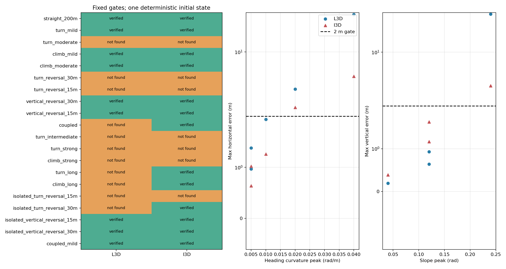
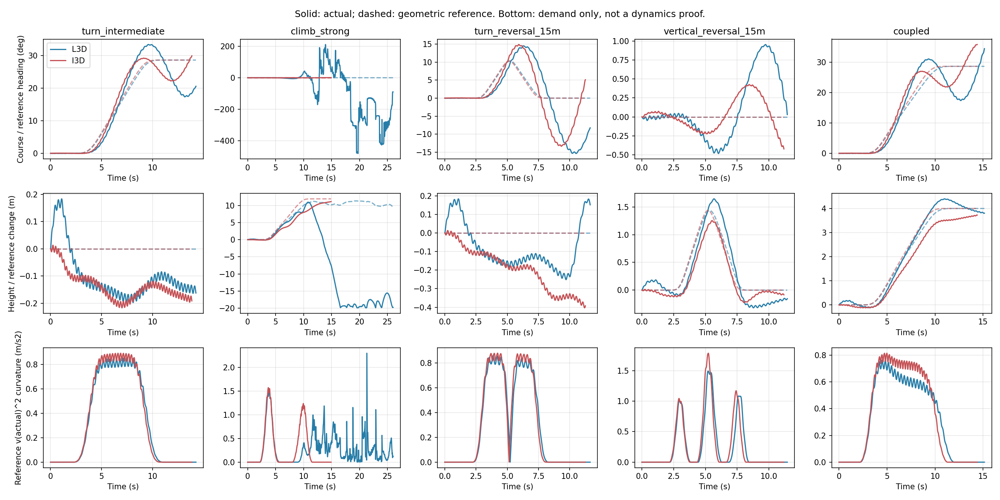
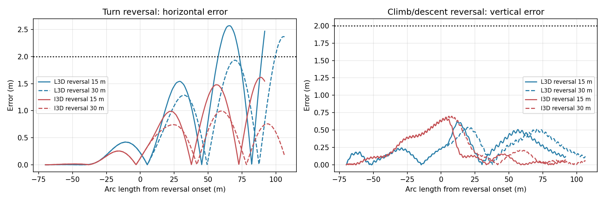

# Unified Trajectory 第二阶段：L/I Plant 离线机动可飞性

本轮实际完成 **88 条 CPU-native PhysX 轨迹**（每后端 44 条，6 批），没有训练 PPO、修改气动物理或执行 commit/push。结果提供有限任务、确定初态和指定控制器下的可行证据，**不是连续完整飞行包线，也不是真正水平配平或实机验证**。

主要结论：L/I 均验证参考航向曲率 .005 rad/m、20 m 恒幅平台的转弯，以及坡度 .12 rad、20 m 平台的爬升。I 还验证上述转弯/爬升延长至 60 m 平台；L 在较长任务中未通过恢复或横向误差门限。固定维持段的左右转过渡，I 在 30 m 过渡通过、15 m 未找到，L 两者均未找到；两后端均通过 ±.08 rad 爬升/下降的 15 m 与 30 m 过渡。更强耦合任务只有 I 通过。所有“未找到”均可被今后的合法成功控制推翻。

## 实验边界与基准

实际 worktree 为 `.worktrees/control-oriented-3d-wing-aero`，HEAD `bc85d62e`；统一轨迹来源 `.worktrees/native-multibody-rl`，HEAD `d343f74d`。两者原有未跟踪文件保留。只移植 `TrajectorySpec`、B 样条几何积分、查询及投影接口，没有合并旧 RL 分支、缓存、环境或课程。新产物全部位于 [`logs/unified_trajectory_phase2_v1/`](../../logs/unified_trajectory_phase2_v1/)。

复用 [L/I 近周期前飞研究](2026-10-29-control-oriented-3d-aero/periodic_trim_lateral_response_zh.md)的各自六变量候选；数值直接读取 `L3D_late/search.json`、`I3D_refined/search.json`，未重新拟合物理参数。

| 初态/条件 | L3D | I3D |
|---|---:|---:|
| 前向速度 m/s | 9.65633749 | 9.25000000 |
| 抬头角 ° | 13.97170780 | 8.55560498 |
| 初始频率 Hz | 3.04320587 | 3.74322489 |
| 对称尾舵 ° | .87348208 | −3.57621175 |
| 方向舵 ° | 1.63101886 | .24606506 |
| 差动尾舵 ° | −2.20549313 | −1.99693057 |

统一为初始高度 20 m、零垂速/角速度、相位零、seed=29、无风。质量、惯量、极线、35° 扭转、每翼 10 站、五翼面尾翼、native holonomic 扑动机构及原执行器不变。显式 `ControlAero3DConfig(backend=...)` 选择 L3D/I3D；没有运行默认 DeLaurier。物理 480 Hz、控制 60 Hz，频率 0–5 Hz、原 2 Hz/s governor，真实尾关节限位 ±40.70865°。位置/速度参考点为 base link，世界 z-up；Euler pitch 为右手 FLU，负值表示抬头，力矩没有被当作系统 COM 真值。

不调用自动 reset、奖励或 PPO；逐步执行原环境的 pre-step/apply-action/PhysX/scene-update。原始轨迹包括失败后的积分，**首次越限及接地后数据不构成安全可飞证据**。首次沙箱启动在插件初始化阶段崩溃；随后同一 `env_isaaclab` 环境以主机权限完成全部 12 批，失败启动不计 plant 失败，日志保留于 `launch_logs/`。

### 事先冻结的判据

每个 `protocol.json` 在积分前写入同一判据：水平/垂直误差最大各 ≤2 m，|roll|≤60°、|pitch|≤45°、角速度模≤8 rad/s，实际速度 4–16 m/s，完成参考长度≥98%（分析还标记离地高度<1 m）。恢复要求为末 1 s 水平/垂直误差均值各≤1 m、平均垂速绝对值≤.5 m/s；任务尾部有至少 30 m 直线恢复段。评价截至首次完成，之前任何越限不能被后来的恢复抵消。这里“完成 200 m 任务”对应实际投影航程至少 196 m，未隐去这个 98% 约定。

`VERIFIED FEASIBLE` 表示一条合法控制全过程满足这些有限任务判据；`NOT FOUND` 表示本轮规定控制搜索未找到；未测试参数为 `UNTESTED / UNCERTAIN`。没有依据经验失败生成硬物理排除。

开环延长至 20 s 后，L 在 8.367 s 首先垂直误差超过 2 m，此时速度 7.707 m/s；I 在 8.283 s 首先水平误差超过 2 m，此时下降 .574 m、速度 9.412 m/s。两者八拍近周期候选均不能直接当作长期稳定水平配平。

最终反馈下，L/I 分别在 21.833/21.267 s 完成 196.085/196.009 m，最大水平误差 .057/.042 m、垂直误差 .184/.143 m；实际速度范围分别 8.76–9.66 / 9.00–9.43 m/s。L/I 最大滚转 .406/.277°，最大俯仰绝对值 13.972/9.135°，最大角速度模 1.805/1.141 rad/s，实际频率约 2.978–3.134 / 3.740–3.807 Hz。因此后续搜索有闭环有限航程基准，但不证明无限时域可持续性。

## 控制与搜索范围

控制输入始终是 `[频率, 方向舵, 左尾舵, 右尾舵]`，通过原归一化动作、滤波、governor 和真实关节执行器作用；没有虚拟力矩或升力。1 s 前保持候选动作，之后启用位置、航迹角、姿态及角速度反馈，测量低通时间常数 .12 s。频率只反馈高度误差和垂速误差，**没有目标速度或速度追踪项**。

侧向参考航迹角为 `ψref − clip(.12 e横, ±.3)`；最终控制使用实际水平速度方向。参考滚转为 `−atan2(v实际² κψ cosγ, g) − .6 航迹角误差`，限制 ±.65 rad。这个协调转弯表达式只是控制器前馈，绝非气动能力证明。方向舵增量为 `20 航迹角误差 − 40 (r − v实际 κψ)`；差动增量为 `80 滚转误差 − 20 p`。这些舵增量以度输出，误差以 rad/rad/s 输入。

纵向参考 pitch 使用原候选后段平均抬头 L=4.31°/I=6.04°，叠加 `γ − clip(.10 e高度, ±.2)`；对称舵为 `12 pitch误差 − 3 q`。频率增量为 `−.2 e高度 + .3(v实际 sinγ − vz)`。各舵命令先叠加各自候选配平，再按真实关节限幅。完整实现和默认项见 `unified_trajectory_feasibility.py`，证据中的控制器版本为 `phase2_feedback_v1`。

预算为每后端：3 条初始基准（开环/两个 pitch 反馈方向），4 条有界侧向增益基准，9 条首轮机动，4 组增益×2 个代表任务，15 条最终任务，5 条过渡/温和耦合补充，共 44 条。最终增益来自已真实积分的成功候选。参数选择和验证均属开发研究，不称为 held-out 泛化。首次机动失败经增益调整转为成功，本身说明“旧控制失败”不能证明物理不可飞。

## 连续轨迹需求与实际结果

B 样条直接定义 κψ=dψ/ds 和 γ，s 为三维弧长。查询解析计算 κψ′、γ′及

`κ3D = sqrt(cos(γ)^2 κψ^2 + γ′^2)`，`a法向参考 = |v实际|² κ3D`。

四个全局峰值通过分段多项式导数根计算；持续段、正负积分、净爬升、高度起伏、共同激活长度及耦合积分 `∫|κψ γ|ds` 同时保存。空间描述网格≤.2 m；“激活段”定义为超过自身峰值 10%，区别于下表的精确恒幅平台。全部参数、空间曲线可由保存的 knots/coefficients 重建。参考几何半径与实际瞬时航迹曲率不等同。

以下“通过”对应 VERIFIED FEASIBLE，“未找到”对应 NOT FOUND。强失败的误差数值含越限后的诊断积分，不代表安全状态；失败机制应看首次越限。

| 任务 | L 状态；最大水平/垂直误差 m | I 状态；最大水平/垂直误差 m |
|---|---|---|
| 直飞 200 m | 通过；0.057 / 0.184 | 通过；0.042 / 0.143 |
| 转弯 κ=.005，平台 20 m | 通过；0.966 / 0.184 | 通过；0.639 / 0.160 |
| 转弯 κ=.005，平台 60 m | 未找到；1.378 / 0.184 | 通过；1.023 / 0.187 |
| 转弯 κ=.010，平台 20 m | 未找到；1.939 / 0.200 | 未找到；1.260 / 0.217 |
| 转弯 κ=.020，平台 20 m | 未找到；3.936 / 0.473 | 未找到；2.488 / 0.452 |
| 转弯 κ=.040，平台 20 m | 未找到；25.556 / 13.701 | 未找到；5.429 / 1.332 |
| 爬升 γ=.04，平台 20 m | 通过；0.164 / 0.193 | 通过；0.037 / 0.390 |
| 爬升 γ=.12，平台 20 m | 通过；0.556 / 0.640 | 通过；0.154 / 1.163 |
| 爬升 γ=.12，平台 60 m | 未找到；2.683 / 0.930 | 通过；0.224 / 1.627 |
| 爬升 γ=.24，平台 20 m | 未找到；12.004 / 31.162 | 未找到；0.807 / 3.657 |
| 耦合 κ=.005、γ=.04 | 通过；1.075 / 0.196 | 通过；0.624 / 0.390 |
| 耦合 κ=.010、γ=.08 | 未找到；2.460 / 0.414 | 通过；1.340 / 0.726 |

持续任务统一为 20 m 直线进入、30 m 渐入、20/60 m 恒幅平台、30 m 渐出、30 m 直线恢复，总长 130/170 m。参考净爬升：γ=.04/20 m 为 2.000 m，γ=.12/20 m 为 5.988 m，γ=.12/60 m 为 10.777 m，γ=.24/20 m 为 11.905 m。正 κ 为先向世界 +y 转弯；不将单向持续任务推广为独立负向全包线。

通过的 .005 转弯在 20 m 平台上，L/I 实际平均航迹曲率约 .00773/.00761 rad/m，存在暂态超调；I 的 60 m 平台平均约 .00454 rad/m。因此“跟踪通过”并不意味着每时刻精确实现指定曲率。γ=.12 的 20 m 平台上，L/I 平均实际坡度约 .1435/.0944 rad，平均速度 7.20/8.27 m/s；I 的 60 m 平台平均实际坡度 .1030 rad、平均速度 8.18 m/s。所有原始 p/q/r、姿态、翼拍相位、实际频率与五关节位置/速度均保留。

### 过渡距离

初版 `*_reversal_15m/30m` 同时改变了平台长度，保留为任务证据，不作单变量过渡距离结论。补充的 `isolated_*` 固定初始段20 m、进出坡段各30 m、正负平台各20 m、末恢复30 m，只改变中间反转距离15/30 m；任务总长165/180 m。

| 任务 | L 状态；最大水平/垂直误差 m | I 状态；最大水平/垂直误差 m |
|---|---|---|
| κ=+.005→−.005；过渡 15 m | 未找到；2.573 / 0.202 | 未找到；1.618 / 0.215 |
| κ=+.005→−.005；过渡 30 m | 未找到；2.370 / 0.184 | 通过；0.995 / 0.183 |
| γ=+.08→−.08；过渡 15 m | 通过；0.529 / 0.615 | 通过；0.095 / 0.678 |
| γ=+.08→−.08；过渡 30 m | 通过；0.402 / 0.539 | 通过；0.101 / 0.698 |

I 的横向过渡：30 m 有成功证据，15 m 虽最大水平误差1.618 m，末段恢复均值仍超过1 m，因此未找到；不能将“15–30 m”写成已定位的物理临界区间。L 的15/30 m均未通过，最短可行距离尚未确定。纵向±.08 rad在两者15 m均成功，**只说明15 m是一个可行测试点，更短尚未测试**。对应最大空间导数，横向15/30 m为 .0015/.00075 rad/m²，纵向为 .024/.012 rad/m。

耦合并非单轴上限的笛卡尔积：(.005,.04) 两者均通过，(.010,.08) 仅 I 通过。I 的纯平面 .010 转弯反而未通过恢复，进一步说明速度、纵向状态与响应历程共同作用，不应对曲率作简单单调硬阈值推断。







## 限制的来源

- **持续升力/能量：未得到硬能力上限。** 爬升时实测速下降，L γ=.12 长任务最低约6.35 m/s，I约7.81 m/s，表明高度获取伴随速度变化。I γ=.24 的平台平均实际坡度仅约.126 rad，垂直误差达3.659 m，实际频率最高4.718 Hz，但没有触顶5 Hz；本次控制下的纵向响应不足不能区分为“最大升力不足”“最大功率不足”或反馈分配尚可改进。没有测量全周期机械功/能量预算，不能证明不可持续爬升。
- **姿态与航迹响应：有直接证据。** L γ=.24 在10.017 s先越俯仰阈值（抬头46.61°），此时速度7.90 m/s、此前最大频率3.99 Hz；不是先触发最低速度或频率上限。之后饱和/接地是失败后果。L长爬升先在退出段越横向2 m；长转弯全段误差未越2 m但恢复未满足1 m。横向反转的超调、恢复和航迹角响应是当前主要限制。
- **舵面权限：未证实硬饱和瓶颈。** 最终成功任务的请求均未触发物理命令裁剪，四通道归一化动作均合法；实际关节位置、governor限制比例逐例存档。失败不是通过放宽限幅或安全门限转换成成功。

## 可配置初始筛选规则

机器配置为 [`screening_rules.json`](../../logs/unified_trajectory_phase2_v1/screening_rules.json)，实现为 `flapping_bot.path_tracking.trajectory_feasibility`。

1. **精确证据层**：匹配 plant、各自初态、风、积分/控制步长、扭转/离散配置、控制器版本/增益及评价判据；完全相同的轨迹配方存在成功记录才返回 VERIFIED FEASIBLE。同条件有失败无成功返回 NOT FOUND；未匹配返回 UNTESTED / UNCERTAIN。未来可追加新的离线成功证据，不需要在线分类器。
2. **连续特征优先级层**：可启停、可配置字段；逐个成功配方比较 |κψ|、|γ|、|κψ′|、|γ′|、总航程、各轴连续激活长度、净爬升绝对值、高度起伏、耦合长度及积分，不能只比较四个峰值，也不跨配方拼接一个虚假的矩形包线。落在逐项不大的区域只标记为“接近成功样本、仍待验证”，包括符号/顺序改变都不继承成功标签。它是训练优先级假设，不是可飞性定理。
3. **硬排除层**：本轮只有不合法的数学表示（非有限系数、非法 knot/长度等）可硬拒绝；没有任何新气动硬排除。经验失败降低优先级，不永久删除采样空间。L/I 的全局连续上限均为 `null`，表示尚未确定，绝不以最强成功点冒充真实最大值。

初始优先种子可直接采用：两者 .005/20 m 转弯、.04或.12/20 m爬升、±.08纵向15/30 m过渡、(.005,.04)耦合；I另加.005/60 m转弯、.12/60 m爬升、±.005横向30 m过渡、(.010,.08)耦合。各项四峰值、完整持续结构、净高度及实测速范围见对应 evidence，**不意味着这些标量之间任意组合均通过**。几何与查询允许更广区域，但证据状态保持未知。

## 交付、验证与复现

新增几何接口 `unified_trajectory.py`、需求/筛选 `trajectory_feasibility.py`；实验、造例、分析和绘图入口位于 `scripts/flapping_px4/*unified_trajectory_feasibility*.py`。新增四个定向测试验证曲率解析式与独立切向有限差分、持续长度/爬升不能被峰值替代、失败不硬排除且成功依赖条件、连续特征优先级不升级未执行配方；全部通过，入口语法编译通过。没有重复完整气动审计。

结果目录包含12批 `protocol.json`、`trace.npz`、`completed.json`、`results.json`、逐批响应图，以及汇总 `summary.json`、筛选配置和三张总结图。NPZ保存60 Hz观测、参考投影、实测速需求、四通道请求及归一化动作、上一控制时刻已施加动作、实际频率、governor标志、机械相位、五关节状态；物理内部仍480 Hz。`applied_action`是在当前控制更新前采样，需按这一时序使用，不能与当行新请求视为同时生效。

在 L/I worktree 内，复现本轮全部批次（使用新目标目录，入口拒绝覆盖）：

```bash
source /home/zn/anaconda3/etc/profile.d/conda.sh
conda activate env_isaaclab
export TERM=xterm
export PYTHONPATH="$PWD/source/flapping_bot${PYTHONPATH:+:$PYTHONPATH}"
SRC=logs/unified_trajectory_phase2_v1
DEST=logs/unified_trajectory_phase2_reproduction
for B in L3D I3D; do
  ./isaaclab.sh -p scripts/flapping_px4/unified_trajectory_feasibility.py --headless     --backend "$B" --duration 20 --cases "$SRC/baseline_cases.json" --output "$DEST/${B}_baseline_host"
  ./isaaclab.sh -p scripts/flapping_px4/unified_trajectory_feasibility.py --headless     --backend "$B" --duration 24 --cases "$SRC/baseline_refine_cases.json" --output "$DEST/${B}_baseline_refine"
  ./isaaclab.sh -p scripts/flapping_px4/unified_trajectory_feasibility.py --headless     --backend "$B" --duration 22 --cases "$SRC/${B}_maneuver_cases.json" --output "$DEST/${B}_maneuvers"
  ./isaaclab.sh -p scripts/flapping_px4/unified_trajectory_feasibility.py --headless     --backend "$B" --duration 16 --cases "$SRC/${B}_control_refine_cases.json" --output "$DEST/${B}_control_refine"
  ./isaaclab.sh -p scripts/flapping_px4/unified_trajectory_feasibility.py --headless     --backend "$B" --duration 26 --cases "$SRC/${B}_final_cases.json" --output "$DEST/${B}_final"
  ./isaaclab.sh -p scripts/flapping_px4/unified_trajectory_feasibility.py --headless     --backend "$B" --duration 24 --cases "$SRC/${B}_transition_cases.json" --output "$DEST/${B}_transitions"
done
MPLCONFIGDIR=/tmp/phase2-mpl ./isaaclab.sh -p scripts/flapping_px4/analyze_unified_trajectory_feasibility.py --root "$DEST"
MPLCONFIGDIR=/tmp/phase2-mpl ./isaaclab.sh -p scripts/flapping_px4/plot_unified_trajectory_feasibility.py --root "$DEST"
./isaaclab.sh -p -m pytest -q tests/test_trajectory_feasibility.py
```

也可仅复现 `final` 与 `transitions` 四批以重现最终表格；应读取每批 `completed.json` 和 `results.json`，不能仅依赖 wrapper 返回码。历史 v1 筛选命令（已由下节 v2 显式合同查询替代，不再适用于当前接口）：

```bash
./isaaclab.sh -p -m flapping_bot.path_tracking.trajectory_feasibility   --backend L3D --trajectory logs/unified_trajectory_phase2_v1/example_trajectory.json   --conditions logs/unified_trajectory_phase2_v1/example_conditions.json   --rules logs/unified_trajectory_phase2_v1/screening_rules.json
```

**下一阶段证据基础：已有可更新证据库和保守优先级筛选器的初始基础；尚无通用可飞/不可飞分类边界。** 只支持指定模型、无风初态和本次控制条件的有限任务。未做风扰/初态泛化、能量极限证明或实机迁移；本轮到此停止。

发布范围：Git 包含本轮源代码、测试、报告、全部 JSON 配方/协议/结果/筛选配置与三张总结图；`logs/unified_trajectory_phase2_v1/*/trace.npz`、`launch_logs/` 及逐批 `response.png` 保留本地，不随本次提交发布。复现命令可重新生成这些原始产物。

## 2026-11-05 证据语义修正（不重新仿真）

本节取代上文将“具体控制条件”纳入可飞性匹配的旧语义。原 `screening_rules.json` 原样保留；新版为 `screening_rules_v2.json`。迁移只读原协议和结果，未读取或重新计算历史气动轨迹，88 条逐项保留为 **35 成功、53 未找到**，完整旧记录、原结果、来源、case 下标及控制器增益均在新版中。实际动作通过原 `trace.npz` 的字段和 case 下标引用，保留动作采样时序说明。

记录分为 `physical_conditions`、`witness` 和 `evaluation_contract`。查询不再接收候选控制器；同一物理条件、轨迹与合同只要存在成功见证，就返回 `VERIFIED FEASIBLE`，追加失败或更换增益/PPO 不会撤销它。`append_evidence()` 只追加独立记录；调用者仍须先验证实际动作和结果，接口本身不认证策略。`NOT FOUND` 仅描述已有搜索，绝非物理不可飞。L3D/I3D 独立匹配。

初始六变量（含频率与尾舵）、相位、角速度、风、seed、步长、plant 配置作用域及执行器约束保留严格匹配；轨迹 seed、原点、航向不归一化。历史轨迹只保存相对环境原点的位置，且采用有限地面和不同批量场景，尚不足以证明任意世界平移等价，因此额外保留场景数量、槽位和间距。不同 plant 修订不因同名后端自动等价。

历史有 **13 组同后端同轨迹的成功/失败混合组，共 49 条记录**。例如 L/I 的 `turn_mild_gain2` 成功、`gain0/1/3` 失败；全部并存，没有失败覆盖成功。但这些历史控制器案例使用不同场景槽位，部分还改变了时间预算；严格物理条件与合同下，没有历史成功/失败完全同条件配对，不能宣称它们已证明世界平移等价。跨控制器复用接口已用同物理条件的定向构造验证；历史成功自身仍可查询为成功。

离线合同明确保存 98% 完成、全过程水平/垂直各 2 m、姿态/角速度/4–16 m/s 安全范围、1 m 离地、末 1 s 恢复、60 Hz 评价、首次完成截断及各批时间预算。参考速度仍无跟踪目标。RL 默认合同快照 `rl_default_contract_v1.json` 来自另一 worktree 的 `UnifiedTrajectoryEnv._get_dones()`、继承配置及共享步长：剩余投影航程≤0.5 m 且三维路径位置误差≤0.5 m，并且无失败；失败包括非有限根状态、高度不在[0.05,60] m、路径误差>8 m、倾角>75°、体轴角速度模>20 rad/s；120 s 资源超时，完成优先于超时。RL 没有速度追踪目标，也没有离线恢复或速度安全区间。实际 RL 配置覆盖需要写入独立完整合同，不能直接沿用默认快照。

不同合同目前仅实现精确相等这一已知蕴含关系；不因某个阈值更严就推断整个合同更强。物理条件相同、有成功但目标合同不同，返回 `RELATED EVIDENCE / TARGET UNVERIFIED`，同时返回原见证与合同。全部 88 条对 RL 默认合同的查询均未升级为 RL 成功。将来可追加经过独立评价的 RL 成功见证，无须改变数据结构；本轮未实现在线采样或训练。

定向验证：`tests/test_trajectory_feasibility.py` **6 passed**，涵盖先成功后失败、记录顺序、跨控制器、物理条件/plant/轨迹差异、合同隔离、RL 追加、特征优先级及 88 条逐项来源/结果守恒。未运行 PhysX、训练或额外气动分析。

只复现本轮迁移、测试和查询（在本 worktree 执行）：

```bash
source /home/zn/anaconda3/etc/profile.d/conda.sh
conda activate env_isaaclab
export TERM=xterm MPLCONFIGDIR=/tmp/phase2-mpl
export PYTHONPATH="$PWD/source/flapping_bot${PYTHONPATH:+:$PYTHONPATH}"
ROOT=logs/unified_trajectory_phase2_v1
./isaaclab.sh -p scripts/flapping_px4/analyze_unified_trajectory_feasibility.py --root "$ROOT" --migrate-existing
./isaaclab.sh -p -m pytest -q tests/test_trajectory_feasibility.py
./isaaclab.sh -p -m flapping_bot.path_tracking.trajectory_feasibility \
  --backend I3D --rules "$ROOT/screening_rules_v2.json" \
  --trajectory "$ROOT/query_v2/trajectory.json" \
  --conditions "$ROOT/query_v2/conditions.json" --contract "$ROOT/query_v2/contract.json"
```

示例返回 `VERIFIED FEASIBLE`；将最后的合同路径换为 `$ROOT/rl_default_contract_v1.json` 返回 `RELATED EVIDENCE / TARGET UNVERIFIED`。旧 v1 查询明确报错提示迁移，避免默默延续旧语义。本轮没有 commit/push。
