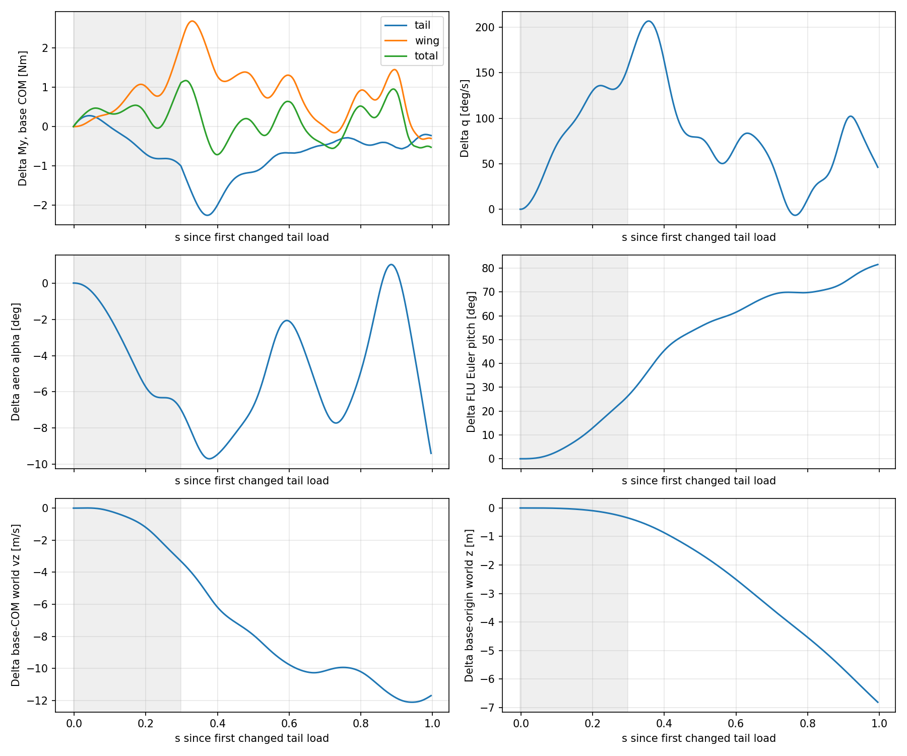
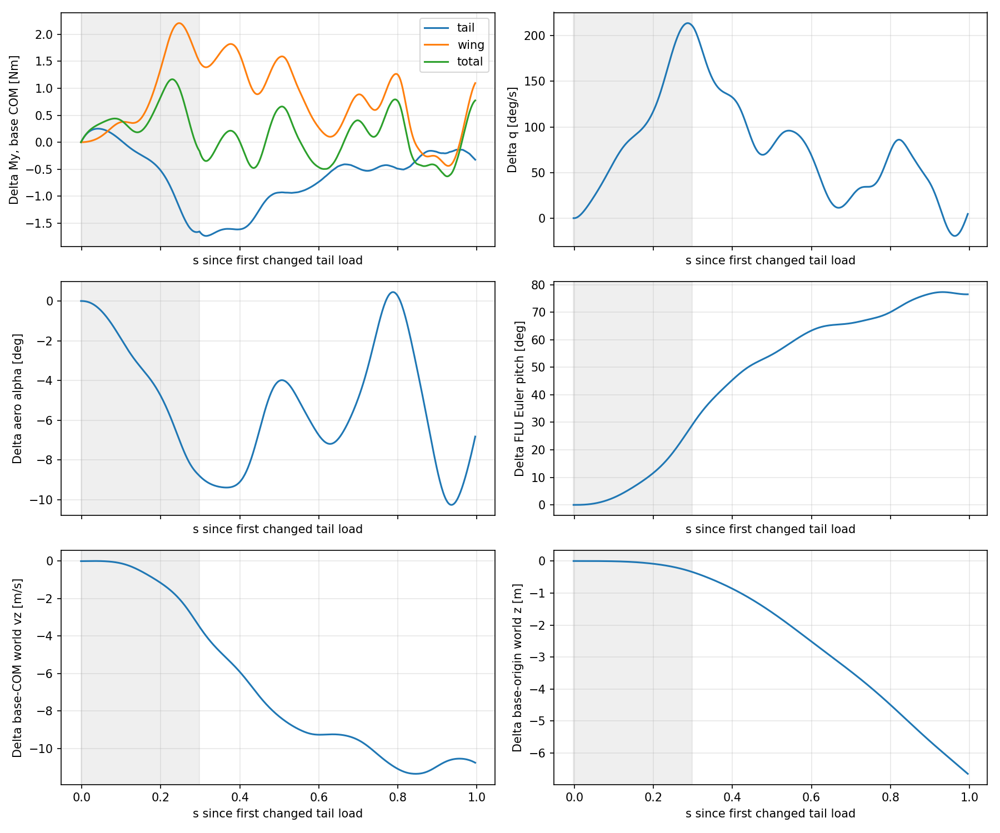
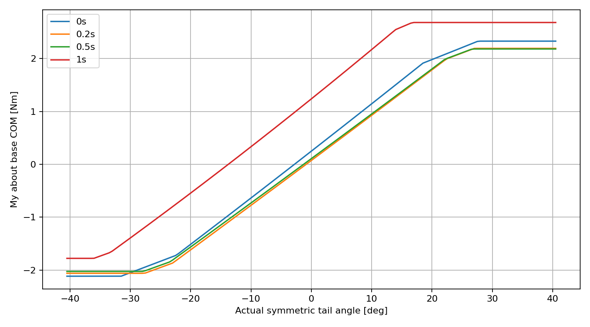
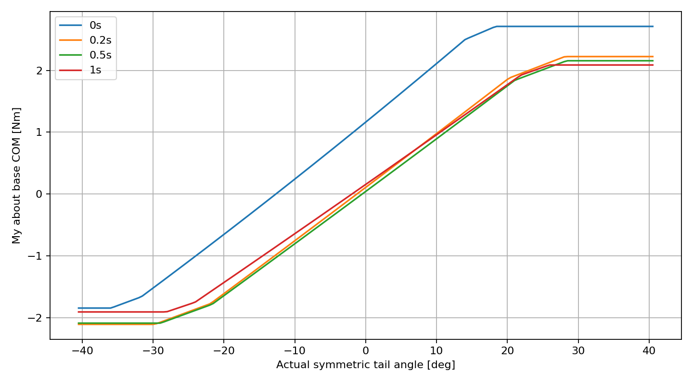

# 扑翼 PhysX 尾翼控制力矩归因诊断

## 结论与 Q1–Q5

**Q1 / VERIFIED：0.65 N·m 是可以复现的正负舵角之间的直接力矩差，不是单组绝对力矩，也不是两条自由轨迹持续存在的差。** T120 在命令后 0.10 s，固定 O 状态、代入 S± 的实际左右尾舵角，得到 My+=1.98929、My−=1.33974 N·m，差 +0.64955 N·m。该时刻 O 空速 10.042 m/s，实际对称角分别 8.9818° / 2.1645°，局部增益 5.4592 N·m/rad（0.09528 N·m/deg）。T144 相同时刻同状态差为 +0.57414 N·m。起点 O 状态施加完整 ±4.070865° 增量的只读查询，差为 +0.72400 / +0.77299 N·m。

**Q2 / SUPPORTED：主翼状态反馈增强初始低头趋势，尾翼自身状态反馈随后主要抵消它。** 两起点主翼差超过 0.01 N·m 并连续三步的时间为实际尾翼载荷起效后 0.01250 / 0.01667 s。主翼差的 1 s 有符号冲量为 +0.85015 / +0.79042 N·m·s，尾翼为 −0.68949 / −0.65695 N·m·s。主翼并非全时同号：例如 T120 末端转为负。无法仅凭这些轨迹拆出主翼迎角、机体角速度、飞行速度和翼运动各自的独立因果比例。

**Q3 / SUPPORTED 与 UNRESOLVED：0.65 N·m 量级并非由几何/动压直接排除；真实气动准确性未确定。** 当前几何下 10 m/s、零角速度、小角度 ±4.070865° 查询给出 0.74065 N·m，来自合计 0.04078 m² 的活动尾面、约 0.42429 m 的纵向力臂和 4.91811 rad⁻¹ 的有效升力斜率。不能设定一个任意“最大合理力矩”。但当前工作域已经出现活动尾面 |CL|=1.14–2.14；这与相近低雷诺数平板文献呈现的失速水平存在明显可信性疑点，且缺少实机尾翼极曲线，不能将文献数值当成本机硬上限。

**Q4 / SUPPORTED：直接舵效启动俯仰，主翼状态反馈维持/放大低头响应，尾翼反馈强烈恢复；多体运动叠加明显拍周期项。** 不是“尾翼持续过大正力矩”这一个机制。六条整机角动量平衡误差 0.52%–1.49%，未发现载荷重复施加或量级错误的惯量；惯量实测精度仍未确定。最终垂向位置差不能按机体系 My 冲量的比例严格分摊。

**Q5 / 建议：优先重新确定工作域内 CL(α,δ) 和固定/活动尾面的组合舵效，再决定是否调小斜率或效能；不要先用统一缩放压低响应。** 尤其要处理 ±25° 以内已出现的高 CL；本次并未触发截断，因此简单把“平台不光滑”视作原因不成立。本轮不修改任何生产物理或参数，不训练 PPO。

## 实验来源、执行和时间定义

基于原工作树 `/home/zn/IsaacLab/.worktrees/unified-tail-authority-v1`，原 HEAD `7a09f441`，独立分支 `research/tail-moment-attribution-v1`。参考分支 `feat/unified-trajectory-ppo-v1` 当前 `5406ab6c`；尾翼和环境文件相同，历史实验工作树保有主翼 I3D 计算复用优化，本实验实际后端仍为原 L3D。原报告 `docs/unified_sustained_tail_authority_zh.md`，原始 14 条数据 `logs/unified_sustained_tail_authority_v1/`。

只重放 T120/T144 的 O、S+、S− 六条，每条独立进程，原五环境、seed=0、reset、冻结历史动作、主翼后端、相位、频率调节、风和场景设置完全沿用。G150 checkpoint 仅用于原合同校验；无 Actor/optimizer 调用。命令脉冲持续 18 控制步（0.30 s），归一化增量 ±0.10，映射 ±4.070865°。不是把舵面直接写到目标角，也不是固定配平动作；原历史基础动作随时间变化。

480 Hz、dt=1/480 s，60 Hz 控制。observer 在原 `_apply_action()` 完成后、PhysX 积分前记录当前状态和本步将施加的载荷；同状态查询结果只写文件，绝不施加。**六条完整 60 Hz trace（含全部五环境）与历史逐值相等；六条 480 Hz 扰动前公共前缀逐值相等。** `checks.json` 为实际检查结果。

命令进入执行器时刻记作 τ=0；第一物理步的气动仍使用旧关节位置，首次不同的尾翼气动力在 τ=1/480 s。以下 A 时间曲线及采样表采用 **t=τ−1/480 s**，即实际载荷起效时刻。B 表保留 τ，便于查原始历史。原协议只到 τ=1 s，因此最末载荷为 t=0.995833 s、最终运动状态为 t=0.997917 s，均清楚标记为“约 1 s”，没有把末步外推成精确 t=1 s。

## 坐标、参考点及生产施加载荷

全部载荷分量使用机体 FLU（x 前、y 左、z 上）；正 My、q、Euler pitch 表示低头。气动机体迎角定义 α=−atan2(Vair,z,Vair,x)，不是 Euler pitch；五面自身局部迎角另存 `surface_alpha_raw_rad`。世界 z 为上。为对应历史 6.7–6.8 m 结果，主表位置为 base link 原点、速度为机身 COM（Isaac Lab root_state 的原定义），二者不是同一点，不用 dz/dt 检查这个混合量。`vertical_reference.csv` 另提供同一机身 COM 的 Δz/Δvz，整机 COM 则在 derived NPZ 中。所有垂向分量均采用世界系，而非随分支旋转的路径坐标。

生产尾翼使用实际关节偏角、机身 COM 速度及 `ω×r`，以固定气动中心计算五面的 `r×F`；无内禀俯仰力偶。尾翼偏转改变弦向，当前模型不移动气动中心，也不加入尾舵自身角速度造成的局部流速；后者是模型简化，不是本次已证实的主因。总尾翼力/力矩及机身阻力在 base COM 施加。虚拟俯仰/滚转增益和阻尼均为零。

主翼使用实际 wing link 位姿/速度、扑动相位和生产加速度输入计算各翼 section 载荷；先求关于 base COM 的世界力矩，再减去 `(wing_COM−base_COM)×F` 转到 wing COM，旋转到 wing link 局部施加。native 路径一次提交 base、left wing、right wing 三行外载荷；没有再把主翼总力矩施加到 base。`wing_link_aero_load_mode=full_wing_link_wrench`。

本报告 A 的总气动矩=尾翼+主翼+机身阻力，均关于 **机身 COM**。逐翼局部 wrench 重建后的最大闭合误差 1.36e−6 N·m；五面和尾翼缓存完全相等。D 单独把整套外载荷移到 **整机 COM** 并转世界系计算角动量。A 的正负差是各自机体 FLU 分量之差；姿态分离后它不是同一惯性方向上的两个向量相减，不能拿它直接当世界角动量冲量。

## A：实际自由飞行力矩归因

### A1–A2：规定采样时刻

下表全部为 S+ 减 S−；角度/角速度已换成 deg / deg/s。α 是气动迎角，θ 是低头为正的 Euler pitch。末行用最后已有载荷时间，不伪造 t=1 s 样本。

|起点|请求 t s|实际 t s|ΔMy尾 N·m|ΔMy翼 N·m|ΔMy总 N·m|Δq °/s|Δα °|Δθ °|Δvz m/s|Δz m|
|---|---|---|---|---|---|---|---|---|---|---|
|120|0.05|0.05|0.2703|0.18334|0.45357|25.312|-0.49889|0.48393|0.0025904|-0.00082588|
|120|0.1|0.1|-0.0075916|0.34178|0.33397|70.994|-1.8948|2.9671|-0.18799|-0.010157|
|120|0.2|0.2|-0.69918|1.0187|0.31973|130.05|-5.7375|12.936|-1.2062|-0.095701|
|120|0.5|0.5|-1.1544|1.2284|0.075086|78.419|-6.7904|55.389|-7.9151|-1.601|
|120|1|0.99583|-0.22779|-0.30214|-0.52684|46.118|-9.3909|81.543|-11.695|-6.8124|
|144|0.05|0.05|0.24374|0.11465|0.35834|23.861|-0.51059|0.49553|0.0020491|-0.00090218|
|144|0.1|0.1|0.027132|0.37409|0.40121|61.701|-1.9233|2.644|-0.12009|-0.008009|
|144|0.2|0.2|-0.52879|1.3735|0.84458|117.42|-4.7837|11.614|-1.1667|-0.086489|
|144|0.5|0.5|-0.9325|1.5735|0.64188|78.197|-4.0151|54.572|-8.2946|-1.6042|
|144|1|0.99583|-0.32525|1.0966|0.77477|4.6499|-6.8196|76.479|-10.757|-6.6471|


原协议精确末端 τ=1 s 的运动差（对应 t=0.997917 s）：

|起点|Δz m|Δvz m/s|Δq rad/s|
|---|---|---|---|
|120|-6.8369|-11.666|0.77263|
|144|-6.6696|-10.782|0.12608|


描述性起效阈值：连续 3 个物理样本超过绝对阈值；不是统计显著性检验或时间延迟辨识。q 阈值 0.01 rad/s 在两起点 t=0.00625 s 达到；主翼 0.01 N·m 在 0.01250/0.01667 s 达到；迎角 0.1° 在 0.02500/0.02292 s 达到。阈值不同，不能由这一顺序证明唯一“q→主翼”中介；它支持主翼差并非只在大姿态分离后才出现。相位/频率沿用原历史，各组相同；wing link 实际运动和全关节速度保存在 NPZ。

在命令后 τ=0.10 s，T120 实际尾翼总矩差仅 +0.00607 N·m；到 τ=0.20 s 为 −0.68462 N·m，主翼为 +1.03377 N·m。初期正舵效触发低头后，尾翼的局部相对气流反馈转为恢复方向，而主翼主要继续推动低头。两种后端没有互换，本报告不外推为 I3D 的证据。

### A3：1 s 原始窗口积分

矩形积分按每一步实际施加的载荷乘 dt，区间 τ∈[0,1)，包含起始零差一步。`正积分` 与 `负积分` 保留符号；绝对积分为 ∫|ΔMy|dt。

|起点|部件|有符号 N·m·s|绝对 N·m·s|正积分|负积分|峰值绝对 N·m|
|---|---|---|---|---|---|---|
|120|tail|-0.68949|0.7254|0.017952|-0.70745|2.2595|
|120|wing|0.85015|0.88758|0.86886|-0.018713|2.6881|
|120|body|0.001031|0.0011743|0.0011027|-7.1631e-05|0.0030853|
|120|total|0.16169|0.40374|0.28272|-0.12103|1.1717|
|144|tail|-0.65695|0.69225|0.017649|-0.6746|1.7392|
|144|wing|0.79042|0.85216|0.82129|-0.030872|2.2086|
|144|body|0.0010071|0.0011919|0.0010995|-9.2413e-05|0.0034274|
|144|total|0.13448|0.38402|0.25925|-0.12477|1.1675|


主翼的有符号及绝对差冲量均比尾翼大，两个有符号积分方向相反。机身项约 +0.001 N·m·s，远小于两者。总有符号差约 +0.162/+0.134 N·m·s，是大幅相抵后的余量；局部正负反转不能用一个绝对贡献百分数替代。以上仅是机体系气动冲量诊断，**不是最终位置差、俯仰角或角动量变化的严格贡献比例**。





## B：同状态直接舵效与状态反馈

直接调用当前实例有效配置的 `TailAeroModel.compute_surface_results`；空速标量之外，完整三分量速度、角速度、COM 和所有非尾舵参数均固定。尾翼模型不接收主翼相位，未引入主翼尾流。δS=(δL+δR)/2；查询保留差动量和方向舵。零增量是原 O 状态的实际舵角，不是假设零度配平。`gain` 用 ±1e−4 rad 对称扰动中心差分，单位 N·m/rad。

|起点|τ s|O 空速 m/s|O δS °|S+ δS °|S− δS °|O My|同态 + My|同态 − My|直接差 N·m|局部增益|
|---|---|---|---|---|---|---|---|---|---|---|
|120|0|9.8898|-1.8879|-1.8879|-1.8879|0.081218|0.081218|0.081218|0|5.0951|
|120|0.1|10.042|5.5732|8.9818|2.1645|1.663|1.9893|1.3397|0.64955|5.4592|
|120|0.2|9.7275|-0.48435|3.4788|-4.4475|0.031708|0.36946|-0.3051|0.67457|4.8762|
|120|0.3|9.8471|-1.9582|2.0952|-6.0116|0.0010261|0.35822|-0.35476|0.71298|5.0392|
|144|0|10.021|5.4537|5.4537|5.4537|1.6767|1.6767|1.6767|0|5.4398|
|144|0.1|9.6884|-0.08045|3.3282|-3.4891|0.10117|0.38862|-0.18552|0.57414|4.8254|
|144|0.2|9.7873|-2.0783|1.8849|-6.0414|-0.07331|0.27035|-0.41582|0.68617|4.9601|
|144|0.3|9.9838|5.286|9.3394|1.2327|1.692|2.0762|1.3122|0.76407|5.4002|


固定水平面与两个活动面的逐项 My 见 `same_state.csv` 的 fixed/left/right 列；例如 T120 τ=0.10 s 的 O 值为 0.34207 / 0.54470 / 0.77802 N·m，合计之外的微小差来自两个垂直面。固定水平面在同状态换舵时不改变载荷，而在自由轨迹上可产生很大反馈差。

进一步在 S± 各自状态互换正负实际舵角，采用对称分解：

- 直接项=½[(M(x+,δ+)−M(x+,δ−))+(M(x−,δ+)−M(x−,δ−))]。
- 状态项=½[(M(x+,δ+)−M(x−,δ+))+(M(x+,δ−)−M(x−,δ−))]。

两项精确相加等于观察到的尾翼差；这是两个查询路径的平均分解，不是唯一因果分解。T120 τ=0.10 s 为 +0.65091−0.64485=+0.00607 N·m；τ=0.20 s 为 +0.68237−1.36699=−0.68462 N·m。T144 τ=0.20 s 为 +0.69212−1.20187=−0.50974 N·m。τ=0.50 s 撤舵后直接项只剩约 0.0185 N·m，尾翼差几乎全部为状态反馈。完整表见 `state_swap.csv`。





扫描横轴是实际对称角而非动作值，保留 O 的差动角；靠近 ±40.5° 的数学查询可能使其中一个舵面超出软限，不能当作可执行控制命令。固定状态下，截断前 CL 对角度线性、诱导阻力随 CL² 增长；一个面先截断后增益降低，两个面均截断后总矩平台。没有无限线性增长，但以 ±25° 才封顶使活动面允许 CL≈±2.146。**六条自由轨迹的五面截断比例全为零**；所以平台不是此次强响应的实际触发机制。

## C：物理量级、参数及可信性

真实几何按现有模型保持不变。下表 r 为气动中心减实际机身 COM，m；有效斜率包含运行时效能系数。

|面|面积 m²|rx m|ry m|rz m|AR|原斜率 rad⁻¹|效能|有效斜率|CD0|k|25° CL|25° CD|
|---|---|---|---|---|---|---|---|---|---|---|---|---|
|fixed_horizontal|0.0539|-0.32002|0.00625|-0.01835|6.679|4.6463|0.5|2.3232|0.02|0.056068|1.0137|0.077612|
|left_elevon|0.02039|-0.42429|0.15625|-0.01835|4.4139|4.0984|1.2|4.9181|0.02|0.084841|2.1459|0.4107|
|right_elevon|0.02039|-0.42429|-0.14375|-0.01835|4.4139|4.0984|1.2|4.9181|0.02|0.084841|2.1459|0.4107|
|fixed_vertical|0.01265|-0.30538|0.00625|0.046034|2.2846|3.0001|1|3.0001|0.02|0.17416|1.3091|0.31845|
|rudder|0.01014|-0.38996|0.00625|0.080932|2.85|3.3471|1|3.3471|0.02|0.13961|1.4605|0.31778|


ρ=1.225 kg/m³，q_scale=1，固定水平安装角偏置=0°，所有迎角截断=25°。固定/活动面积合计 0.09468 m²，翼展 0.6 m；各活动面均弦长约 0.06797 m。

零角速度、零来流迎角/侧滑、实际 COM、±4.070865° 的准定常只读查询：

|V m/s|q Pa|正负 ΔFz N|正负 ΔMy N·m|dMy/dδ N·m/rad|等效 CLδ rad⁻¹|活动面 Re|
|---|---|---|---|---|---|---|
|6|22.05|0.62842|0.26663|1.8764|4.9181|27187|
|8|39.2|1.1172|0.47402|3.3358|4.9181|36249|
|10|61.25|1.7456|0.74065|5.2122|4.9181|45311|


实际自由轨迹的活动尾面局部投影动压和尾翼绝对总矩范围如下。q 包含 ω×r，因此不能用机身空速动压代替；正负组已经分离，极值也不必发生在同一时刻。

|起点|组|局部 q 最小 Pa|局部 q 最大 Pa|绝对 My 最小 N·m|绝对 My 最大 N·m|
|---|---|---|---|---|---|
|120|O|55.257|65.002|-0.41676|1.788|
|120|S+|58.741|96.547|-0.9069|1.8624|
|120|S-|34.484|67.652|-0.29134|2.8947|
|144|O|53.674|63.854|-0.42608|1.7342|
|144|S+|56.661|90.247|-1.1136|1.6767|
|144|S-|28.792|69.254|-0.29973|2.6399|


等效 CLδ 定义 ΔMy/[q·(2S_e)·|rx|·Δδ]，Δδ=8.14173°，此工况为 4.91811 rad⁻¹。若用整个水平尾翼面积 S=0.09468 m²、c=S/0.6=0.1578 m 定义 Cmδ=(dMy/dδ)/(qSc)，得到约 5.70 rad⁻¹；它是无量纲矩系数导数，和 CLδ 的参考量不同，不能直接互比。反推 10 m/s 下 0.65 N·m 成对差需要 CLδ≈4.316 rad⁻¹，8 m/s 下约 6.744 rad⁻¹；因此必须附带空速，不能脱离动压评判 0.65。

原斜率公式 a=a0/[1+a0/(πeAR)]，a0=2π，水平 e=0.85、垂直 e=0.8；CD=0.02+CL²/(πeAR)。[NASA 诱导阻力说明](https://www1.grc.nasa.gov/beginners-guide-to-aeronautics/induced-drag-coefficient/)支持这个有限翼诱导阻力形式，但不验证本机 e 或高迎角极曲线。效能 1.2 把活动面斜率从 4.0984 提至 4.9181，高于按单个活动面 AR 求得的原值；固定面系数 0.5 则把斜率减半。它们来自现有仿真兼容配置/历史调整接口，不是本轮找到的实机风洞标定值。

[Ananda、Sukumar、Selig（2015），Measured aerodynamic characteristics of wings at low Reynolds numbers](https://m-selig.ae.illinois.edu/pubs/AnandaSukumarSelig-2015-AeroSciTech-LowReWings.pdf)测试 AR=2–5、Re=60,000–160,000 的平板尾翼类有限翼。其斜率随 Re/AR 变化，失速判据对应 CL 约 0.55–0.7，示例平板约 10° 已失速，且气动中心/俯仰矩会改变。本机活动面在 6–10 m/s 的参考 Re 约 27,000–45,000（ν假设 1.5e−5 m²/s），低于该资料范围；轮廓、铰链和固定/活动面连续性也不同。因此文献是**高 CL 线性延伸可疑的依据，不是本机 CLmax=0.7 的证据**。

实测轨迹中的有效活动面 CL：T120 O 峰值 1.141/1.524，S− 峰值 1.692/2.142，后者局部迎角最高 24.956°；T144 S− 为 1.685/1.829。即使完全不触碰 25° 截断，当前线性规律已经进入缺乏附着流依据的工作域。小扰动零迎角时每个活动面 |CL|≈0.349、10 m/s 每面正负升力差≈0.873 N，量级本身可以解释；不能把这个可信的小角度估算推广到历史 O/S 的所有相位。

### 参数来源与后续优先级

|参数/机制|现有值与来源|物理含义及后续建议|
|---|---|---|
|几何、面积、气动中心|五面实际几何；`tail_aero.py` polygon/URDF 铰链定义|用户确认几何正确，保持；高迎角压力中心迁移尚未建模，不以重设计几何解决|
|a0、e、有限翼斜率|2π；0.85/0.8；公式见上|工程附着流先验；优先用适用 Re 的完整尾翼/舵面曲线确定有效斜率|
|elevon_effectiveness|1.2，`straight_flight_env.py` 运行时覆盖|直接缩放活动面升力斜率，同时经 CL² 影响阻力；不是独立测得的铰链舵效，优先重新确定|
|fixed_horizontal_effectiveness|0.5，同上|决定固定面稳定/阻尼反馈；与活动面组合标定，不能只压活动面而忽略稳定性变化|
|线性 CL 与 ±25° 截断|CL=aα 后 clamp α，生产模型|**最高优先级：** 本次未触发 clamp，却已预测高 CL；用有依据的平滑有限翼失速/后失速规律覆盖实际工作域|
|CD0 与 k|0.02；1/(πeAR)|小迎角阻力/诱导阻力先验；随 CL 规律一起核定，不能只改升力而保留失配阻力|
|q_scale、ρ、安装偏置|1、1.225、0°|当前无异常证据；不加人为 q 缩放，不引入主翼尾流|
|固定/活动面相互关系|五面独立求解，固定面无直接 δ 依赖|后缘舵实际会改变相邻固定部分压力分布；优先确认总升力/力矩对 δ 的组合导数，避免把各分块当独立完整翼的假设当真值|
|质量惯量|实测输入+PhysX 实际值，见 D|本次未支持先改惯量来缓和响应；记录实际与输入差异，不自动修正|

若单独把 1.2 改成 1.0，小角度直接舵效理论上下降 16.7%；这只是参数敏感度，不是推荐标定值。当前证据不能确定“应减多少”。需要的最小后续依据是现有几何、对应 Re/α/δ 工作域下的尾翼整体极曲线/力矩数据，而非大规模架构重构或以 1 s 位移为目标调参。

## D：实际惯量、动力学耦合与数值核查

PhysX 读取总质量 0.904150004 kg，和背景约 0.95 kg 不同。机身实际质量 0.782310009 kg，两翼各 0.060769998 kg，左右活动尾翼及方向舵各 0.0001 kg 数值占位质量；非翼硬件质量已包含在机身测量，不可再把完整尾翼质量叠加。固定尾面属机身集合。

机身实际 COM=(-0.13103,−0.00625,+0.01500) m（base FLU），实际对角惯量约 (0.00308333,0.02305667,0.01997333) kg·m²。源测量输入为 (0.00298,0.02316,0.01987)，存在 −0.00031 kg·m² 的三角不等式余量；**PhysX 返回值与源输入不同**，本次以返回值计算，不以测量表代替。变化约为 (+0.00010333,−0.00010333,+0.00010333)，符合物理可实现性修正的量级；具体内部修正算法未独立证明。每翼实际对角为 (0.00270,0.00101,0.00371)，翼 COM 分别 (−0.06040,±0.29394,0) m，各在自己的 link 坐标。

关于当前整机 COM、在机体坐标的瞬时锁定惯量 Iyy=0.025669–0.029892 kg·m²。整机 COM 相对机身 COM 的 x≈+0.009352 m、y≈+0.000843 m、z 随相位约 −0.022076 至 +0.016717 m；这说明机身 COM 与整机 COM 不是同一点。完整 3×3 tensor、世界 COM、逐 link 运动及质量参数已保存。

代码质量分配函数把主 link 的 COM 四元数写作 (1,0,0,0)，其文档称 wxyz，而 PhysX 原始接口使用 xyzw；当前主 link 对角惯量在绕 x 轴 180° 下不变，因此该约定问题**不能解释本次强俯仰**。报告转换原始 PhysX COM frame 后计算惯量，不把此潜在接口歧义自动改入生产。

整机角动量按 H_G=Σ[R_i I_i R_iᵀ ω_i+(r_i−G)×m_i(v_i−v_G)] 求和。重力关于整机 COM 的总矩为零；内关节反力在整机角动量中抵消。用世界系外气动矩关于 G 的逐步冲量对照 H_G 变化，窗口 τ=0 至最后已有状态 τ=0.997917 s，未把缺少下一状态的最后一步混入闭合积分。

进一步定义 H_G^B=I_lock^B ω_body+H_rel^B，得

M_G^B = I_lock·dω/dt + (dI_lock/dt)ω + ω×(I_lockω) + dH_rel/dt + ω×H_rel。

H_rel 由所有 link 相对机体运动计算，包含扑翼及数值占位尾舵运动；它不是单独观测的驱动马达力矩。下表为 y 分量各项 RMS（N·m）；`balance_residual` 是离散导数/积分及未建模数值误差的余量，不能称作未知气动力。

|起点|组|世界冲量误差 %|I·ωdot|Idot·ω|陀螺项|相对运动项|方程余量|
|---|---|---|---|---|---|---|---|
|120|O|0.93398|0.79659|0.074397|0.0013429|0.3382|0.024006|
|120|S+|1.4437|0.72247|0.072515|0.0026696|0.33761|0.021303|
|120|S-|1.4867|0.87836|0.0985|0.00075418|0.33866|0.026773|
|144|O|0.52282|0.80428|0.069695|0.0022016|0.33165|0.02213|
|144|S+|1.1078|0.72278|0.066984|0.0039786|0.33108|0.019459|
|144|S-|1.014|0.89049|0.095463|0.0014948|0.33211|0.025201|


相对运动项 RMS≈0.331–0.339 N·m、时变惯量项≈0.067–0.098 N·m，不能忽略。简单 M_G,y/Iyy 与实际 dq/dt 的 RMS 差为 10.58–10.81 rad/s²；这验证了单刚体直接相除不适用，却不说明多体项是最终差动位移的首要原因。实际各轨迹 |dq/dt| 峰值约 45.7–61.2 rad/s²；各轴角加速度可由 NPZ 的 omega 派生。中心二阶差分、端点单侧二阶差分，未平滑；拍周期和数值积分误差会进入导数，角加速度不是独立传感真值。方程 y 余量 RMS≈0.019–0.027 N·m；不强行用这个近似平衡识别精确 PhysX constraint multiplier。

无翼拍惯性额外外矩被人为重复加入，native 机制通过多体约束反作用传递惯性；`applied_torque` 只记录可见关节驱动量，不等于 native constraint multiplier。运行时 `native_holonomic_load_diagnostics=false`，未为本轮改变开关；精确约束乘子与纯翼拍惯性反作用的独立测量仍未确定。

## 验证、数据与复现

1. 六条历史完整 trace 完全一致；共同前缀 480 Hz 数组完全一致，所有数组有限。
2. 五面力矩重建尾翼缓存误差 0；逐翼 COM/坐标变换闭合最大 1.36e−6 N·m。
3. 整机线动量冲量检查最大向量误差约 3.74e−5 N·s；频率和相位逐物理步在各组完全相等；r×F、分面合力、冲量重算及互换分解通过，见 `focused_checks.json`。
4. 同状态查询均离线执行；生产参数、生产公式、执行器、奖励、采样器、PPO checkpoint 未改。
5. 原始 `T*_physics.npz` 六份随本报告保存，包含全前缀逐步状态/载荷；`T*_derived.npz` 为整机 COM、惯量、角动量及分解。CSV 包括逐步差、规定时间点、冲量、同状态查询、舵角扫描和速度量级。
6. 大的原始五环境 trace、独立进程日志和合同保留于 `logs/tail_moment_attribution_v1/`；原 14 条目录不覆盖。启动日志出现文件监听器 errno=28，但磁盘剩余约 245 GB，六条运行与逐值检查全部完成；无物理运行失败。

复现必须使用不存在的新目录：

```bash
cd /home/zn/IsaacLab/.worktrees/unified-tail-authority-v1
bash scripts/flapping_px4/reproduce_tail_moments.sh logs/tail_moment_attribution_reproduction
source /home/zn/anaconda3/etc/profile.d/conda.sh
conda activate env_isaaclab
export TERM=xterm
export PYTHONPATH="$PWD/source/flapping_bot:$PWD/source/isaaclab:${PYTHONPATH:-}"
./isaaclab.sh -p scripts/flapping_px4/analyze_tail_moments.py --input logs/tail_moment_attribution_reproduction --output docs/results/tail_moment_attribution_reproduction
./isaaclab.sh -p scripts/flapping_px4/check_tail_moments.py --input docs/results/tail_moment_attribution_reproduction
./isaaclab.sh -p scripts/flapping_px4/report_tail_moments.py --input docs/results/tail_moment_attribution_reproduction
```

分析器默认对照原 14 条本地 trace；需要保留这些历史文件。`isaaclab.sh` 可能掩盖子进程退出码，因此检查实际 summary、CSV、checks 和 report，而不是只检查 wrapper 返回值。分支提交完成后的 SHA 由最终交付消息及 `git rev-parse HEAD` 给出，避免在提交内自引用 SHA。

本轮停止在诊断和建议，不自动实施尾翼模型调整，也不声称本轮证明了真实飞机的气动参数。
