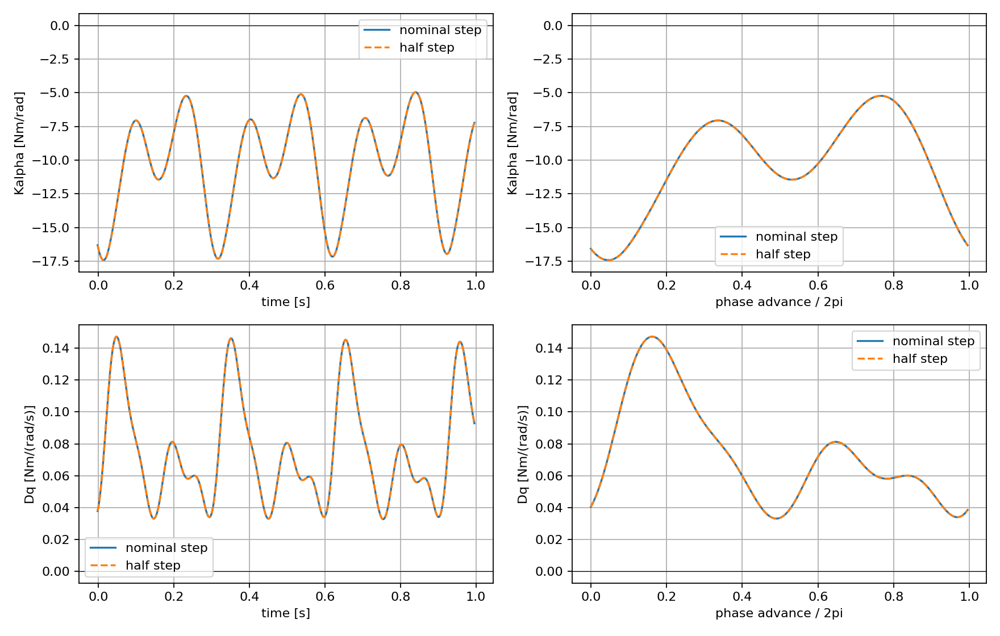
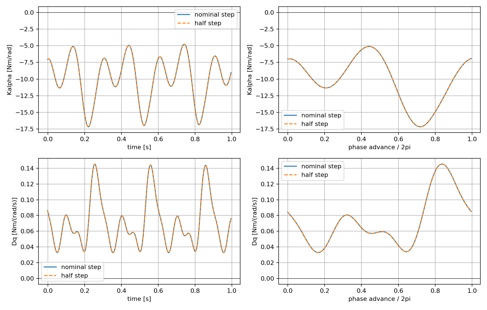
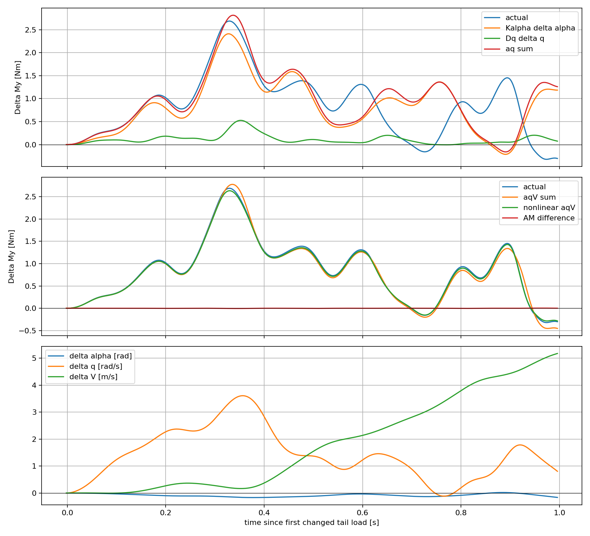
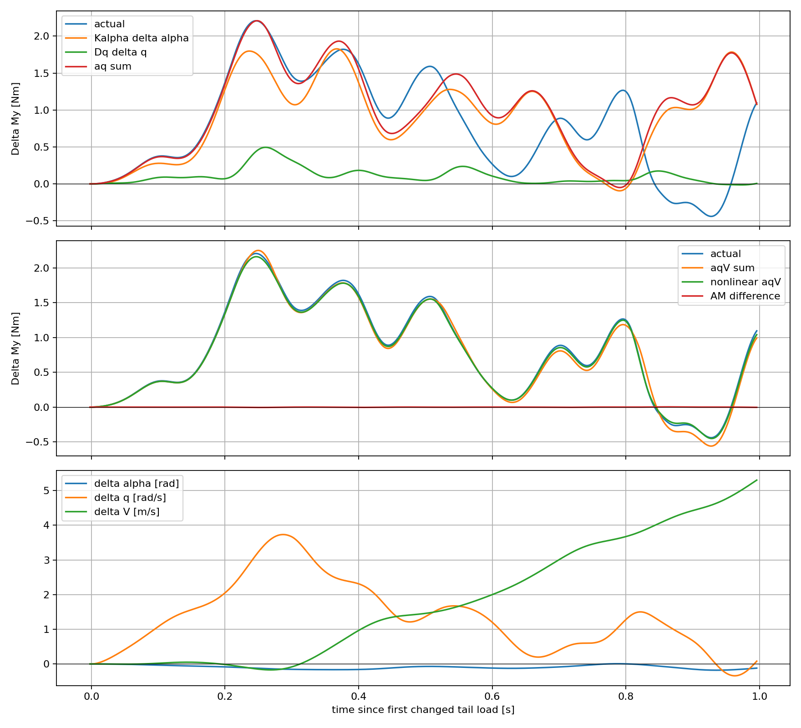

# L-3D 主翼俯仰气动反馈机制诊断

## 结论：Q1–Q5

**Q1 / VERIFIED（当前模型）：主翼迎角反馈为局部静不稳定方向。** T120/T144 从尾翼实际起效开始的一个完整翼拍内，Kα 时间均值为 **−10.349/−10.187 N·m/rad**；原生状态范围为 **[−17.418,−5.230]/[−17.163,−5.118] N·m/rad**，负号占比均为 **100%**。正 α 是机头相对来流上仰，正 My 是低头；因而此负导数意味着增加迎角会产生更大的抬头矩。两个起点均值仅差约 1.6%，同一时刻的差异主要需结合翼拍相位理解，不能把不同相位的单点值当成两种稳定性工况。

**Q2 / VERIFIED（当前模型）：主翼 q 反馈为局部反阻尼方向。** 对应 Dq 时间均值为 **+0.07357/+0.07287 N·m/(rad/s)**；范围 **[+0.03309,+0.14732]/[+0.03295,+0.14529]**，正号占比均为 **100%**。它不是只在少数相位反阻尼；整个所选周期内都未出现负 Dq。这里固定了翼相对运动，未人为增加机体角加速度或附加质量。

**Q3 / SUPPORTED：早期主要是迎角项，q 项同向增强，二者并不相互抵消。** S+ 相对 S− 低头加速后出现 Δα<0、Δq>0；负 Kα 乘负 Δα 和正 Dq 乘正 Δq 都给出正 My。在 0.1–0.2 s，实际主翼差均值为 **0.7527/0.5968 N·m**，迎角项 **0.6498/0.4936**，q 项 **0.0997/0.0870**，两项合计 **0.7495/0.5806**。两项预测与实际逐点同号率均为 100%，RMSE **0.0144/0.0173 N·m**，约为实际 RMS 的 **1.8%/2.6%**。迎角项约占实际均值 86%/83%，q 项约 13%/15%；这些是局部一阶模型的描述性比例，不是自由飞行动力学的唯一因果贡献率。

**后期反转不能由这两项单独解释。** 0.5 s 后两项预测 RMSE 增至 **0.931/0.984 N·m**。补充速度导数后降至 **0.0811/0.0791 N·m**；保持 O 的几何、侧滑及相对运动，仅同时替换 α、q、V 的有限变化生产模型查询，进一步降至 **0.0217/0.0223 N·m**。这支持速度变化是后期的重要遗漏变量，有限变化的非线性也有作用；不能强行把整个 1 s 归于两个局部导数。

**Q4 / SUPPORTED 与 UNRESOLVED：存在值得核验的主翼俯仰机制，但没有证明真实飞行器不稳定。** 在当前几何和载荷位置下，主翼力作用四分之一弦点全部位于机身 COM 前方；迎角增加带来的垂向力变化主要形成抬头反馈。q 的反阻尼主要也来自垂向载荷变化；当前在四分之三弦取流、四分之一弦施加准定常载荷的组合应当作为后续模型可信性核验对象。该结果是生产 L-3D 数学模型的局部导数，不是实现错误、真实气动错误、周期轨道不稳定或闭环失稳的充分证据。没有新增气动模型、改参数或搜索配平。

**Q5 / SUPPORTED：尾翼恢复作用在当前组合模型中很重要。** 上一轮主翼差冲量 +0.850/+0.790 N·m·s 与尾翼 −0.689/−0.657 相抵；本轮揭示早期主翼确有不利迎角和 q 反馈。统一减小尾翼升力斜率会同时改变直接舵效、迎角恢复、角速度反馈及随升力变化的阻力，不能等同于只削弱初始控制脉冲。下一步尾翼调整必须同时看直接舵效和状态恢复，并核验主翼载荷位置/局部流速采样所对应的气动机制；本轮不提供经验补偿系数，也不以运动平缓作为物理正确性的标准。

## 数据、配置与时间合同

独立分支 `research/wing-pitch-feedback-v1`，从上一轮 `research/tail-moment-attribution-v1` 的 `3bce953b` 创建，工作树 `/home/zn/IsaacLab/.worktrees/wing-pitch-feedback-v1`。原工作树和历史结果保留。

输入为相邻历史结果目录中的六份 `T120/T144_{O,S+,S-}_physics.npz` 与 `parameters.json`。这些 NPZ 已提供实际 link 原点、姿态、COM、线/角速度、关节角/速度、风、相位、频率和实际气动力矩；本轮直接使用原始物理字段，无需依赖 derived 文件中的二次派生量。480 Hz，每起点取原 τ∈[0,1) 的 480 个载荷样本，分析时间 t=τ−1/480 s。包含首个 t=−1/480 s 的零差公共载荷，最后 t=0.995833 s；没有外推到精确 1 s。

生产配置保持：L3D、每翼 10 段、ρ=1.225 kg/m³、规定扭转幅值 35°、kappa=−0.5、相对运动附加质量开启、原几何 CSV/URDF、原机身 COM。完整配置见 `configuration.json`。机体 FLU；My、q 低头为正；α=−atan2(Vair,z,Vair,x)，单位 rad。所有 S+−S− 比较取各自机体坐标分量，与原报告一致，非同一世界轴的力矩冲量。

O 全分析窗口空速范围分别 9.602–10.124 / 9.535–10.036 m/s，α 为 0.925–5.728° / 0.764–6.133°，q 为 −2.188–1.651 / −2.282–1.710 rad/s。不能把这些结论推广到任意迎角、速度、翼扭转或 I3D。

### 重建时序：一项必要修正

历史 observer 在 `_apply_action()` 完成后记录相位/频率，但生产 `_compute_control_3d_wrench()` 在本步末相位更新之前计算载荷。因此气动查询应使用**上一条记录的相位/频率**；相位加速度缓存是上一物理步 governor 的值，而本步 qdd 是当前 governor 由旧相位计算的值。最初直接用本条记录相位导致约 0.33 N·m 偏差，已修正，不参与最终结果。

没有直接记录加速度，但可用生产一阶频率 governor 的解析更新反算：T=0.15/4 s，ḟ_old=(f_new−f_old)/[T(1−exp(−dt/T))]。规定共同翼加速度 A[cos(φ_old)φ̈−sin(φ_old)(2πf_old)²]，A 为 URDF 0.5233 rad 经 0.98 限位软化后的值。该重建保留生产缓存时序，**不擅自“修好”模型时序或改成身体角加速度**。float32 记录转 float64 离线查询，六条轨迹总 My 最大重建误差 **2.70×10⁻⁵ N·m**。加速度反算的舍入误差不影响这些导数：扰动两侧相对运动及附加质量完全相同，差分时该项抵消。

## 扰动与运动学检查

全部气动载荷调用生产 `LinkKinematics3D.sample()` / `ControlAero3D.evaluate()`，不重写升阻力公式。

- α：保留 |Vair|、Vair,y/|Vair|，旋转机体 xz 平面相对速度方向，再转世界系修改共同风输入。几何、姿态、实际翼运动、角速度、相位/频率、COM 不动。中心差分 ±0.5°，复核 ±0.25°。
- q：Δω_w=R_body·(0,Δq,0)，所有翼绝对角速度加 Δω_w，翼 COM 速度加 Δω_w×(COM_wing−COM_base)。机身 COM 平动速度、几何和实际相对运动固定。中心差分 ±0.05 rad/s，复核 ±0.025 rad/s。机身 q 未作为一个无效标量单独送入接口，实际改变的是生产模型使用的完整翼 twist。
- 四分之三弦流速变化必须等于 −Δω_w×(r_station−COM_base)，最大误差 **3.79×10⁻¹⁵ m/s**；相对运动全部字段差为 **0**。这里不仅翼绝对线速度改变，section 的角速度叉乘项也一致改变。
- α 扰动空速误差 ≤3.56×10⁻¹⁵ m/s，侧滑正弦误差 ≤5.56×10⁻¹⁷，实际 α 增量误差 ≤2.95×10⁻¹⁷ rad。
- 全窗口导数半步复核相对 L2 差：Kα **0.0374%/0.0346%**，Dq **0.0000233%/0.0000748%**。这是步长一致性，不是统计置信区间，近零值不采用不稳定的逐点相对误差。

定向检查还核对两个起点的 480 个原生样本、有限性、时间步、力臂分解闭合、一阶乘积、六组历史载荷重建，以及原 +0.85015/+0.79042 N·m·s 主翼差冲量。实际结果见 `checks.json`；独立结果检查脚本输出 PASS。没有新的 PhysX 自由积分、训练或宽泛回归测试。

## 相位依赖及力臂机制

选择从 t=0 的原生相位起前进 2π；周期端点由相邻原生相位线性定位，分别 t=0.303628/0.303680 s。时间平均为原生物理步零阶保持积分，末步按跨越 2π 的比例加权。CSV 保留全部原生相位及周期标记，图以该周期起点为相位零；它不是数学精确周期轨道，更不是 Floquet 分析。原生样本极值和符号占比已在 Q1/Q2 列出，两个导数在完整约 1 s 窗口也保持相同符号。





将生产 section 力的差分按同一机身坐标分解：dMy=r_z dFx−r_x dFz。AM 两侧不变，因此无差分自由力偶；此分解数值闭合到 10⁻¹⁰ 以内。

|起点|Kα 中 r_z dFx|Kα 中 −r_x dFz|Dq 中 r_z dFx|Dq 中 −r_x dFz|
|---|---:|---:|---:|---:|
|T120|−3.0814|−7.2673|+0.00374|+0.06984|
|T144|−3.0210|−7.1661|+0.00358|+0.06929|

以上为相同周期时间平均，Kα 列单位 N·m/rad，Dq 列单位 N·m/(rad/s)。约 70% 的负 Kα 来自垂向力臂项，约 95% 的正 Dq 来自该项。四分之一弦作用点相对 COM 的 x 范围 +0.0560 至 +0.1149 m，均在 COM 前方；四分之三弦取流点 x 范围 −0.0940 至 +0.0888 m，跨越 COM 前后。刚体 q 扰动在取流点的 Δflow_z=Δq·r_x，同时改变其他流分量和升阻力方向，最后在另一弦向位置形成力矩。**SUPPORTED：这种取流/作用点及实际扑翼几何组合产生了本工况的正 Dq；不能仅以“力作用点在前”推断 q 导数，也不能把反阻尼归因于凭空增加的附加质量。**

## S+/S− 力矩归因与后期反向





下表全部是原生实际时刻，力矩列单位 N·m。迎角、q 项均在 O 的对应状态求导；原始 Δα、Δq、ΔV 及所有逐点数据见 CSV。

|起点|t s|Kα|Dq|实际 ΔMy|KαΔα|DqΔq|两项和|KVΔV|
|---|---:|---:|---:|---:|---:|---:|---:|---:|
|T120|0.00000|-16.57766|0.04038|-0.00006|-0.00005|-0.00001|-0.00006|-0.00000|
|T120|0.10000|-7.05440|0.08151|0.34178|0.23330|0.10099|0.33429|0.00155|
|T120|0.20000|-7.91552|0.08050|1.01871|0.79265|0.18272|0.97536|0.01822|
|T120|0.50000|-8.30433|0.08063|1.22838|0.98418|0.11036|1.09454|0.07641|
|T120|0.99583|-7.22995|0.09288|-0.30214|1.18501|0.07476|1.25977|-1.71182|
|T144|0.00000|-7.00091|0.08428|-0.00005|-0.00002|-0.00003|-0.00005|0.00000|
|T144|0.10000|-8.30433|0.08063|0.37409|0.27876|0.08683|0.36559|0.00104|
|T144|0.20000|-15.32728|0.03434|1.37351|1.27969|0.07039|1.35007|-0.00465|
|T144|0.50000|-14.50182|0.03410|1.57351|1.01623|0.04655|1.06277|0.47087|
|T144|0.99583|-9.03691|0.07608|1.09659|1.07562|0.00617|1.08179|-0.08795|

例如 t=0.1 s，T120 Δα=−1.895°、Δq=+70.994°/s，产生 +0.2333 和 +0.1010 N·m，两项和 +0.3343，对应实际 +0.3418。T144 t=0.2 s，Δα=−4.784°、Δq=+117.42°/s，产生 +1.2797 和 +0.0704 N·m，两项和 +1.3501，对应实际 +1.3735。

两项已经解释早期主要变化，未为早期残差启动额外模型研究。速度导数是为了回答**尚未解释的后期反向**才补算：固定方向/侧滑，仅以共同风改变空速，步长 ±0.05 m/s，半步 ±0.025 m/s；相对 L2 差 ≤0.00257%。KV 全窗口范围约 −0.453 至 +0.346 N·m/(m/s)，会随相位变号。

以实际 ΔMy<−0.01 N·m 标记有明确幅度的反向区间，T120 为 0.7000–0.7458 s、0.9417–0.9958 s，T144 为 0.84375–0.95625 s。两项预测在这些反向样本中**没有一次预测负号**；加入空速项 KVΔV 后，分别有 96.0%/96.4% 预测负号（这里的“速度项”是空速 V，不是角加速度）。这些区间之外也有微小零交叉，阈值仅为描述，非统计显著性界限。主翼在早期约 0–0.5 s 持续主要增强低头；后期仍有正反馈段，不是永久翻转。

T120 末端的例子最清楚：两项 +1.2598，速度项 −1.7118，三项 −0.4521，实际 −0.3021 N·m；有限变化 α/q/V 查询为 −0.2841。两项无法解释反号，速度项可以给出方向，非线性查询改善幅值。T144 最后一刻实际仍为正，不能用 T120 末端反转概括两个起点。

### 未解释部分与翼运动

有限变化查询保留 O 翼相对几何和运动，以各分支 α/q/V 构造共同风与一致刚体 q 变化；它是受控数学查询路径，不是另一条自由飞行。0.1–0.2 s 该查询 RMSE 为 0.0169/0.0129 N·m，并不保证比相抵后的两项线性和更小；0.2–0.5 s 为 0.0333/0.0343 N·m；0.5 s 后为 0.0217/0.0223。残差包含侧滑、p/r、实际翼 link 几何/相对运动差、参考姿态耦合以及重建舍入，未把它们强行分配为唯一因果百分比。

S± 相位及频率逐值相同；实际翼关节速度并不完全相同，全窗口最大差 0.1270/0.1311 rad/s。用相同生产模型关闭 AM 的**诊断查询**（不改生产配置）分出非 AM 载荷，再从历史实际载荷减去它，得到 AM 差；0.1–0.2 s 均值仅 −0.00089/−0.00036 N·m，0.2–0.5 s 为 −0.00181/−0.00191 N·m，远小于主翼总差。该差包括上述 ≤2.70×10⁻⁵ N·m 重建误差。因此在本数据中，没有依据把强响应归因于相位分离或附加质量差；实际翼运动差可解释部分剩余误差，但不是已经证明的主要遗漏机制，无需扩大为模型辨识研究。

## 交付与复现

- `T120_derivatives.csv`、`T144_derivatives.csv`：全窗口逐物理步导数、半步复核、相位、状态差、预测与力臂分解；Kα 为 N·m/rad、Dq 为 N·m/(rad/s)、KV 为 N·m/(m/s)。
- `samples.csv`：指定时刻。`summary.json`：周期统计及分窗口误差。`checks.json`：运动学及重建检查。`configuration.json`：未修改的气动配置。
- 四张 PNG：逐时间/相位导数与实际/预测比较。
- 独立诊断、结果检查及复现脚本位于 `scripts/flapping_px4/`，名称含 `wing_pitch_feedback`。

从本研究 worktree 运行（输出目录必须尚不存在，防止覆盖）：

```bash
bash scripts/flapping_px4/reproduce_wing_pitch_feedback.sh /tmp/wing-pitch-feedback-reproduction
```

使用配置的 `env_isaaclab` 和 `./isaaclab.sh -p`。复现脚本生成数值/图表并检查结果；本中文报告是对已验证结果的人工解释。无需 Isaac Sim 启动、GPU、checkpoint 或新飞行。生产主翼、尾翼、执行器、惯量和参数文件相对父提交无改动。本地提交，不 push。
