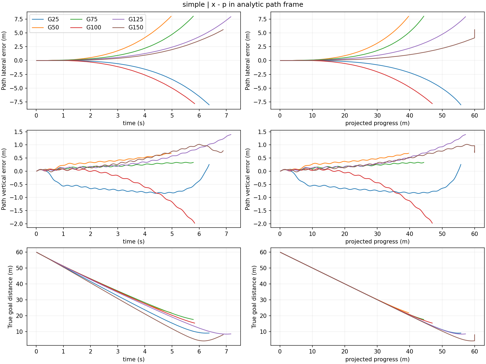
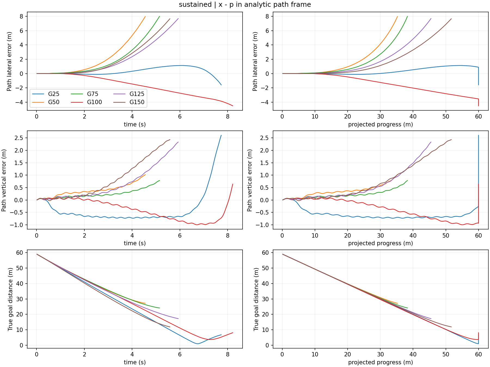
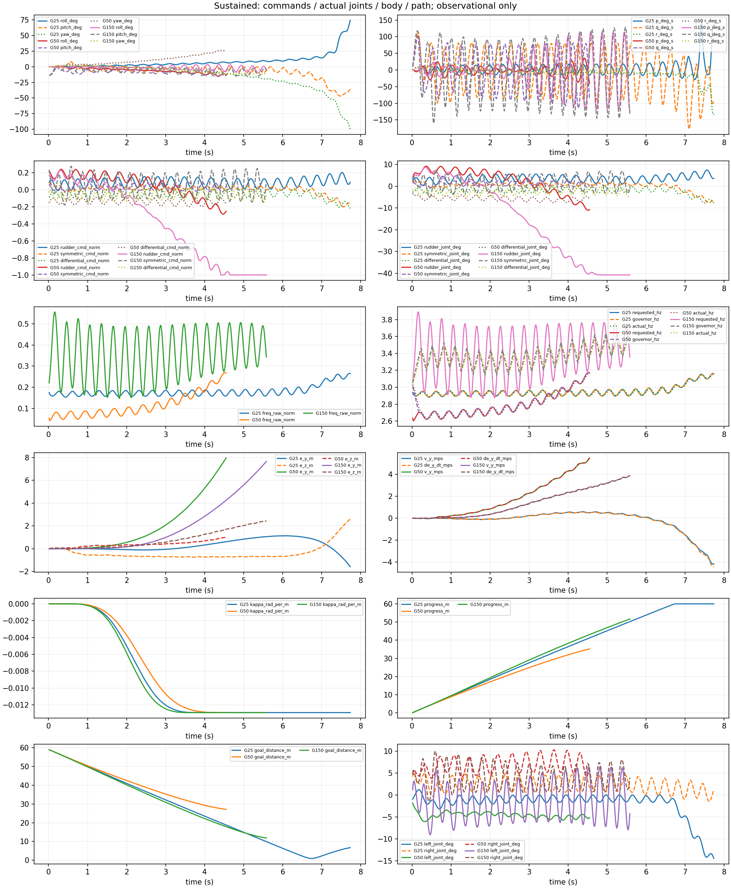
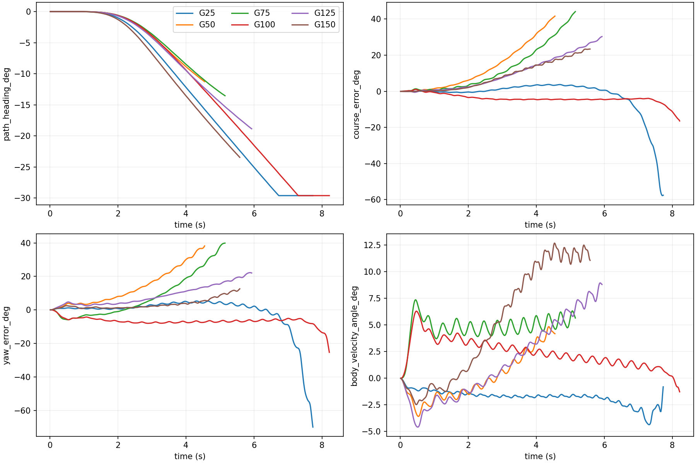
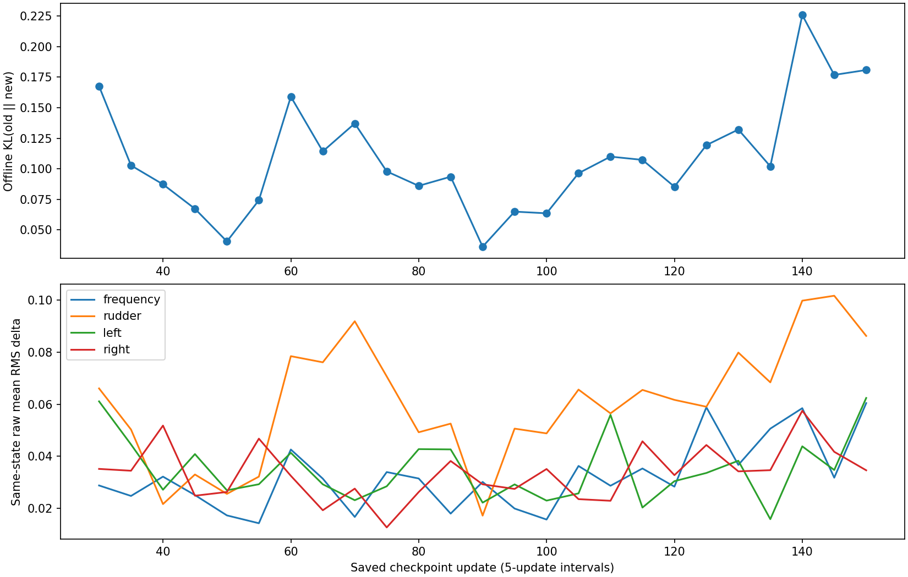
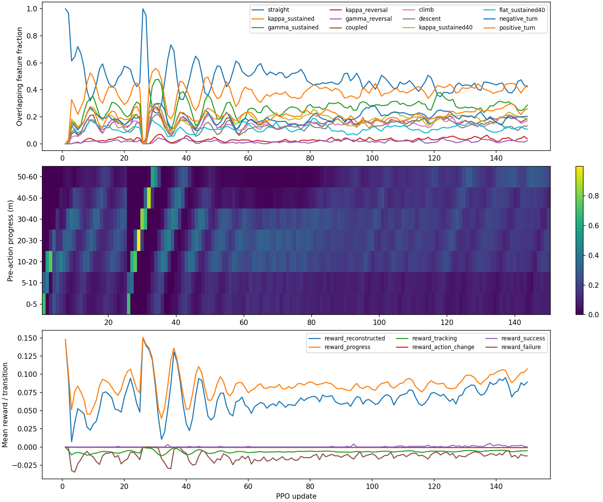

# Unified Trajectory G25–G150：只读复盘与 PPO 诊断

## 结论与证据排序

**SUPPORTED：H1 的相对证据最强——策略函数发生明显变化，伴随冻结闭环的早期横向退化及后期恢复。**
39D 输入先通过动作复现，再进行固定状态比较；物理、任务、奖励和严格终止合同一致。不能进一步认定某一次 PPO 更新、某个尾舵通道或 clip 参数导致退化，也不能把有限 loss 当作收敛。

- **H1：SUPPORTED，排序 1。** G25→G50 的同状态 Gaussian KL 均值 0.681，方向舵/左尾舵均值变化 RMS 为 0.110/0.149（归一化 raw action）。Sustained 从接近终点变成中段向错误方向运动。G50→G150 在另外四条任务上逐渐恢复，但 sustained 出现反复。每 5 更新离线 KL 为 0.036–0.226；并非所有较大漂移都会造成性能下降。
- **H3：局部 SUPPORTED，排序 2；“主要失败都在终点”被历史证据反驳。** G150 四条非 sustained 任务到达投影终点并越过终点平面；但六批共 30 条轨迹中，24 条在进度 <50 m 已首次超过 4 m 路径误差。G50 的五条、G150 sustained 都不能归为终点过冲。终点目标与持续前飞是否存在结构性不协调仍为 HYPOTHESIS。
- **H2：覆盖偏斜 VERIFIED，是否“不足以学习” UNRESOLVED，排序 3。** 持续转弯/耦合并不缺席，训练也不是大部分都止于 5–20 m。G51–75 的后段访问明显萎缩、负曲率晚段尤其稀少，可能形成学习反馈，但也可能是策略退化的结果，不能反转因果方向。
- **H4：UNRESOLVED，排序 4。** 39D 已含机体系速度、角速度、重力、路径误差、切线、三点 preview、几何参数、历史动作、频率和尾舵位置。现有数据没有同状态不可辨识性或表示干预，不能从失败断言缺状态。

只有一个 seed、固定五条 development 任务。这里识别的是模拟控制现象和候选机制，不验证气动力物理真实性。

## 数据来源与完整性

基准工作区 `/home/zn/IsaacLab/.worktrees/unified-goal-consistent-reward-v1`，实际 HEAD
`908d381b129196c387f7b673bdd064e2dffc23e5`，历史工作树干净。
实现位于独立 worktree `/home/zn/IsaacLab/.worktrees/unified-g150-diagnostics-v1`、分支 `experiment/unified-g150-diagnostics-v1`，从同一提交建立；本轮不 commit/push。

输入均经存在性检查，完整绝对路径见 [audit.json](results/unified_g150_diagnostics/audit.json)：

- G25：`logs/unified_goal_consistent_reward_v1/G/`。
- 长训：`logs/unified_longrun_l3d_G_seed0_u026_150/`。
- 先前结果：`logs/unified_longrun_l3d_G_seed0_u026_150_launcher/result_comparison.json`。本轮真实终点最小距离与其逐条一致。
- checkpoint、training/evaluations JSONL、两份训练 SQLite、六份 development SQLite、物理/任务/采样源码快照全部存在。没有通过新 rollout 补数据。

**VERIFIED：** G1–G150 恰好 150 条训练记录；每次 12,288 transitions，累计 1,843,200。
恢复源为 G25 `model_000025_final.pt`，307,200 transitions、Adam=500；终点 G150 final 为 Adam=3000、pending_evaluation=false。
39 个现有 checkpoint（含 evaluated/final）逐一验证实际策略 digest、版本、Adam step=20×update、transition 数、相同 physical/reward/terminal/初始化合同。
G25 冻结评价使用普通 `model_000025.pt`，其策略与正式恢复 final 相同；final 是完成评价后的恢复状态，不是重新初始化。
两份物理快照各 34 个源码/原生依赖指纹与 checkpoint 一致，任务和采样源码快照与训练合同一致。
G25 保存的代码 provenance 是 `a3a9a497…` 加 dirty=true（发布提交前的实验状态），长训为 `908d381b…`、dirty=false；不能把 G25 的保存时 SHA 改称 908d381b。物理/任务/采样指纹和运行恢复合同相等，完整来源保存在 audit.json。

训练数据库：G25 有 1,139 episodes/terminals、307,200 steps；长训有 5,307 episodes/terminals、1,843,200 steps。
`integrity_check=ok`，无孤立 step、无缺失 terminal 的 episode。历史前缀 1,139 条终止、metadata 及全部逐步 payload 精确一致。
**统计只扫描长训数据库一次**，它已包含 G1–25，未再相加旧库。

六批五任务严格重放全部通过，均为 `unified_terminal_v2`、`frozen_full_batch_v4`、同一 evaluation 初始合同，策略 digest 在冻结期间不变，optimizer_updates=0。
本轮没有新增冻结评价，重放只是读取现存数值记录。没有运行 final 六条留出任务。

5,306 个有控制步的训练 episode 中，5,233 个跨多个策略版本。终止记录合计 **81 completed、4,714 failed、512 manual_reset**；其中一个 manual_reset 是零步 episode。
512 条均按右删失处理，不记成功或失败；81 个训练成功不能分配给单个冻结 checkpoint。
按每条 step 的真实 `policy_version` 归属，策略 K−1 产生更新 K 的 rollout；末端 episode 汇总只标“最后 rollout update”，不标“该 checkpoint 的能力”。恢复后物理 episode 重新 reset，不是恢复中途 PhysX 状态。

## 坐标、时序与统一事件定义

世界系 z-up。按实际保存的轨迹 spec 和投影进度 s 重建解析路径：
`t=(cosγ cosψ, cosγ sinψ, sinγ)`，`n=(-sinψ,cosψ,0)`，`b=t×n`。
本报告 `e=x−p(s)`，沿程/横向/垂向误差是 `(e·t,e·n,e·b)`，单位 m；世界速度同样投影，单位 m/s。
**原 SQLite 的 reference.error/path_error_xyz 是 p−x，不能直接拿其世界 Y/Z 当本报告横向/垂向。**
使用解析路径消除了依赖新 worktree 物理场景的需要；缓存路径与解析路径的微小数值差不改变事件结论。

时间零点是 episode reset。root_state 是控制周期末状态，采用实际连续 1/60 s 记录。
事件对全部 checkpoint 使用同一规则：

- 首次 |ey|、|ez| >1/2/4 m；首次整体路径距离 >2/4/6 m。
- 持续偏离：起始 |ey|≥0.5 m，连续 0.5 s 内绝对误差增加≥0.5 m，至少 80% 差分为正；恢复用相反方向。另记录整体路径距离的同规则事件。无满足窗口记 null，不声称不存在任何短暂恢复。
- `de_y/dt` 使用连续记录差分，包含移动路径坐标系的贡献；`v_y` 是世界速度的瞬时投影，不假设二者严格相等。
- 投影到达：s≥60−1e−5 m；越过终点平面：`(x−p(60))·t(60)>0`。这些都不是严格成功。
- 描述性失败阶段：首次整体误差 >4 m 时 s<50 m 记“中段偏离”，否则“后段/终点”；该 50 m 划分只是诊断标签，不修改任何训练规则。

完整事件、真实终点最近时刻、末端 root_state/局部速度/姿态/角速度见 [frozen_events.json](results/unified_g150_diagnostics/frozen_events.json)。30 份 `trace_G*_*.csv` 同时保留时间和进度。
进度达到 60 m 后的多条记录会在进度图上重合为竖线，应结合时间图和沿程误差判断过冲。

## 六个 checkpoint 的逐任务结果

全部严格成功率为 **0/5**。下表误差是各自完整存活段的路径局部横向/垂向 RMSE，存活长度不等，不能直接作为公平窗口排名。
最后一列的“中/末”采用上述统一事件定义；失败除 G25 sustained 为 tilt 外全部为 path_error。

| G | 任务 | 最小终点距离 m | 有效航程 m | 存活 s | 路径 y/z RMSE m | 阶段 |
|---|---|---|---|---|---|---|
| 25 | simple | 9.016 | 55.762 | 6.367 | 2.839 / 0.641 | 中 |
| 25 | sustained | 0.923 | 60.000 | 7.733 | 0.604 / 0.745 | 末 |
| 25 | reverse_right_first | 9.300 | 55.332 | 6.400 | 2.625 / 0.645 | 中 |
| 25 | reverse_left_first | 8.647 | 56.457 | 6.350 | 3.122 / 0.625 | 中 |
| 25 | coupled_3d | 9.468 | 54.583 | 6.333 | 2.572 / 0.649 | 中 |
| 50 | simple | 21.863 | 39.663 | 4.967 | 3.027 / 0.403 | 中 |
| 50 | sustained | 27.123 | 35.216 | 4.550 | 2.953 / 0.450 | 中 |
| 50 | reverse_right_first | 22.604 | 38.333 | 4.783 | 3.106 / 0.441 | 中 |
| 50 | reverse_left_first | 21.214 | 40.780 | 5.150 | 2.925 / 0.373 | 中 |
| 50 | coupled_3d | 22.289 | 38.636 | 4.750 | 3.104 / 0.473 | 中 |
| 75 | simple | 17.593 | 44.340 | 5.783 | 2.830 / 0.216 | 中 |
| 75 | sustained | 24.113 | 38.280 | 5.150 | 2.845 / 0.305 | 中 |
| 75 | reverse_right_first | 18.257 | 43.327 | 5.583 | 3.016 / 0.253 | 中 |
| 75 | reverse_left_first | 17.000 | 45.213 | 5.983 | 2.645 / 0.194 | 中 |
| 75 | coupled_3d | 17.663 | 44.157 | 5.617 | 3.069 / 0.286 | 中 |
| 100 | simple | 15.327 | 46.958 | 5.833 | 3.007 / 0.723 | 中 |
| 100 | sustained | 3.638 | 60.000 | 8.217 | 2.146 / 0.541 | 末 |
| 100 | reverse_right_first | 14.819 | 47.682 | 6.017 | 2.797 / 0.646 | 中 |
| 100 | reverse_left_first | 16.129 | 45.839 | 5.600 | 3.162 / 0.769 | 中 |
| 100 | coupled_3d | 14.230 | 47.997 | 6.083 | 2.786 / 0.615 | 中 |
| 125 | simple | 8.394 | 57.197 | 7.167 | 2.856 / 0.571 | 中 |
| 125 | sustained | 17.201 | 45.472 | 5.933 | 2.945 / 0.917 | 中 |
| 125 | reverse_right_first | 6.968 | 60.000 | 7.517 | 3.149 / 0.590 | 中 |
| 125 | reverse_left_first | 9.697 | 54.780 | 6.967 | 2.605 / 0.560 | 中 |
| 125 | coupled_3d | 7.096 | 59.923 | 7.450 | 3.086 / 0.549 | 中 |
| 150 | simple | 4.109 | 60.000 | 6.883 | 2.047 / 0.541 | 末 |
| 150 | sustained | 11.852 | 51.682 | 5.583 | 2.927 / 1.104 | 中 |
| 150 | reverse_right_first | 2.667 | 60.000 | 6.950 | 1.575 / 0.459 | 末 |
| 150 | reverse_left_first | 5.631 | 60.000 | 6.783 | 2.456 / 0.674 | 末 |
| 150 | coupled_3d | 2.734 | 60.000 | 6.933 | 1.639 / 0.497 | 末 |

对于公平时间比较，每条任务采用六个 checkpoint 的最短公共前缀（simple 298、sustained 273、reverse_right 287、reverse_left 309、coupled 285 步）；再合并五任务的实际误差样本计算 RMSE。3D 包含沿程分量。

| G | 公共窗口横向 RMSE m | 垂向 RMSE m | 3D RMSE m |
|---|---|---|---|
| 25 | 1.059 | 0.636 | 1.236 |
| 50 | 3.023 | 0.428 | 3.053 |
| 75 | 1.740 | 0.216 | 1.753 |
| 100 | 1.690 | 0.384 | 1.733 |
| 125 | 1.068 | 0.327 | 1.117 |
| 150 | 0.993 | 0.447 | 1.089 |

G50 的五条任务都在 29.7–34.4 m 已超过 4 m 路径误差，属于早期方向控制退化。G150 非 sustained 四条的该事件推迟到 54.5–60 m；而 sustained 仍在 41.37 m 越过 4 m 阈值。
因此“恢复”主要是另外四条任务把偏离推迟到了后段，不能推广到所有几何。




另外三条完整曲线：[reverse right](results/unified_g150_diagnostics/errors_reverse_right_first.png)、[reverse left](results/unified_g150_diagnostics/errors_reverse_left_first.png)、[coupled](results/unified_g150_diagnostics/errors_coupled_3d.png)。

## Sustained：方向、侧向速度与执行器

参考为负 kappa 的持续同向转弯；`kappa=dψ/ds`，不是任意 3D 路径的 Frenet 曲率。本任务 γ=0，平台 kappa≈−0.012916 rad/m；按 |kappa|>0.002 阈值的最长同号段为 45.2 m。
CSV 另外提供实际三维曲率、路径航向、速度航向和机头航向，避免把 yaw 当作航迹方向。

四元数为 wxyz、body→world；姿态采用 xyz 欧拉角（roll/pitch/yaw，deg），p/q/r 为世界角速度逆旋转至机体系后的分量（deg/s）。项目初始化 nose-up 为**负 pitch**，不套用 NED 的符号解释。
URDF 的 rudder 正轴 +Z，left/right tail 均为各自 +Y，左右 wing 均为各自 +X；左右扑翼反向由既有机构合同实现。本分析保留原关节符号，不额外反转尾舵。
对称尾舵=(left+right)/2，差动尾舵=(left−right)/2；`*_cmd_norm` 为裁剪后的归一化命令，`*_command_deg` 用原 URDF soft limits 映射，`*_joint_deg` 为实际关节位置，三者不混用。
`freq_raw_norm` 是 Actor raw 频率动作；`raw_frequency_hz` 是未裁剪线性映射；requested/governor/actual Hz 来自原 actuator_state。

| G | 持续偏离起点 s | |ey|>1 m s | |ey|>4 m s | 投影60 m s | 最近终点 s | 最近距离 m |
|---|---|---|---|---|---|---|
| 25 | — | 5.383 | — | 6.733 | 6.750 | 0.923 |
| 50 | 1.933 | 2.417 | 3.667 | — | 4.550 | 27.123 |
| 75 | 2.417 | 2.850 | 4.233 | — | 5.150 | 24.113 |
| 100 | 7.467 | 3.283 | 7.867 | 7.317 | 7.267 | 3.638 |
| 125 | 2.717 | 3.117 | 4.750 | — | 5.933 | 17.201 |
| 150 | 2.550 | 3.017 | 4.467 | — | 5.583 | 11.852 |

G25 sustained 在中段保持较小横向误差，6.733 s 才到投影终点；最近距离 0.923 m，未进入 0.5 m 成功球，随后过冲并以 tilt 结束。
G50 从约 1.93 s 持续向外偏离，机头与实际速度均朝相反侧偏移；不需要终点解释。
G100 出现恢复到较长存活/终点附近的阶段，但 G125/G150 又退化，不能描述成单调学习曲线。

下表为 **3.0±0.25 s 实际闭环窗口均值**，用于压低扑频振荡对单点读数的影响；不同 checkpoint 的访问状态/进度不同，不是固定状态干预。

| G | 进度 m | ey m | vy m/s | roll ° | yaw误差 ° | 速度航向误差 ° | 方向舵实际 ° | 差动实际 ° | 频率 Hz |
|---|---|---|---|---|---|---|---|---|---|
| 25 | 27.532 | -0.047 | 0.209 | 3.823 | 2.706 | 1.341 | 4.174 | -1.691 | 2.922 |
| 50 | 24.887 | 2.088 | 2.267 | -7.258 | 16.509 | 16.339 | 1.479 | -6.031 | 2.807 |
| 75 | 24.345 | 1.205 | 1.368 | -5.794 | 6.294 | 10.340 | -7.569 | -7.062 | 2.546 |
| 100 | 24.762 | -0.822 | -0.617 | 3.512 | -7.677 | -4.487 | -7.124 | -3.024 | 2.476 |
| 125 | 25.262 | 0.891 | 1.031 | -1.426 | 6.882 | 7.513 | -1.736 | -3.672 | 2.667 |
| 150 | 29.057 | 1.005 | 1.354 | -0.629 | 2.165 | 8.036 | -16.960 | -2.404 | 3.312 |

**SUPPORTED：G150 的主要症状是速度方向没有随机头充分转入路径，且滚转响应与 G25 不同。**
3 s 时 G150 机头相对参考误差仅约 2.17°，速度方向却偏 8.04°，body 水平速度夹角约 5.97°；G25 对应速度方向误差 1.34°。
G150 的横向误差/横向外向速度约 1.00 m / 1.35 m/s，G25 约 −0.05 m / 0.21 m/s。
因此不能简单写成“yaw 不足”，更不能用单个差动舵或方向舵相关性宣称控制通道因果。
初始约 1 s 仍接近直飞/曲率渐入，G150 的小误差不能当作已建立持续转弯能力；在转弯需求增加后才出现明显外向速度。终止时 G150 roll≈−4.80°、pitch≈−5.86°，由路径误差触发，而不是 G25 后段那种大滚转 tilt 失败。

G150 方向舵 raw 动作在 **4.417 s** 首次越过 −1，整条存活段 18.5% 的控制步发生方向舵裁剪，实际舵角后来接近 −40°；它晚于 2.55 s 持续偏离、3.017 s 横向误差越过 1 m，因此不能解释偏离起点。
G25 sustained 没有方向舵裁剪。G150 的 requested/governor 频率差超过 1e−5 Hz 的步占 94.6%，G25 仅 0.86%；这是限速作用的观察，不证明限速导致失败。
G150 频率较高、滚转较弱/异号、侧向速度夹角增长、方向舵后期饱和同时发生，不能隔离各自作用。




## 固定状态上的策略漂移

从六批现存冻结记录确定性抽取 **1,839 个状态**：早期稳定段、横向误差起点、垂向变化、sustained、reverse 几何反转窗口、coupled 活跃段、终点 10 m 内、失败前最后 12 个非终止状态，并添加每 30 步的覆盖点。
同一来源 episode/step 的多标签取并集；不按最终成功调节取样。此集合是六策略访问状态的并集，不是某个 checkpoint 的原始占用分布，也不是训练样本。

先对六批全部可用的相邻周期重建 39D：post-state k→raw action k+1，排除每个 episode 首个动作（没有前一条完整 reference）和末端之后不存在的动作。
共 11,095 个动作，最大绝对复现误差 **2.384e−7**，低于预先使用的 2e−5 验收阈值；无跨 reset 拼接。
因此才允许解释固定输入差异。重建用原始记录的 reference/actuator/joint state，数值误差源主要为 float32 四元数旋转及矩阵运算顺序。
[逐批验证](results/unified_g150_diagnostics/observation_validation.json)、[固定状态索引](results/unified_g150_diagnostics/fixed_state_index.json)、`fixed_observations.npz`/`fixed_actor_means.npz` 可复现，六个 checkpoint 再推理与归档输出逐元素一致。

KL 使用各 checkpoint 保存的四维 std，计算对角 Gaussian `KL(old || new)`，对四通道求和后按状态平均。不是均值欧氏距离，不是 PPO 内部 approximate KL，也不是累计 25 个单步 KL 的和。

| Checkpoint | KL 均值 | RMS Δ：频/舵/左/右 | 有符号均值 Δ：频/舵/左/右 |
|---|---|---|---|
| 25→50 | 0.681 | 0.077/0.110/0.149/0.044 | -0.067/0.080/-0.105/0.006 |
| 50→75 | 1.943 | 0.093/0.340/0.095/0.084 | -0.080/-0.294/0.019/0.037 |
| 75→100 | 0.366 | 0.038/0.082/0.053/0.114 | -0.000/-0.044/0.027/0.010 |
| 100→125 | 1.327 | 0.077/0.286/0.094/0.085 | 0.044/0.141/0.020/-0.027 |
| 125→150 | 2.476 | 0.210/0.387/0.075/0.140 | 0.167/-0.095/0.020/0.005 |
| 25→150 | 4.797 | 0.194/0.484/0.209/0.275 | 0.064/-0.213/-0.020/0.031 |

完整通道 P90、对称/差动变化、各任务及状态标签分层见 [fixed_state_drift.json](results/unified_g150_diagnostics/fixed_state_drift.json)。G25→G50 的左尾舵 RMS 0.149 已与当时约 0.17 的探索 std 同量级，说明漂移有行为尺度意义；这不是单次 PPO 更新大小。
G50→G75 和 G125→G150 的 KL 更大，但整体指标有恢复，反对“KL 越大必然越差”的解释。



## 每更新的实际训练覆盖

全部 1,843,200 控制步按实际策略版本归属，每更新核对 12,288；不用 reset 次数作分母。
进度为动作前进度，首个控制步为 0；后续取上一条记录。轨迹解析网格 0.2 m，阈值固定：
近直飞 |kappa|≤0.002 rad/m 且 |gamma|≤0.02 rad；持续段为同号活跃区间≥10 m；反转要求前后相反号活跃段各≥2 m，局部反转窗口为两段边界中点±5 m；耦合是两个轴同时活跃。
另记录≥40 m 同号转弯、该区间同时近水平、正/负曲率。阈值是描述性定义，不作可达性判据。

主要任务类别互斥优先级：整条路径存在耦合→reverse→sustained_turn→sustained_vertical→straight_or_short。
主要类别的所有步相加等于总 transitions；局部几何标签可以重叠，**不能相加当总量**。某条复杂路径的起始步可属于局部近直飞。

| 更新 | 总步 | 耦合主类 | 反转主类 | 持续转弯主类 | 持续垂向主类 | 直/短主类 |
|---|---|---|---|---|---|---|
| 26–50 | 307200 | 123412 | 36287 | 50422 | 48830 | 48249 |
| 51–75 | 307200 | 134535 | 33619 | 53970 | 39869 | 45207 |
| 101–150 | 614400 | 268434 | 63673 | 108768 | 84795 | 88730 |

局部几何实际步数（括号为占窗口总训练步比例）：

| 更新 | 持续转弯 | 持续爬降 | 横向反转附近 | 垂向反转附近 | 局部耦合 | ≥40m同向转弯且近水平 |
|---|---|---|---|---|---|---|
| 26–50 | 109,456 (35.6%) | 81,162 (26.4%) | 9,192 (3.0%) | 5,455 (1.8%) | 44,914 (14.6%) | 30,315 (9.9%) |
| 51–75 | 112,092 (36.5%) | 73,678 (24.0%) | 6,462 (2.1%) | 2,658 (0.9%) | 42,878 (14.0%) | 36,522 (11.9%) |
| 101–150 | 248,082 (40.4%) | 178,493 (29.1%) | 22,213 (3.6%) | 11,592 (1.9%) | 106,926 (17.4%) | 71,810 (11.7%) |

G26–50 的 pre-action 进度≥20 m 占 60.9%，G101–150 占 68.6%；所以不是大多数训练步都停留在最初 5–20 m。
后段≥40 m 占比从 G26–50 的 23.8%，下降到 G51–75 的 **5.29%**，再恢复到 G101–150 的 34.8%。
G51–75 在负曲率且 s≥40 m 只有 **1,402 步**，正曲率同区间有 **10,913 步**；G101–150 对应为 57,813 与 59,090 步。
这种“访问由当前能力决定”的覆盖变化支持反馈关联，但不能说它先于 G25→G50 的退化，更不能证明只需增加 sustained 权重即可解决。
已有持续转弯/近水平长转弯经验并非零，是否足量、是否与该固定 sustained 的关键状态匹配尚未通过干预判断。

[逐更新重建 JSON](results/unified_g150_diagnostics/training_reconstruction.json) 包含每主要类别/每重叠标签的七个进度 bin；[逐 episode 汇总](results/unified_g150_diagnostics/training_terminals.json) 保留跨版本和右删失。

## Reward 与历史学习指标

严格按 G 的已有数学定义逐控制步重算：
`T=exp(-||p−x||²/4)`；新增高水位弧长 `dh=max(0,high_water−previous_high_water)`；
`r = dh*T + (T−1)/60 −0.01*mean((clipped_action−previous_clipped_action)²) +10*completed −5*(failed|invalid_data)`。
reset 首步用保存的 initial action 和 high_water=0；manual_reset 不加终止奖励/惩罚。跨策略边界不重置这些物理 episode 内部量。
Recovery/goal 仅作为原日志中的候选项遥测，不计入 strict_goal reward。

每更新与已有 reward_mean 最大差 **2.085e−9**。重建了新增高水位航程总量、非删失结束 episode 有效航程、失败约束、动作裁剪、governor 限速比例；其终止统计仍是混合版本训练 episode 的解释指标。
以下 reward 为完整更新窗口均值，并非冻结评价分数：

| 更新 | 总reward | 新进度 | 跟踪时间 | 动作变化 | 成功 | 失败 |
|---|---|---|---|---|---|---|
| 26–50 | 0.073308 | 0.091082 | -0.006119 | -0.000603 | 0.000195 | -0.011247 |
| 51–75 | 0.058212 | 0.082369 | -0.006857 | -0.000651 | 0.000065 | -0.016715 |
| 76–100 | 0.064760 | 0.084137 | -0.006365 | -0.000691 | 0.000228 | -0.012549 |
| 101–125 | 0.067866 | 0.085504 | -0.006190 | -0.000771 | 0.000553 | -0.011230 |
| 126–150 | 0.080360 | 0.095795 | -0.005479 | -0.000890 | 0.001563 | -0.010628 |

训练 reward 后期改善，并伴随四条固定任务的后段跟踪改善；然而仍无严格成功，sustained 反复。标准差、loss 和参数变化在 150 条日志中均有限，但这不证明收敛。
各更新的四通道 std 是更新后数值；`parameter_delta_l2` 是参数位移，不是梯度范数。



**历史不可恢复、未来训练新增：** 每次更新的原始动作旧 log-prob、当时 storage 的 return/advantage、逐 minibatch KL/clip fraction、真实梯度范数没有完整归档。
不能从每 5 更新 checkpoint 和 JSONL 准确恢复它们，也不能用离线跨 checkpoint KL 替代内部 approximate KL。
历史按五更新间隔的完整 Actor/std 漂移已计算，历史内部优化过程仍缺证据。

## 可选 PPO 诊断实现

- CLI：[train_unified_trajectory.py](../scripts/flapping_px4/train_unified_trajectory.py) 新增 `--ppo-diagnostics`，默认关闭。
- 挂接：[unified_ppo_training.py](../source/flapping_bot/flapping_bot/analysis/unified_ppo_training.py)，在原 `alg.update()` 前 capture、后 deterministic diagnose。原 update 仍只调用一次，PPO loss、mini-batch 顺序、optimizer 和 rollout 数学不变。
- 核心：[unified_ppo_diagnostics.py](../source/flapping_bot/flapping_bot/analysis/unified_ppo_diagnostics.py)。只支持当前 CPU、非循环 ELU MLP、恒定四维 std、Identity normalizer；其他结构明确拒绝，避免带状态 normalizer/dropout 偷改输入或 RNG。
- 输出 `diagnostics/ppo_update.jsonl`，schema=`unified_ppo_fixed_rollout_diagnostics_v1`；含 update、rollout/updated policy version、真实样本数和独立诊断耗时。

已直接检查本机 `/home/zn/anaconda3/envs/env_isaaclab/lib/python3.11/site-packages/rsl_rl/algorithms/ppo.py` 与 storage/ActorCritic 实现。
实际 storage 为 TensorDict observations，含 raw actions、actions_log_prob、mu/sigma、values、returns、advantages；PPO.update 最后 clear storage。
因此更新前 clone 固定 rollout 的轻量张量，更新后只用 act_inference/evaluate，不调用 act/sample、不修改 distribution cache，不复制 SQLite，不修改第三方源码。

新增指标：

- 全 batch 更新前后 `analytic_kl_old_to_new`（含分位数），`raw_action_ratio_clip_fraction`（使用保存的**未裁剪采样动作**和旧 log-prob）；比较在 log 空间进行，避免 exp 溢出。
- 前后四通道 std；同样观测上的 raw Actor 均值变化 mean/RMS。
- 更新前/后 critic explained variance，target 固定为本轮 returns。target 方差≤1e−12 时 JSON null，不填 0。
- 更新前 returns、advantages 的均值、总体标准差、P01/P10/P50/P90/P99。advantages 是 compute_returns 后 storage 实际保存的量（当前 PPO 已按其原规则归一化），不伪装成未归一化 GAE。
- `gradient_norm=null` 与 unavailable 原因；无 optimizer hook，不用参数位移冒充梯度。

这些字段全部显式标记 `pre_post_update_fixed_rollout_batch_not_internal_minibatches`，不是每个 minibatch 的内部统计。
每次 capture/diagnose 比较 Torch、NumPy、Python RNG，检查 policy/buffer、Adam/storage 张量 mutation counter、optimizer 超参数、storage.step、training mode、distribution cache 不变。
RSL-RL 在 inference_mode 中重新生成的 advantages 没有 mutation counter，对这部分采用轻量精确副本比较。离线验收进一步对所有相关值做完整比较（不只依赖 mutation counter），合成 fixture 同样调用真实 compute_returns 并产生 inference tensor。

开关关闭不会创建 diagnostics 目录、不会导入/执行诊断；现有训练合同不增加强制字段，所以不改变恢复合同。当前不同 worktree 的物理路径身份限制仍然存在，本轮没有尝试在新 worktree 启动 PhysX。
所有动作裁剪、governor 比例和任务覆盖已经能从 SQLite 离线重建，因此没有新增 env.step() 的 Python 聚合或原始字段。

## 离线验收与成本

**9 项 focused tests 通过**：独立 Normal KL 对照、同策略零 KL、EV 零方差边界、四维 std、raw actions 路径、RNG/参数/Adam/storage 不变、真正已安装 PPO.update 的合成样本开关诊断严格对照、默认关闭静态路径、不可支持结构拒绝、只读数据库及几何/趋势定义（部分同属一个测试函数）。
合成 PPO 数值对照仅作用于内存 fixture，不是正式训练，未产生实验 checkpoint；两条路径的 losses、所有参数、Adam state、最终梯度、storage 和 RNG **逐元素完全相同**。
已有六 checkpoint 在固定状态集再推理，保存的 Actor means 完全复现。
纯 CPU benchmark 不调用 optimizer.update，用 256×48=12,288 合成样本执行完整 capture/diagnose，记录六次耗时：

0.1241 s, 0.1302 s, 0.1407 s, 0.1221 s, 0.1230 s, 0.1228 s。去首轮中位数 **0.1230 s**。

与历史约 8.64 s/更新相比量级约 1.4%，但这是离线成本参照，**不是实测启用诊断后的 PhysX 训练减速**；未来记录 diagnostics_wall_s 单独核验。该计时包括统计与只读检查，不含 JSONL 文件写入。
保存结果见 [offline_acceptance.json](results/unified_g150_diagnostics/offline_acceptance.json)。无完整 Isaac Sim 初始化、无新 PhysX rollout、无新正式 PPO 更新、无新冻结评价。

## 复现入口与产物

历史分析与 benchmark 全部接受显式路径；输出不允许落入历史输入目录。数据库用 `mode=ro&immutable=1`，非空 WAL 直接拒绝，避免忽略未 checkpoint 数据或写入 SHM。
`--refresh-derived` 只授权覆盖指定的新分析产物，不触碰历史实验。

```bash
cd /home/zn/IsaacLab/.worktrees/unified-g150-diagnostics-v1
export TERM=xterm
source /home/zn/anaconda3/etc/profile.d/conda.sh
conda activate env_isaaclab
export PYTHONPATH="$PWD/source/flapping_bot:$PWD/source/isaaclab:$PWD/source/isaaclab_assets:$PWD/source/isaaclab_tasks:$PWD/source/isaaclab_rl:${PYTHONPATH:-}"
./isaaclab.sh -p scripts/flapping_px4/analyze_unified_g150.py   --g25 /home/zn/IsaacLab/.worktrees/unified-goal-consistent-reward-v1/logs/unified_goal_consistent_reward_v1/G   --longrun /home/zn/IsaacLab/.worktrees/unified-goal-consistent-reward-v1/logs/unified_longrun_l3d_G_seed0_u026_150   --comparison /home/zn/IsaacLab/.worktrees/unified-goal-consistent-reward-v1/logs/unified_longrun_l3d_G_seed0_u026_150_launcher/result_comparison.json   --output docs/results/unified_g150_diagnostics --refresh-derived
./isaaclab.sh -p -m pytest tests/test_unified_ppo_diagnostics.py tests/test_unified_retrospective.py -q
./isaaclab.sh -p scripts/flapping_px4/check_unified_ppo_diagnostics.py --results docs/results/unified_g150_diagnostics
```

主要文件：`audit.json`（输入/合同/前缀）、`frozen_events.json`（完整事件/末端状态）、30 份 `trace_*.csv`（每步局部误差、速度、姿态、控制）、`fixed_state_*`（同状态行为）、`training_reconstruction.json`（150 更新覆盖/reward/std/损失）、`training_terminals.json`（删失/跨版本）、`reward_per_update.csv`、九张 PNG 和离线验收结果。
不复制原始 8.1 GiB SQLite，不包含 checkpoint。

## 下一步只推荐一项干预，未执行

**Sustained 上的同状态短窗三尾舵策略替换。** 使用 G150 已记录动作从共同初始状态确定性重放到约 2 s（明显偏离之前），在两个独立进程验证相同 body、joint、phase、actuator 状态；不能仅靠 reset pose 声称完整恢复 PhysX 内部状态。
然后保持同一条已记录 G150 扑频输入序列，比较 0.5 s 内使用 G150 三尾舵 Actor 与 G25 三尾舵 Actor 的响应，三尾舵都在各自当前观测上确定性推理，所有其他参数相同。
主要观察外向 v_y、|ey| 增量、速度航向误差及滚转变化，不以 0.5 s 严格完成率作目标。

该实验可区分“尾舵策略行为变化可在同状态改善局部响应”与“仅交换尾舵不足，频率/状态分布/可达性还需解释”，信息量高于直接再延长训练。
即便 G25 尾舵改善，也只能定位这一状态附近的局部控制作用，不能推断 H2 或 PPO 内部统计是训练退化的根因。本轮未执行该干预，等待下一步指令。
