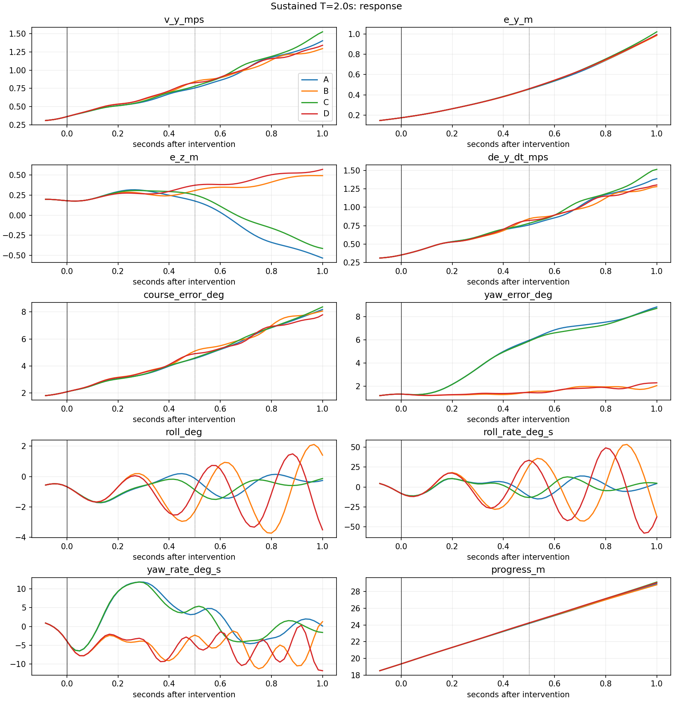
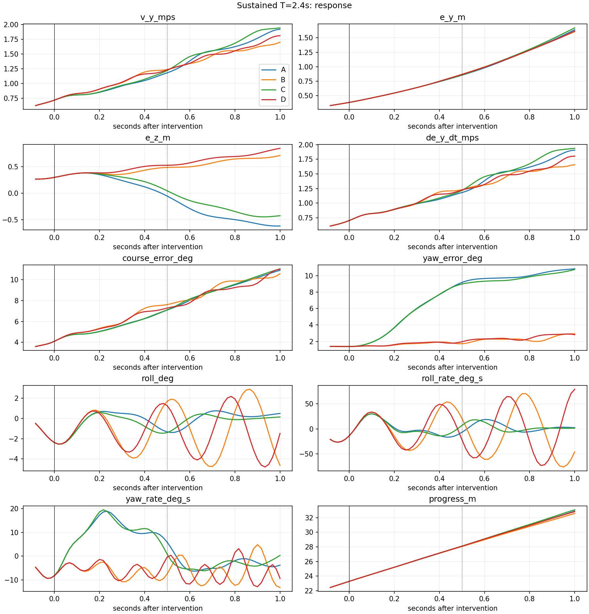
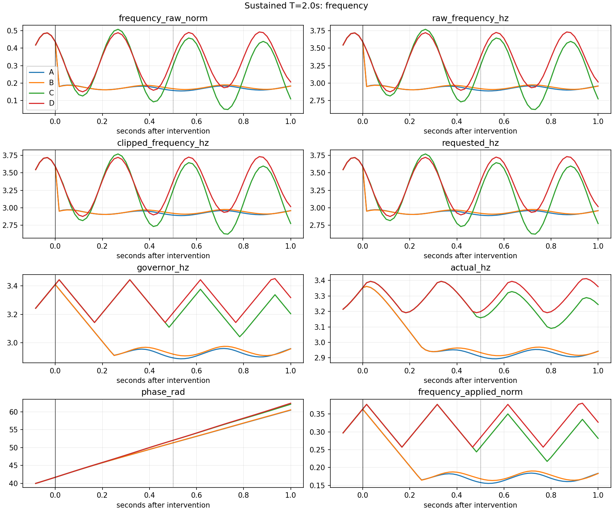
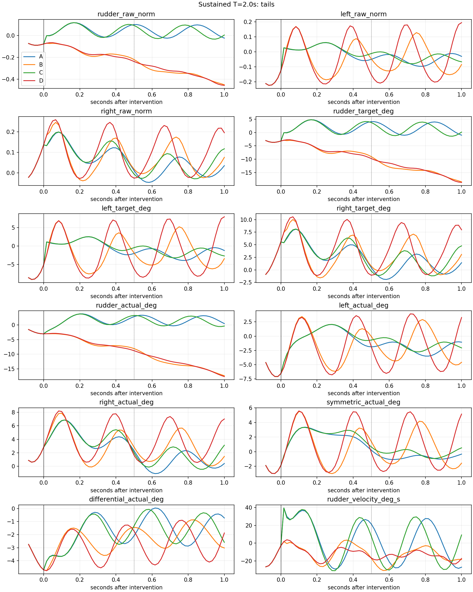
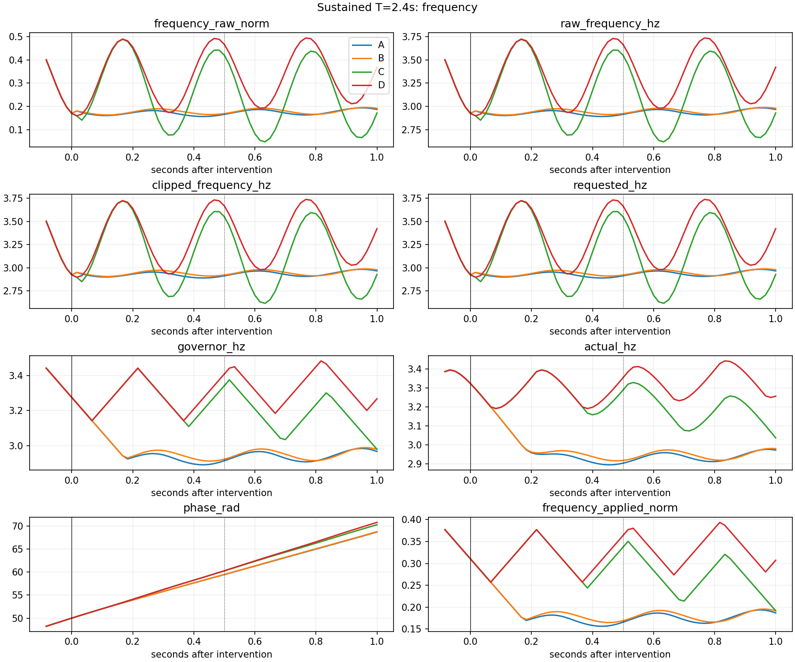
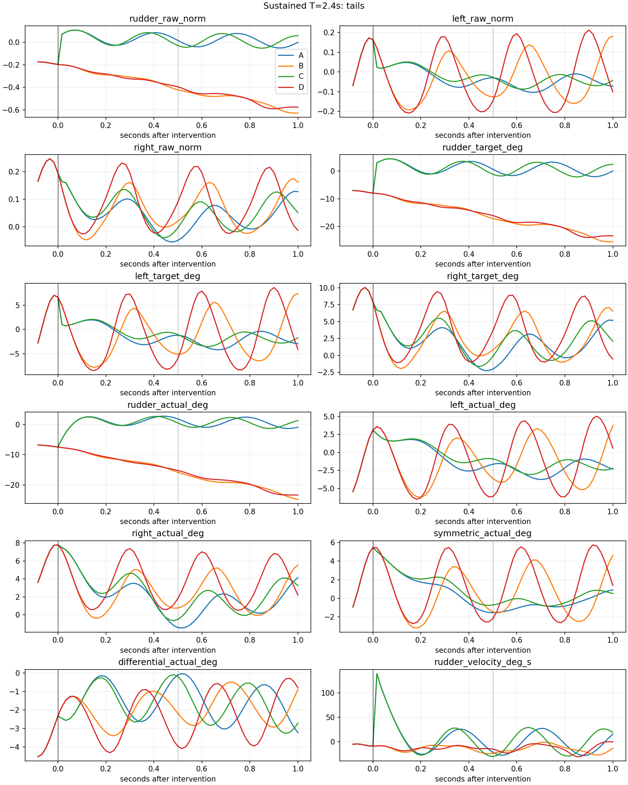

# Sustained 同状态控制律交叉干预：局部物理响应复盘

## 结论

**VERIFIED：G25/G150 控制律替换会改变同一公共历史之后的真实 CPU-native PhysX 响应，但本次证据不支持“G150 三尾舵退化是横向失稳的充分解释”。** 两个起点均出现同样的时间反转：G25 三尾舵在主要 0.5 s 窗口降低外向速度，在补充 1.0 s 窗口反而增大外向速度。完整 G25 在 1.0 s 均不如完整 G150；混合 B（F25/T150）此时的外向速度最小。四组的正横向速度和正横向误差仍继续增长，未实现短窗恢复。

G25 扑频的实际执行频率确实较低，并在 1.0 s、两个起点、两种尾舵条件下均降低末端外向速度；0.5 s 则有条件依赖。存在不可忽略的频率×尾舵交互，交互符号在两个起点的 1.0 s 对照中相反。因而优先研究联合控制响应与局部控制权，尚不能把保持 G25 尾舵输出当成解决方案，更不能推断 PPO 梯度冲突。

这里只识别选定 G150 状态上的短时闭环控制律干预效应，不能解释 G25 从 reset 开始形成的全部状态历史，也不能判断 60 m 任务成功率。

## 1. 实验身份与范围

- 工作区：`/home/zn/IsaacLab/.worktrees/unified-sustained-intervention-v1`。
- 分支：`experiment/unified-sustained-intervention-v1`。
- 实验执行时的基准及 HEAD：`eb44d6f167761b3a48d03fd08cdfd91a3af7d750`；实验运行时新增独立脚本与本报告尚未提交；后续按用户明确的 push 指令发布。实际物理执行入口副本保存在 `runner_source/`；当前入口另修复了父进程收尾写状态的问题，不改变物理运行逻辑。
- G25：原工作区 `logs/unified_goal_consistent_reward_v1/G/model_000025.pt`；digest `cec9555c7dfad2547e83048ba8b99eb6940fdbcb477b89eab9c6dd2fc00f228f`。
- G150：原工作区 `logs/unified_longrun_l3d_G_seed0_u026_150/model_000150.pt`；digest `4f829000ae79a8b881b3e332db575c055b4b7fd258b19f9c0c8c75e4769d68ac`。
- 历史来源：G150 `evaluation_000150/evidence/rollout_feedback.sqlite3`，`integrity_check=ok`；只用 development 五环境场景，Sustained 为零基槽位 1，origin=(10,5,0) m。
- CPU-native PhysX / L3D / seed=0 / 无风 / 480 Hz physics / 60 Hz control。原初始化、路径、执行器、终止合同不变。
- 精确完成两个起点 × 四组合 = 八个独立新进程；各自公共前缀 120 或 144 步，干预 60 步。八条均无提前终止，无额外起点、seed、正式评价或 PPO/optimizer 更新。

|组合|F 扑频控制律|T 三尾舵控制律|
|---|---|---|
|A|G25|G25|
|B|G25|G150|
|C|G150|G25|
|D|G150|G150|

每步均对当前分支的当前 39D 观测调用冻结 Actor 的 `act_inference`，随后按组选择 raw 动作；其余四个环境始终用 G150。A/D 的 Sustained 输出分别逐值等于完整 Actor；B/C 分组通过逐步断言。两 Actor 完整 state_dict 严格加载并与保存值逐项比较，运行后再比较；digest 一致。推理前后 Torch、NumPy、Python RNG 一致。没有 `act` 随机采样、optimizer 构造/更新或 checkpoint 写入。

## 2. 物理身份及复现门槛

在任何物理重放之前固定绝对容差：raw/clipped/applied 动作 2e-6（归一化量），其余历史可见物理字段 2e-5（相应 SI 单位：m、m/s、rad、rad/s、Hz；四元数无量纲），39D 归一化观测 2e-5；rtol=0。独立分支公共前缀则要求完整记录逐值完全相同。未在失败后放宽。

G25/G150 保存的 plant、terminal、policy_config 完全相同。新运行全部物理参数、physical_sources 文件 SHA、URDF、翼几何 CSV、六个 STL 依赖 SHA 一致；新旧 plant 仅以下四个资源路径字段不同：

1. `configuration.robot.spawn.asset_path`
2. `configuration.scene.robot.spawn.asset_path`
3. `configuration.scene.robot.spawn.usd_dir`
4. `identity.urdf`

这些字段由原 worktree 前缀变为新 worktree 前缀；独立入口白名单只允许这四项，并另验依赖字节。转换产物位于各新分支的 `assets/` 和新 worktree 自身 URDF 缓存目录（场景默认配置亦触发转换）；历史资产、历史转换目录和 SQLite 均未作为写目标。没有修改生产 `require_compatible_plant`。新 worktree 的 converter 自动改写了 tracked `config.yaml`（非 URDF/物理源码）；已将其及差异留存于本次日志并恢复 HEAD 内容，历史 worktree 未改动。完整参数及差异见每组 `physical_comparison.json`。

两 D 组先完成历史 replay，才执行 A/B/C。五个环境所有控制周期的 raw/clipped/applied、root state、全部 joint pos/vel、phase、actuator 内部状态、reference 与 projection，均与历史逐值一致，最大差 **0**。D120 覆盖 reset→3.0 s，D144 覆盖 reset→3.4 s。历史 post-step k 状态重建观测对应 pre-step k+1；最大重建误差 1.1921e-7，未犯同周期动作/末状态错位。reset 初始完整可见记录也逐值一致。

每个 A/B/C 从独立 reset 重放公共前缀，与对应 D 的所有逐步记录及起点快照完全一致：包括 39D 观测、所有第一维为五环境的环境 Tensor buffers、机器人所有 body state、joint state、动作与参考记录。PhysX 求解器隐藏状态未直接比较；完整公共输入历史、全部可见状态一致以及 D 后续精确复现共同支持此次局部反事实比较，不声称实现了任意 PhysX 状态序列化。

干预日志 schema=`sustained_cross_policy_intervention_v1`，不属于 `frozen_full_batch_v4`。原 builder 创建的 bootstrap journal 在 reset 前关闭并断开；其中没有任何训练/评价 step 或成功 witness。所有实际干预证据写入独立 JSONL，不进入 sampler。

|分支|控制步数|历史字段最大差|公共前缀跨进程最大差|提前终止|
|---|---:|---:|---:|---|
|T120_A|180|0|0|无|
|T120_B|180|0|0|无|
|T120_C|180|0|0|无|
|T120_D|180|0|基准|无|
|T144_A|204|0|0|无|
|T144_B|204|0|0|无|
|T144_C|204|0|0|无|
|T144_D|204|0|基准|无|

## 3. 共同起点与坐标

所有指标使用实际投影 s 上原 Trajectory 的世界系单位切线 t、横向 n、垂向 b=t×n。e=x−p(s)，ey=e·n，ez=e·b，vy=v_world·n；正 ey/vy 是本 Sustained 历史的外向，不推广到其他任务。dey/dt 为相邻控制记录数值导数，包含局部坐标系运动，不等同 vy。速度航向为 atan2(v_world_y,v_world_x)，机头航向为 wxyz 四元数转 xyz Euler 的 yaw；二者相对路径 heading，wrap 到 ±180°。

滚转/俯仰/偏航为 xyz Euler；角速度先由世界转机体系，角度与角速度用 °、°/s。机体系 FLU，世界 Z 向上；方向舵 URDF 轴 +Z、左右尾舵均为各自关节 +Y；没有额外反转左尾舵符号。对称=(左+右)/2、差动=(左−右)/2，命令与实际分别计算。

|起点 s|投影 m|ey m|vy m/s|ez m|速度航向误差 °|机头航向误差 °|roll °|实际 Hz|
|---:|---:|---:|---:|---:|---:|---:|---:|---:|
|2.0000|19.3324|0.1741|0.3604|0.1807|2.0895|1.3306|-0.6686|3.3531|
|2.4000|23.2805|0.3823|0.7154|0.2972|4.1013|1.3834|-2.3923|3.3229|

完整起点物理状态和内部 buffer 分别见 `T120_*/start_state.json` 与 `T144_*/start_state.json`；这里没有用 root pose 写回伪造共同状态。切换精确发生在第 120/144 步结束后，即第 121/145 步首次混合。

## 4. 主要与补充窗口

Δ 均为窗口末端减共同起点。负的组间 vy 对照表示相对较小的外向速度，并不表示实际 vy 已为负或回到路径。

### 0.5 s 窗口

|起点|组|vy m/s|Δvy|ey m|Δey|速度航向误差 °|Δ速度航向 °|roll °|Δroll °|ez m|
|---:|---|---:|---:|---:|---:|---:|---:|---:|---:|---:|
|2.0|A|0.7549|0.3945|0.4551|0.2811|4.5510|2.4615|-0.1179|0.5507|0.1777|
|2.0|B|0.8426|0.4822|0.4577|0.2836|5.1017|3.0122|-2.2969|-1.6283|0.3075|
|2.0|C|0.7783|0.4179|0.4583|0.2842|4.5890|2.4995|-0.8739|-0.2052|0.2538|
|2.0|D|0.8268|0.4664|0.4598|0.2857|4.9064|2.8169|-0.8725|-0.2039|0.3733|
|2.4|A|1.1797|0.4643|0.8535|0.4712|7.0875|2.9862|-1.3305|1.0617|-0.0552|
|2.4|B|1.2346|0.5192|0.8688|0.4865|7.6109|3.5095|1.7010|4.0933|0.4852|
|2.4|C|1.2185|0.5031|0.8580|0.4757|7.1042|3.0029|-1.3911|1.0012|0.0443|
|2.4|D|1.2299|0.5145|0.8658|0.4835|7.2766|3.1753|1.2666|3.6588|0.5262|

### 1.0 s 窗口

|起点|组|vy m/s|Δvy|ey m|Δey|速度航向误差 °|Δ速度航向 °|roll °|Δroll °|ez m|
|---:|---|---:|---:|---:|---:|---:|---:|---:|---:|---:|
|2.0|A|1.4040|1.0436|0.9933|0.8192|8.1786|6.0891|-0.2601|0.4085|-0.5332|
|2.0|B|1.2961|0.9356|0.9857|0.8116|8.0608|5.9713|1.4031|2.0717|0.4934|
|2.0|C|1.5267|1.1663|1.0212|0.8471|8.3668|6.2773|-0.1311|0.5375|-0.4137|
|2.0|D|1.3415|0.9810|0.9925|0.8184|7.7842|5.6947|-3.5032|-2.8346|0.5714|
|2.4|A|1.9196|1.2041|1.6393|1.2570|10.8877|6.7863|0.4980|2.8902|-0.6186|
|2.4|B|1.6983|0.9829|1.6061|1.2238|10.5528|6.4515|-4.6510|-2.2588|0.7099|
|2.4|C|1.9423|1.2269|1.6717|1.2893|11.0285|6.9272|0.1493|2.5416|-0.4251|
|2.4|D|1.8096|1.0942|1.6169|1.2345|10.9938|6.8924|-1.4786|0.9136|0.8452|

两起点的 A/C（G25 尾舵）在后半窗出现更大的机头航向误差：1 s 时分别约 8.7–8.8°、10.7–10.8°，B/D 约 2.1–2.3°、2.8–2.9°。A/C 滚转振荡较小，却未保持横向收益，说明不能把“滚转更平稳”直接视为“转弯控制更好”。

A/C 在 1 s 已转为负 ez：T1 为 −0.533/−0.414 m，T2 为 −0.619/−0.425 m；B/D 仍为正 ez。G25 尾舵对垂向的组间影响约 −1.01 m、−1.30 m，比横向误差差异更大。此次没有巨大滚转或安全失败，但有明显三维响应权衡与垂向越过参考面。

### 全窗口响应曲线





## 5. 执行器实际响应

raw 第 0 通道线性外推请求为 (a0+1)×2.5 Hz；裁剪后的请求、执行器 `_requested_frequency_hz`、governor `_applied_frequency_hz` 与相位驱动 `_freq` 分列。尾舵记录 raw、clipped、applied 归一化量、实际映射目标角、全部实际关节角与角速度。没有绕过原裁剪、滤波/限速、governor、相位积分或关节动态。

|起点|窗 s|组|平均实际 Hz|末端实际 Hz|governor 限速步比例|raw 动作裁剪步比例|
|---:|---:|---|---:|---:|---:|---:|
|2.0|0.5|A|3.0640|2.9085|46.7%|0.0%|
|2.0|1.0|A|2.9931|2.9432|23.3%|0.0%|
|2.0|0.5|B|3.0696|2.9341|46.7%|0.0%|
|2.0|1.0|B|3.0028|2.9421|23.3%|0.0%|
|2.0|0.5|C|3.2932|3.1586|100.0%|0.0%|
|2.0|1.0|C|3.2560|3.2442|98.3%|0.0%|
|2.0|0.5|D|3.2953|3.1979|100.0%|0.0%|
|2.0|1.0|D|3.3026|3.3599|98.3%|0.0%|
|2.4|0.5|A|3.0036|2.9046|33.3%|0.0%|
|2.4|1.0|A|2.9729|2.9733|16.7%|0.0%|
|2.4|0.5|B|3.0163|2.9191|33.3%|0.0%|
|2.4|1.0|B|2.9835|2.9811|16.7%|0.0%|
|2.4|0.5|C|3.2636|3.2884|100.0%|0.0%|
|2.4|1.0|C|3.2244|3.0373|96.7%|0.0%|
|2.4|0.5|D|3.2775|3.3531|100.0%|0.0%|
|2.4|1.0|D|3.3078|3.2561|96.7%|0.0%|

所有干预均未 raw 动作裁剪。F150 在 0.5 s 的 governor 限速比例为 100%，F25 为 33–47%；但实际频率已经明显分开：0.5 s 平均频率的 F 主对照在 T1/T2 为 −0.227/−0.261 Hz，1 s 为 −0.281/−0.288 Hz。故不能把早期频率效应小解释为“执行频率完全没变”，也不能把请求频率当作即时实现频率。

扑频改变相位历史；图中滚转、尾舵与气动状态响应会随相位变化。尾舵控制律也通过后续状态改变同一个 F Actor 的输出，因此因子效应是整个闭环动作组替换的总效应，并非在固定气动状态下的单通道力导数。









## 6. 2×2 描述性因子对照

对每个 Y，ΔT=((A−B)+(C−D))/2，ΔF=((A−C)+(B−D))/2，ΔFT=A−B−C+D。单位与 Y 相同；完全确定性的选定状态对照，不估计总体显著性，无 p 值/置信区间。由于共同起点一致，末端指标与其相对起点变化的因子对照相同。

|起点|窗 s|Y（单位）|ΔT|ΔF|ΔFT|
|---:|---:|---|---:|---:|---:|
|2.0|0.5|vy (m/s)|-0.06811|-0.00380|-0.03925|
|2.0|0.5|ey (m)|-0.00205|-0.00263|-0.00108|
|2.0|0.5|ez (m)|-0.12465|-0.07096|-0.01019|
|2.0|0.5|速度航向误差 (°)|-0.43404|+0.07862|-0.23323|
|2.0|0.5|roll (°)|+1.08886|-0.33423|+2.18043|
|2.0|1.0|vy (m/s)|+0.14658|-0.08405|-0.07727|
|2.0|1.0|ey (m)|+0.01818|-0.01736|-0.02113|
|2.0|1.0|ez (m)|-1.00584|-0.09876|-0.04150|
|2.0|1.0|速度航向误差 (°)|+0.35019|+0.04421|-0.46488|
|2.0|1.0|roll (°)|+0.85449|+2.38866|-5.03531|
|2.4|0.5|vy (m/s)|-0.03316|-0.01709|-0.04354|
|2.4|0.5|ey (m)|-0.01154|-0.00077|-0.00749|
|2.4|0.5|ez (m)|-0.51115|-0.07027|-0.05862|
|2.4|0.5|速度航向误差 (°)|-0.34790|+0.15878|-0.35093|
|2.4|0.5|roll (°)|-2.84462|+0.24753|-0.37390|
|2.4|1.0|vy (m/s)|+0.17697|-0.06705|+0.08862|
|2.4|1.0|ey (m)|+0.04400|-0.02156|-0.02162|
|2.4|1.0|ez (m)|-1.29941|-0.16437|-0.05824|
|2.4|1.0|速度航向误差 (°)|+0.18479|-0.29090|+0.30010|
|2.4|1.0|roll (°)|+3.38846|-1.41186|+3.52107|

### 不掩盖条件效应：末端 vy（m/s）

|起点|窗 s|尾舵替换@F25 A−B|尾舵替换@F150 C−D|扑频替换@T25 A−C|扑频替换@T150 B−D|
|---:|---:|---:|---:|---:|---:|
|2.0|0.5|-0.08773|-0.04848|-0.02343|+0.01582|
|2.0|1.0|+0.10795|+0.18522|-0.12269|-0.04542|
|2.4|0.5|-0.05493|-0.01139|-0.03886|+0.00468|
|2.4|1.0|+0.22128|+0.13266|-0.02274|-0.11135|

0.5 s 的 ΔFT≈−0.039/−0.044 m/s，与尾舵平均对照同量级；1 s 为 −0.077/+0.089 m/s，跨起点符号相反。滚转交互也较大（T1 1 s −5.04°、T2 +3.52°），部分反映扑翼周期相位及姿态振荡，不宜仅从单个末帧宣称滚转控制优劣。

## 7. 机制判断与唯一后续建议

- **情况 A：仅 0.5 s SUPPORTED。** G25 三尾舵在两频率条件下都降低 vy，但 1 s 全部反转。验证尾舵控制律有局部物理作用，未验证保留该控制律能持续改善当前 G150 状态。
- **情况 B：1.0 s SUPPORTED，主要 0.5 s 不普遍成立。** G25 扑频在 1 s 的四个条件对照均降低 vy；实际频率已经分离。它支持扑频参与局部响应，但不能将频率称为唯一主因。
- **情况 C：不支持。** 完整 A 不是持续最优，混合 B 在两个起点的 1 s 末端 vy 均最小；不能声称只有完整 G25 协同才有效。不过非零交互说明也不能忽略协同。
- **情况 D：未恢复这一层面成立，控制权不足仍 UNRESOLVED。** 四组 vy 与 ey 均增长；相对改善不等于恢复。只能说两套已有控制律在这些 G150 状态和时域下均未阻止外偏，不能证明所有允许的控制输入都无效。
- **情况 E：不支持“无差异”。** 输出、实际频率、关节/姿态和垂向状态均有可辨变化；横向收益较小且随时域反转。

**总体：同状态干预证明控制律变化可以影响局部横向响应，但目前不足以解释 G25 与 G150 全路径差距，更不支持单独把三尾舵漂移作为可持续纠正目标。** G25 在其原本闭环轨迹上的良好表现，不能直接迁移为它在 G150 状态上的良好恢复能力。B/C 也不是训练得到的独立最优控制器；状态分布、相位及垂向耦合仍限制解释。

**唯一下一步（未执行）：在 T1=2.0 s 的同一 G150 公共历史上做一次预先限幅、正负成对的三尾舵局部脉冲辨识，固定重放同一 G150 扑频序列。** 将方向舵、对称尾舵、差动尾舵作为一次小规模预定控制权测量的三个方向；固定脉冲幅度/时长而不搜索最优值，观测实际关节响应、vy/航迹曲率、机头航向及 ez。它能直接区分“已有两控制律选择不佳”与“这些通道短时有效控制权弱/强耦合”，信息增量高于立即做 PPO 保持训练。此次没有执行该实验，也没有批准任何后续预算。

## 8. 文件、验收与复现

- 运行入口：`scripts/flapping_px4/run_sustained_cross_policy.py`。
- 纯 CPU 验收：`scripts/flapping_px4/check_sustained_cross_policy.py`；完成后独立验收 `scripts/flapping_px4/verify_sustained_cross_policy.py`。
- 离线分析：`scripts/flapping_px4/analyze_sustained_cross_policy.py`。
- 一键入口：`scripts/flapping_px4/reproduce_sustained_cross_policy.sh`。
- 本地原始数据根目录：`logs/unified_sustained_cross_policy_intervention_v1/`（不随 Git 发布）；[全部数字及因子对照](results/unified_sustained_cross_policy_intervention_v1/results.json)。
- 各分支 `trace.jsonl` 含完整公共前缀与短窗、动作来源、pre-step 观测、两个 Actor raw 均值、物理及内部状态；`start_state.json` 为切换点；`contract.json`、`physical_comparison.json`、`summary.json` 为身份与复现核验。
- `analysis/T120_{A,B,C,D}.csv`、`analysis/T144_{A,B,C,D}.csv` 为八条逐步派生轨迹；六张 PNG 如上。原始 JSONL 保留所有五环境，CSV/图只评价 Sustained。
- `runner_source/` 保留实际本轮入口；`offline_acceptance.json` 包含完成后的独立数值与逐步动作检查。

运行状态说明：八个子进程在写出通过的 summary 后由 Kit close 退出，导致子目录 status.json 仍为 running；父进程 status 为 completed，八条 trace 均完整，当前无运行进程。原文件保留；独立验收显式列出这些 stale 状态，不把它们当作运行存活证据。已在后续入口中由父进程收尾写子状态，未重跑任何物理轨迹。

### 一键重现（仅提供，不自动重跑）

```bash
cd /home/zn/IsaacLab/.worktrees/unified-sustained-intervention-v1
bash scripts/flapping_px4/reproduce_sustained_cross_policy.sh logs/unified_sustained_cross_policy_intervention_reproduction
```

指定目录必须不存在；固定八条、遇复现失败即停止，无自动重试。当前已完成的目录不会覆盖。

### 检查当前结果（不运行 PhysX）

```bash
cd /home/zn/IsaacLab/.worktrees/unified-sustained-intervention-v1
cat logs/unified_sustained_cross_policy_intervention_v1/status.json
cat logs/unified_sustained_cross_policy_intervention_v1/offline_acceptance.json
python - <<'CHECK'
import json
from pathlib import Path
p=Path('logs/unified_sustained_cross_policy_intervention_v1')
r=json.loads((p/'analysis/results.json').read_text())
for k,v in r['audit'].items(): print(k,v)
for x in r['factor_effects']:
    if x['metric']=='v_y_mps': print(x)
CHECK
```

本轮已停止，没有训练、final 留出任务、额外起点或下一阶段干预。历史 checkpoint、SQLite、评估和源码快照保持只读。

发布说明：六张图、完整派生指标 JSON 和[独立验收记录](results/unified_sustained_cross_policy_intervention_v1/offline_acceptance.json)已随文档发布；原始轨迹、CSV、资产和历史 checkpoint/SQLite 留在本地。
