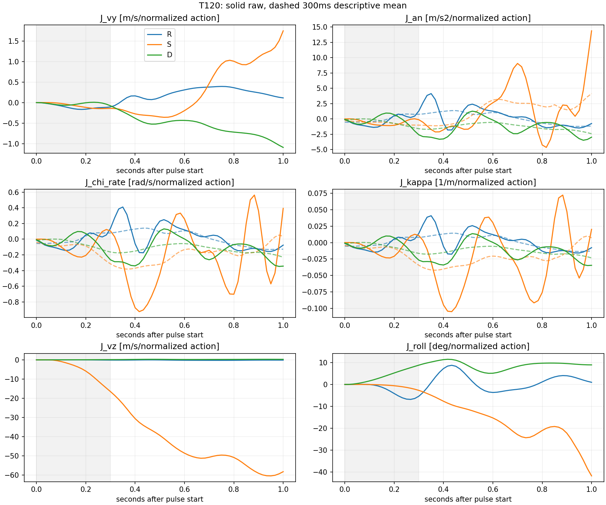
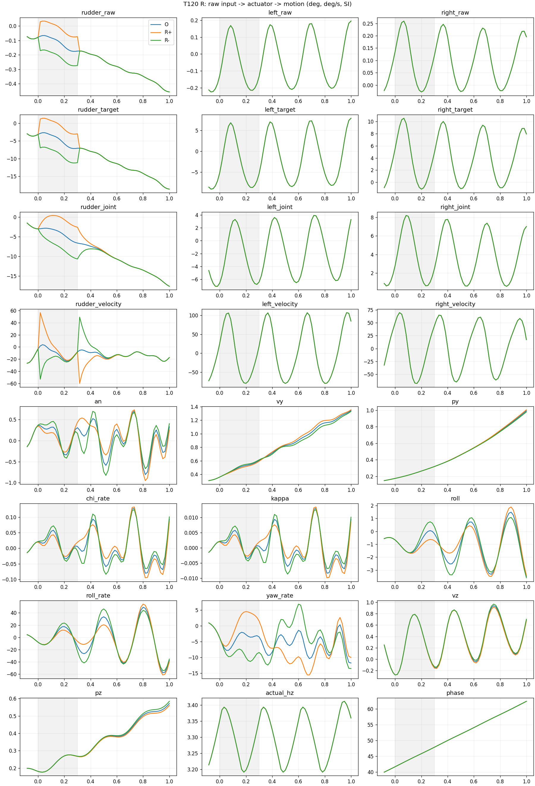
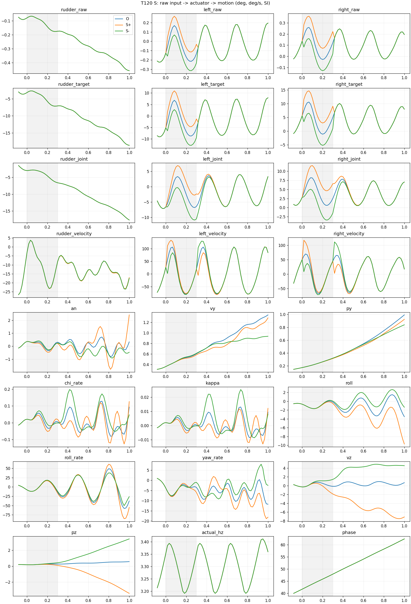
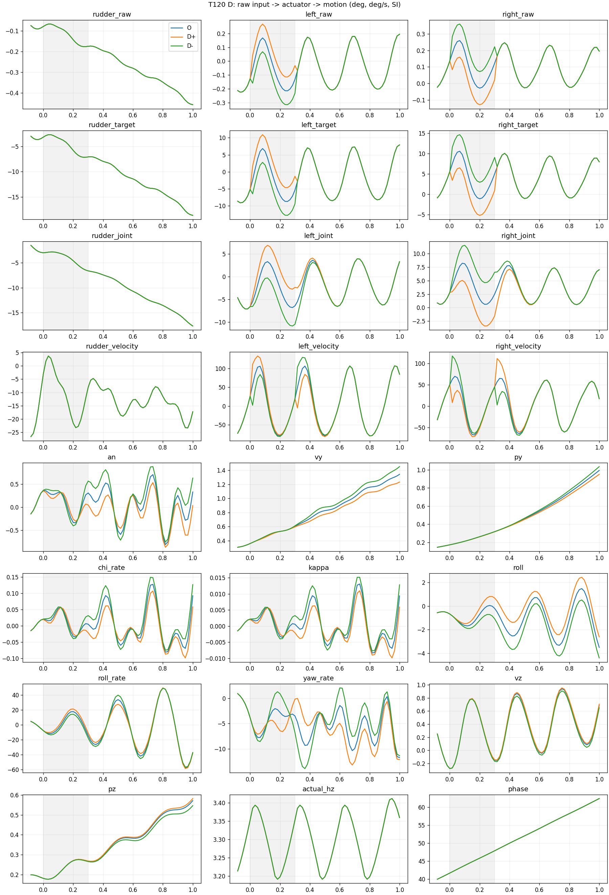
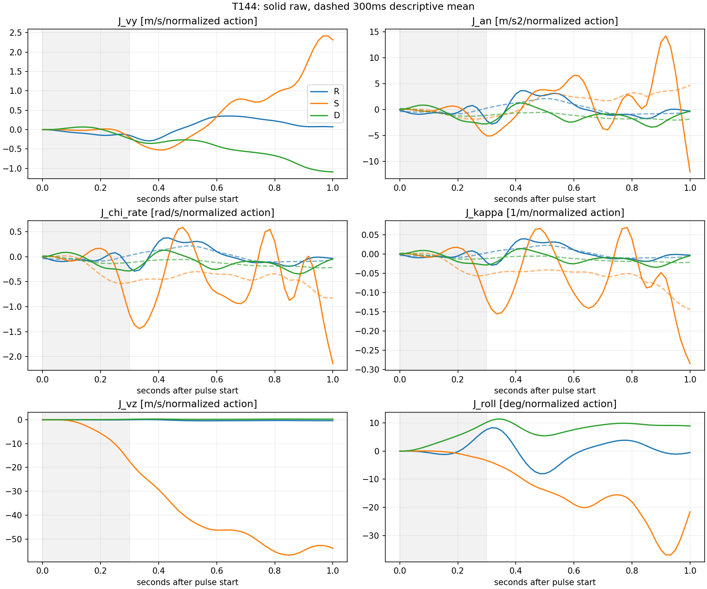
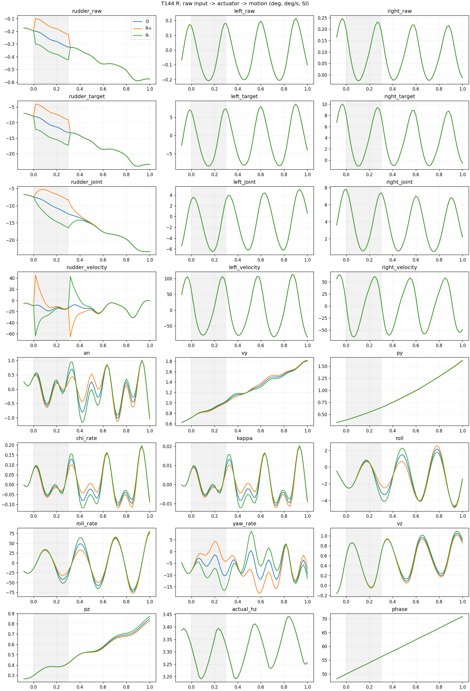
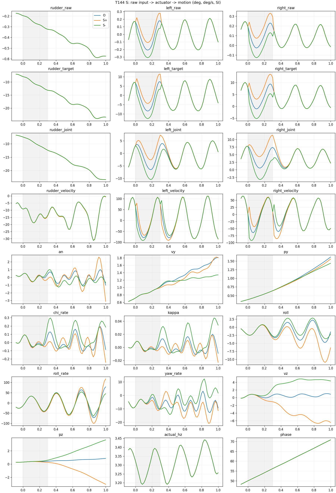
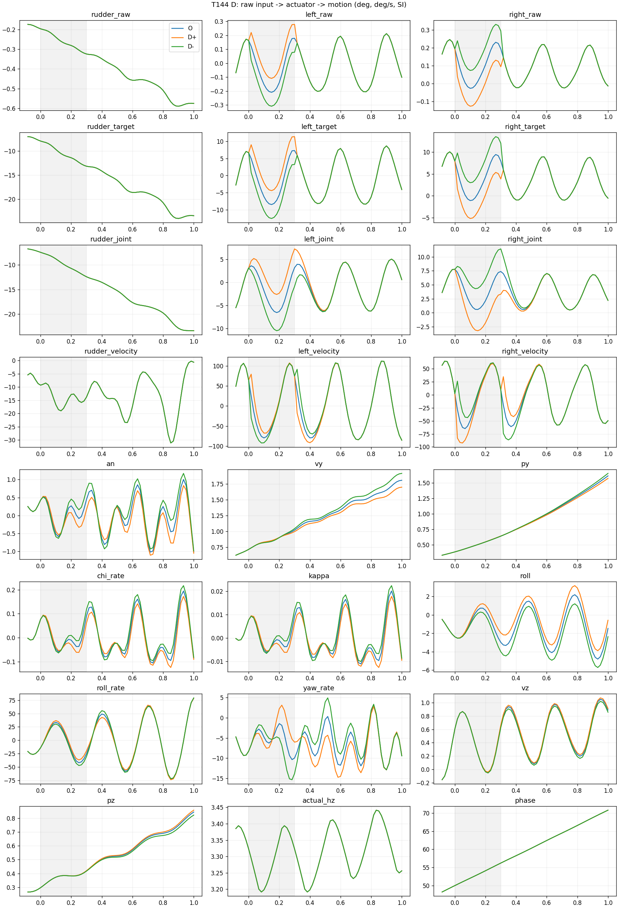

# Sustained 三尾舵局部控制权辨识

**VERIFIED：14 条规定的独立 CPU-native PhysX/L3D 短窗实验完成，两个 O 历史重放和全部公共前缀通过。SUPPORTED：差动尾舵 D 在两个工作点均有及时、同符号、持续至 1 秒的有利横向干预效应；方向舵 R 效应较小并随窗口反转；对称尾舵 S 的主要代价是很强的垂向响应和明显非对称性。**

D+ 在 1 秒相对 O 降低共同坐标外向速度约 0.1093 / 0.1092 m/s，横向位置降低约 0.0427 / 0.0409 m；它没有消除已有外向速度或实现路径恢复。这里的“有效”指本次有界脉冲造成可辨且方向有利的局部响应，不等于恢复能力、瞬时气动导数、全局可控性或 PPO 可学习性证明。

## 1. 固定协议与证据

基准 `56bb181ca2483838496241908cb46246e6d9194a`，分支 `experiment/unified-tail-authority-v1`，工作区 `/home/zn/IsaacLab/.worktrees/unified-tail-authority-v1`。仅加载指定 G150 checkpoint 校验 plant/评价合同；不构造或调用 Actor，不进行 PPO/optimizer 更新。G25 不参与执行。

沿用五个 development 环境、Sustained slot 1、原 reset、原路径与场景位置。480 Hz physics，60 Hz control，seed 0，世界 z-up、机体 FLU。第 120/144 步结束后开始脉冲；第 121–138 / 145–162 步施加，随后撤销，分别运行至第 180/204 步。全部五环境每步基础 raw action 均来自原冻结 SQLite，只有 slot 1 的指定通道叠加 ±0.10。R=(0,1,0,0)，S=(0,0,1,1)，D=(0,0,1,-1)。不重算基础动作、不写关节、不加外力，不修改气动、reward、任务、终止或执行器。

历史 checkpoint 和 SQLite 只读；SQLite 用 immutable URI，拒绝非空 WAL。原 bootstrap journal 在 reset 前断开，干预写入独立 JSONL。每分支从 reset 完整重放，没有 root pose 恢复。两个 O 首先通过，才启动十二条脉冲。

沿用历史绝对容差：动作 2e-6，其他物理字段 2e-5，39D 观测 2e-5，rtol=0；跨分支公共前缀逐值完全相同。实际 O 历史误差为 0，观测重建误差 1.1920929e-7，所有分支公共前缀误差为 0；其余四环境在整个短窗也与历史完全相同。完整 joint pos/vel、root/all body state、phase、governor/actuator、projection/reference、39D 观测、第一维为 5 的所有环境 Tensor buffers 均有记录。PhysX 隐藏求解器状态无法直接读取，证据边界仍是完整共同输入历史、可见状态一致与 O 后续精确复现。

[独立验收](results/unified_sustained_tail_authority_v1/offline_acceptance.json)逐步核对全部历史基础动作、脉冲方向/边界、clipped command、其余环境、共同参考投影、世界速度导数、J 与 N。父进程确认退出和 summary 后写最终状态；14 条均 completed，无提前终止。
|分支|实际控制步数|历史可比字段最大差|公共前缀最大差|提前终止|
|---|---|---|---|---|
|T120_O|180|0.0|0|None|
|T120_R+|180|0.0|0.0|None|
|T120_R-|180|0.0|0.0|None|
|T120_S+|180|0.0|0.0|None|
|T120_S-|180|0.0|0.0|None|
|T120_D+|180|0.0|0.0|None|
|T120_D-|180|0.0|0.0|None|
|T144_O|204|0.0|0|None|
|T144_R+|204|0.0|0.0|None|
|T144_R-|204|0.0|0.0|None|
|T144_S+|204|0.0|0.0|None|
|T144_S-|204|0.0|0.0|None|
|T144_D+|204|0.0|0.0|None|
|T144_D-|204|0.0|0.0|None|

原始数据位于 `logs/unified_sustained_tail_authority_v1/`。每组有 `trace.jsonl`、`contract.json`、`physical_comparison.json`、`start_state.json`、`summary.json` 与 `status.json`，父目录保留每个子进程的独立日志。两个完整初始物理状态见 `T120_O/start_state.json` 与 `T144_O/start_state.json`，含全部五环境及所有 body/joint 状态；六个对应脉冲起点逐值等于各自 O。

首次沙箱启动在环境创建前的 CUDA 初始化崩溃，无 reset/物理步，日志保留于 `logs/unified_sustained_tail_authority_v1_startup_failed/`。宿主 GPU 检查正常，获得设备访问后完成上述 14 条；没有额外物理试验。URDF converter 生成的配置保留于日志，tracked config 已恢复。首次离线验收发现 float32 角速度 CSV 与差分计算的舍入不一致；统一派生数组为 float64 后通过原 1e-12 离线公式校验，未修改原始物理轨迹或放宽物理容差。

## 2. 起点、坐标与数值定义

主要 vy=v·n_O，py=(x−p_O)·n_O，vz=v·b_O，pz=(x−p_O)·b_O；n_O/b_O/p_O 是 O 同时刻的路径框架。各分支自己的 ey/ez/vy_own 另存，不能与共同坐标混用。正 ey/vy 为本任务的外向。`an` 先对世界速度做 60 Hz 二阶中心差分，再投影 n_O；不是 d(v·n_O)/dt。端点采用二阶单侧差分。

chi=unwrap(atan2(vwy,vwx))，chi_rate 为 rad/s，kappa=chi_rate/Vh 为 m⁻¹。Vh<0.1 m/s 屏蔽除法；本次最小 Vh>5.47 m/s，未触发。滚转与机头 Euler 角连续展开，机体角速度由世界转 FLU。角度用 deg、角速度 deg/s，位置 m、速度 m/s、加速度 m/s²。J=(Y+−Y−)/0.2；N=(Y++Y−)/2−YO。J 单位为对应物理量/归一化动作；所有正负绝对效应同时报告。

图中实线为未经拍周期平均的原始响应，虚线为固定 18 样本、约 0.30 秒的居中趋势平均；并非相位对齐的严格拍平均，边缘截短，不用于判定作用时延。原始相位完整保留。数值微分只有 60 Hz 分辨率，不能识别控制步内的精确起效时刻。
|起点|ey m|vy m/s|ez m|相位 rad|相位模 2π rad|实际 Hz|
|---|---|---|---|---|---|---|
|120|0.17407|0.36044|0.18075|41.67746|3.97835|3.35312|
|144|0.38234|0.71542|0.29718|50.00185|6.01955|3.32290|

两个起点相隔 0.4 秒，既有相位变化也有位置、速度和姿态变化；不能把它们的差异归因于纯相位。

## 3. 实际执行器传播

运行时三个 soft limits 均为 ±0.7105000019073486 rad，即 ±40.708650°；δ=0.10 精确映射约 ±4.070865°（以此精确值为准）。首个 16.7 ms 记录即有约 ±1.06314° 实际关节变化，约 0.1333 秒达到目标增量 90%，0.30 秒达到约 ±4.05335°。下表均为相对 O 的增量；双尾舵按 left/right 顺序。所有基础和脉冲 raw action 均无 clipping，正负激励未被裁成不对称。

|起点|分支|首步目标 Δdeg|首步关节 Δdeg|0.30s 关节 Δdeg|脉冲内峰值 Δdeg/s|90% 时间 s|
|---|---|---|---|---|---|---|
|120|R+|4.07087|1.06314|4.05335|54.67988|0.1333|
|120|R-|-4.07086|-1.06314|-4.05334|-54.67990|0.1333|
|120|S+|4.07087/4.07087|1.06314/1.06314|4.05338/4.05338|54.68527/54.68484|0.1333|
|120|S-|-4.07087/-4.07086|-1.06314/-1.06314|-4.05336/-4.05338|-54.68548/-54.68496|0.1333|
|120|D+|4.07087/-4.07086|1.06314/-1.06314|4.05334/-4.05334|54.68964/-54.68398|0.1333|
|120|D-|-4.07087/4.07087|-1.06314/1.06314|-4.05334/4.05334|-54.68962/54.68390|0.1333|
|144|R+|4.07087|1.06314|4.05335|54.67954|0.1333|
|144|R-|-4.07087|-1.06314|-4.05333|-54.67962|0.1333|
|144|S+|4.07086/4.07086|1.06314/1.06314|4.05338/4.05339|54.68543/54.68812|0.1333|
|144|S-|-4.07087/-4.07087|-1.06314/-1.06314|-4.05338/-4.05338|-54.68759/-54.68621|0.1333|
|144|D+|4.07086/-4.07087|1.06314/-1.06314|4.05334/-4.05334|54.68756/-54.68758|0.1333|
|144|D-|-4.07087/4.07086|-1.06314/1.06314|-4.05334/4.05334|-54.68781/54.68771|0.1333|

全部分支的 requested/governor/实际 frequency 与 phase 对 O 差值均严格为 0；不是只因为 raw 扑频相同就假设如此，而是完整日志验证的结果。撤销脉冲后目标立即回到历史值，关节继续动态回落；关节位置/速度曲线见各方向图。

## 4. 横向响应与规定时间窗口

以下均为 **正减负成对差异**，不是 J；除以 0.2 即得到敏感度。加速度是对应窗口原始样本均值，位置/速度为窗口末端。负值表示正脉冲相对负脉冲减小外向响应。

|起点|方向|窗口 s|平均 Δan m/s²|末端 Δvy m/s|末端 Δpy m|末端 Jvy|
|---|---|---|---|---|---|---|
|120|R|[0.0, 0.3]|-0.05855|-0.02105|-0.00058|-0.10524|
|120|R|[0.3, 0.5]|0.23305|0.02459|0.00292|0.12297|
|120|R|[0.5, 1.0]|-0.01382|0.02276|0.02526|0.11378|
|120|S|[0.0, 0.3]|-0.10825|-0.02837|-0.00543|-0.14184|
|120|S|[0.3, 0.5]|-0.29677|-0.06977|-0.01492|-0.34887|
|120|S|[0.5, 1.0]|0.55244|0.34953|0.08491|1.74766|
|120|D|[0.0, 0.3]|-0.06735|-0.01559|-0.00187|-0.07795|
|120|D|[0.3, 0.5]|-0.39864|-0.10182|-0.01436|-0.50910|
|120|D|[0.5, 1.0]|-0.24752|-0.21844|-0.08463|-1.09219|
|144|R|[0.0, 0.3]|-0.11325|-0.02964|0.00044|-0.14822|
|144|R|[0.3, 0.5]|0.27584|0.01637|-0.00680|0.08186|
|144|R|[0.5, 1.0]|-0.01560|0.01444|0.00931|0.07222|
|144|S|[0.0, 0.3]|-0.16199|-0.03988|-0.00329|-0.19941|
|144|S|[0.3, 0.5]|-0.08035|-0.04415|-0.01772|-0.22075|
|144|S|[0.5, 1.0]|0.55740|0.46276|0.12086|2.31380|
|144|D|[0.0, 0.3]|-0.17280|-0.04713|0.00168|-0.23566|
|144|D|[0.3, 0.5]|-0.01138|-0.05296|-0.01180|-0.26481|
|144|D|[0.5, 1.0]|-0.33084|-0.21827|-0.08102|-1.09135|

各正负分支相对 O 的绝对变化如下；完整所有物理量、三窗口 mean/end/max_abs、J 和 N 在 [results.json](results/unified_sustained_tail_authority_v1/results.json) 与 `analysis/T*_sensitivity.csv`。

|起点|方向|末端 s|+−O vy|−−O vy|+−O py|−−O py|Nvy|
|---|---|---|---|---|---|---|---|
|120|R|0.3|-0.01070|0.01035|-0.00029|0.00029|-0.00018|
|120|R|0.5|0.01170|-0.01289|0.00138|-0.00154|-0.00059|
|120|R|1.0|0.01102|-0.01174|0.01234|-0.01291|-0.00036|
|120|S|0.3|-0.02051|0.00786|-0.00321|0.00222|-0.00632|
|120|S|0.5|-0.09936|-0.02958|-0.01557|-0.00065|-0.06447|
|120|S|1.0|-0.05616|-0.40570|-0.06880|-0.15371|-0.23093|
|120|D|0.3|-0.00804|0.00755|-0.00096|0.00091|-0.00025|
|120|D|0.5|-0.05149|0.05033|-0.00731|0.00705|-0.00058|
|120|D|1.0|-0.10934|0.10910|-0.04271|0.04192|-0.00012|
|144|R|0.3|-0.01505|0.01459|0.00022|-0.00022|-0.00023|
|144|R|0.5|0.00760|-0.00878|-0.00349|0.00331|-0.00059|
|144|R|1.0|0.00691|-0.00754|0.00438|-0.00493|-0.00032|
|144|S|0.3|-0.02745|0.01243|-0.00220|0.00109|-0.00751|
|144|S|0.5|-0.09864|-0.05449|-0.01880|-0.00108|-0.07657|
|144|S|1.0|-0.00792|-0.47068|-0.05885|-0.17970|-0.23930|
|144|D|0.3|-0.02401|0.02312|0.00082|-0.00086|-0.00045|
|144|D|0.5|-0.02693|0.02603|-0.00608|0.00572|-0.00045|
|144|D|1.0|-0.10924|0.10903|-0.04093|0.04009|-0.00010|

**D：** 三个窗口的平均 Δan 在两个起点均为负；0.5 秒 Δvy=−0.1018/−0.0530 m/s，1 秒收敛到 −0.2184/−0.2183 m/s。1 秒 Jvy≈−1.092/−1.091 m/s/归一化动作。正负相对 O 近似对称，Nvy 仅约 −0.00012/−0.00010 m/s。支持两个工作点均存在有利局部横向作用，但 0.3–0.5 秒的加速度幅值明显依赖起点。

**R：** 0.30 秒正脉冲降低外向速度约 0.0107/0.0151 m/s；0.50 和 1.00 秒符号反转，1 秒正脉冲反而增加约 0.0110/0.0069 m/s。存在快速作用，不能视作固定正增益、持续向内控制方向。

**S：** 0.5 秒正脉冲比负脉冲更低 vy，但两者都可能低于 O；1 秒成对差反转为 +0.3495/+0.4628 m/s，Nvy≈−0.231/−0.239 m/s。大幅非对称且状态已远离共同起点，不支持用单一局部线性横向导数描述整个 1 秒。它不是 clipping 导致；不能仅凭 N 指定为某种气动非线性的证据。

O 在 1 秒仍有外向速度 1.3415/1.8096 m/s。D+ 自身路径坐标速度仍为 1.2327/1.7007 m/s，ey=0.9498/1.5759 m；所有分支末端仍为正 ey 与正 vy_own，未恢复路径。

近水平路径的 Vh² κpath 在 O 的脉冲窗约为 −0.711/−1.020 m/s²（带符号，负为向内）。D+ 相对 O 在同窗平均 Δan 约 −0.034/−0.087 m/s²，明显小于这一需求量级。这个比较只是历史速度下的近水平参考，不包含完整三维平衡，也不能推断更大扰动或联合控制的能力上限。

## 5. 作用时延、航迹与三维耦合

时延采用描述性操作定义：原始正负差连续三个采样点超过阈值，vy/vz 为 0.01 m/s，an 为 0.1 m/s²，航迹转向率为 0.01 rad/s，roll 为 0.1°。这些是离线描述阈值，不是预注册统计显著性门槛，也不改变原固定实验预算；“首次达到”不意味着随后一直保持符号。微分可混入相邻采样，须结合速度及关节响应判断。

|起点|方向|an 起效 s|vy 起效 s|航迹转向率 s|roll s|vz s|
|---|---|---|---|---|---|---|
|120|R|0.03333333333333333|0.08333333333333333|0.03333333333333333|0.13333333333333333|0.25|
|120|S|0.08333333333333333|0.13333333333333333|0.08333333333333333|0.2|0.06666666666666667|
|120|D|0.03333333333333333|0.08333333333333333|0.03333333333333333|0.06666666666666667|0.18333333333333332|
|144|R|0.03333333333333333|0.08333333333333333|0.03333333333333333|0.1|0.18333333333333332|
|144|S|0.16666666666666666|0.26666666666666666|0.08333333333333333|0.18333333333333332|0.06666666666666667|
|144|D|0.05|0.1|0.05|0.06666666666666667|0.18333333333333332|

D 的可辨横向加速度/航迹转向率差约 0.033–0.050 秒出现，速度差约 0.083–0.100 秒出现；并非只有长时滞后才可见。R 的速度差约 0.083 秒，S 约 0.133/0.267 秒，S 的垂向差在约 0.067 秒已出现。

|起点|方向|末端 s|Δroll °|Δp °/s|Δr °/s|Δvz m/s|Δpz m|Δχdot rad/s|Δκ m⁻¹|
|---|---|---|---|---|---|---|---|---|---|
|120|R|0.3|-1.07553|15.99750|9.92575|-0.02327|-0.00164|0.02761|0.00280|
|120|R|0.5|0.66717|-25.85066|-11.00497|-0.01001|-0.00482|0.04604|0.00476|
|120|R|1.0|0.19511|-4.50835|3.51229|-0.02843|-0.02408|-0.01514|-0.00155|
|120|S|0.3|-0.54183|-5.29470|-4.93518|-3.31029|-0.34597|0.02098|0.00214|
|120|S|0.5|-2.28804|1.39209|8.37590|-7.87675|-1.58422|-0.08893|-0.00912|
|120|S|1.0|-8.35277|-28.86330|-15.63227|-11.66635|-6.83686|0.07861|0.00403|
|120|D|0.3|1.76282|6.90191|6.61399|0.02402|0.00314|-0.05257|-0.00534|
|120|D|0.5|1.70506|-12.23545|-1.06711|0.05409|0.01185|0.02130|0.00221|
|120|D|1.0|1.78687|-0.75772|-0.76038|0.05352|0.03563|-0.06868|-0.00691|
|144|R|0.3|1.53611|12.54473|11.59493|-0.00124|-0.00209|-0.04461|-0.00448|
|144|R|0.5|-1.60263|3.41812|-14.38188|-0.07796|-0.00609|0.05696|0.00587|
|144|R|1.0|-0.10531|4.28893|4.31214|-0.07767|-0.04355|-0.00676|-0.00068|
|144|S|0.3|-0.67151|-5.96061|0.76897|-3.50322|-0.33995|-0.23198|-0.02379|
|144|S|0.5|-2.77551|-5.72687|-8.16612|-8.25843|-1.58660|0.09446|0.01085|
|144|S|1.0|-4.31507|72.47668|-13.05042|-10.78182|-6.66961|-0.42709|-0.05695|
|144|D|0.3|2.05093|10.57511|7.79003|0.03759|0.00313|-0.05694|-0.00573|
|144|D|0.5|1.08493|0.04436|-8.72650|0.03434|0.01276|-0.00198|-0.00020|
|144|D|1.0|1.78299|-0.82573|0.10800|0.05432|0.03583|-0.00866|-0.00094|

D 在 1 秒产生约 +1.79° 成对滚转差、约 +0.054 m/s 垂向速度差及 +0.036 m 垂向位置差；横向效应伴随滚转和偏航角速度变化。扑动使瞬时航迹转向率/曲率和偏航率交替，不能仅用末帧偏航率解释整个横向速度积分，也不能证明“滚转→横向”的唯一中介通道。

R 有明显偏航率振荡：0.30 秒成对 Δr≈+9.93/+11.59°/s，0.50 秒转为 −11.01/−14.38°/s；滚转差在两起点还可能符号不同，和小幅横向响应反转同时存在。

S 的垂向代价占主导：1 秒正负成对 Δvz≈−11.67/−10.78 m/s、Δpz≈−6.84/−6.67 m，滚转差 −8.35/−4.32°。相对 O，S+ 位置约下降 3.99/3.88 m，S− 上升 2.85/2.79 m；S− 水平速度最低降至约 5.79/5.47 m/s，因此横向速度变小不能简单解读为更好的转弯引导。它说明该状态下的 S 主要影响三维姿态/速度分配，未证明具体气动力或执行器机制。

## 6. 曲线

阴影为 0–0.30 秒脉冲；方向图按 raw 输入、目标角、实际关节、关节速度、运动响应排列。绘图使用完整 60 Hz 数据，不先拍平均。敏感度图三方向颜色一致，虚线仅为 0.30 秒描述性趋势。

















## 7. 判断、限制与唯一下一步

- **情况 A：SUPPORTED，主要由 D 支持。** 两起点都有及时、方向一致的横向加速度均值和速度干预效应。尚不足以恢复路径。
- **情况 B：部分支持耦合与记忆效应，不支持“只能长时之后才响应”。** 实际舵面约 0.133 秒达到 90%，运动响应能更早测到，但脉冲撤销后仍持续，R/S 有时域反转。
- **情况 C：不作为整体结论。** S 主要改变垂向/姿态，但 D 的横向作用明确，不能说三个方向都缺乏横向控制作用，也不因此优先启动 L3D/I3D 比较。
- **情况 D：部分 SUPPORTED。** D 早期幅值、R 滚转符号、S 横向起效时间与瞬时曲率明显依赖起点；D 的 1 秒速度差却高度一致。两起点的状态和相位同时变化，纯相位依赖仍 UNRESOLVED。

**唯一推荐下一阶段：设计包含路径相对速度、航迹方向误差及短时执行器/相位状态的 RL 状态表示，并以航迹方向引导和横向—垂向协调控制目标利用 D 的局部作用。** 这是一项表示与引导目标设计方向，需显式容纳约 0.1 秒执行器响应和脉冲后的动态记忆；本轮不自动实施、不训练。现有证据足以支持研究这个方向，但不足以保证 PPO 学会、保证闭环稳定或提升全程任务成功率。

不支持的解释：未识别瞬时气动力导数；未证明唯一滚转/偏航因果中介；未分离相位与状态；未测试其他幅度、时长、起点、联合扑频或 I3D；未复跑同一脉冲来估计重复性分布，无 p 值或置信区间。两个状态一致不等于总体可重复性证明。S 的大垂向变化使后半窗超出小状态偏差邻域。所有因果表述仅限固定历史、指定幅度和时长下的有限干预效应。

## 8. 复现与停止

```bash
cd /home/zn/IsaacLab/.worktrees/unified-tail-authority-v1
bash scripts/flapping_px4/reproduce_sustained_tail_pulses.sh logs/unified_sustained_tail_authority_reproduction
```

仅提供命令，不自动再次执行。新目录必须不存在，固定 14 条，无重试或额外扫描；Isaac Sim 需要设备访问。CPU 测试、分析和独立验收使用 `env_isaaclab` 与 `./isaaclab.sh -p`。入口分别为 `check_sustained_tail_pulses.py`、`run_sustained_tail_pulses.py`、`analyze_sustained_tail_pulses.py`、`verify_sustained_tail_pulses.py`。复现命令生成数值和图表，本文为本次实际结果的解释，不自动覆盖。

本轮已停止：无 PPO、final 留出任务、幅度/时长扫描、额外起点、G25 混合搜索、commit/push 或下一阶段执行。
